<div align="center" style="background-color: #0d1b2a; padding: 25px; border-radius: 10px; color: white; margin-bottom: 20px;">
    <h1 style="color: #4cc9f0; margin-bottom: 5px;">Taller de TinyML</h1>
    <h3 style="color: #e0e1dd; margin-top: 0;">Clasificación de Imágenes con XIAO ESP32S3 Sense y Edge Impulse</h3>
    <p style="color: #a0a0a0; font-size: 14px; margin-bottom: 0;">Universidad Peruana Cayetano Heredia</p>
</div>

## Introducción

Este proyecto documenta la implementación de un sistema de visión artificial (TinyML) utilizando la placa XIAO ESP32S3 Sense y la plataforma Edge Impulse. El objetivo principal es entrenar un modelo de aprendizaje automático capaz de clasificar objetos en tiempo real, específicamente distinguir entre una "Billetera" y una "Laptop", desplegando finalmente el modelo directamente en el microcontrolador.

A lo largo de este taller, se abordan desde la configuración inicial del entorno en Arduino IDE y la captura de datos mediante la cámara, hasta el entrenamiento del modelo en la nube y su despliegue final. Las evidencias presentadas a continuación demuestran el correcto funcionamiento del flujo de trabajo, destacando el rendimiento del modelo y su capacidad de inferencia en el dispositivo.

### Materiales y herramientas
 
| Componente | Uso en el taller |
|---|---|
| XIAO ESP32S3 Sense (con cámara) | Captura de imágenes e inferencia del modelo |
| Cable USB-C | Alimentación, programación y monitor serie |
| Arduino IDE | Programación y carga del código en la placa |
| Edge Impulse | Gestión del dataset, entrenamiento y exportación del modelo |
| SenseCraft | Visualización del modelo en tiempo real |
| Red WiFi | Transmisión de video para capturar el dataset |

### Contenido
 
1. [Configuración del entorno y preparación de la cámara](#1-configuración-del-entorno-y-preparación-de-la-cámara)
3. [Captura del dataset](#2-captura-del-dataset)
4. [Entrenamiento del modelo en Edge Impulse](#3-entrenamiento-del-modelo-en-edge-impulse)
5. [Despliegue en Arduino IDE y error de compilación](#4-despliegue-en-arduino-ide-y-error-de-compilación)
6. [Visualización con SenseCraft](#5-visualización-con-sensecraft)

---

## 1. Configuración del entorno y preparación de la cámara
 
Siguiendo la guía del taller, antes de capturar las imágenes se dejó configurado el entorno de desarrollo:
 
1. En **Archivo > Preferencias** de Arduino IDE se añadió la URL de Espressif (`package_esp32_dev_index.json`) al campo de URLs adicionales del administrador de tableros.
2. En el **Administrador de placas** se instaló el paquete *ESP32 [Espressif Systems]* en una versión estable (las versiones alpha no funcionan correctamente con el XIAO ni con Edge Impulse).
3. En **Herramientas** se seleccionaron la placa *XIAO ESP32S3* y el puerto correspondiente.
4. Se activó **PSRAM > OPI PSRAM**, ya que el modelo necesita memoria adicional para procesar los datos de la cámara y realizar predicciones sin errores de memoria.
5. Se abrió el ejemplo **CameraWebServer** (Archivo > Ejemplos > ESP32 > Camera), se habilitó en `board_config.h` el modelo `CAMERA_MODEL_XIAO_ESP32S3` y se colocaron las credenciales de la red WiFi.

Tras verificar el código, lo subimos al XIAO ESP32S3 y abrimos el Monitor Serie para comprobar la conexión de la cámara a la red.
 
<p align="center">
  <br>
  <em>Figura 1: Carga del código CameraWebServer y Monitor Serie con la dirección IP de la cámara.</em><br>
</p>

En la parte inferior se aprecia el registro de carga, que termina con la verificación de los datos y el reinicio de la placa. En la ventana del Monitor Serie se lee que el WiFi se conectó y que la cámara quedó lista, junto con la dirección IP (`http://10.51.140.115`) a la que se accede desde el navegador. Al inicio aparece un aviso sobre el tamaño de la imagen de volcado (*core dump*), pero la conexión se completó con normalidad.
 
Con la dirección IP abierta en el navegador seleccionamos **Start Stream** para comprobar la imagen en vivo y revisamos el panel de ajustes del sensor OV3660.
 
<p align="center">
  <br>
  <em>Figura 2: Prueba de la transmisión de video (Start Stream) y panel de ajustes de la cámara.</em><br>
  <sub><strong> Evidencia grupal </strong></sub>
</p> 

Se observa la vista previa en tiempo real de la cámara junto con parámetros como la resolución (QVGA, 320x240), la calidad, el brillo y el contraste. Esta prueba valida el funcionamiento del sensor y del servidor web antes de iniciar la captura del dataset.

## 2. Captura del dataset
 
Dado que se necesitaba un conjunto numeroso de imágenes, se utilizó un programa web de captura por lotes (como se hizo en SenseCraft) que recopila las fotografías en un archivo ZIP por clase. En el programa ingresamos la dirección IP de la cámara (`http://10.51.140.115`), la etiqueta de la clase, el número de imágenes (100) y el intervalo entre capturas (1200 ms), y pulsamos **Iniciar captura y descargar ZIP**. Repetimos el procedimiento para cada clase.
 
<table width="100%">
  <tr>
    <td align="center" valign="top" width="50%">
      <br>
      <em>Figura 3: Captura por lotes de la clase Billetera.</em><br>
    </td>
    <td align="center" valign="top" width="50%">
      <br>
      <em>Figura 4: Captura por lotes de la clase Laptop.</em><br>
    </td>
  </tr>
</table>

Las capturas muestran el avance de cada proceso (*Procesadas 81/100* para Billetera y *67/100* para Laptop) junto al panel de la cámara. Al finalizar, la herramienta descarga un ZIP con una carpeta que lleva el nombre de la etiqueta. Antes de continuar cerramos el Monitor Serie y detuvimos el stream de la cámara para poder usar Edge Impulse.
 
<p align="center">
  <br>
  <em>Figura 5: Archivos ZIP generados para cada clase.</em><br>
</p>

Se observan los archivos `Laptop_images_100` (707 KB) y `Billetera_images_100` (772 KB). Cada uno contiene las 100 imágenes de su clase, lo que da un total de 200 imágenes para el dataset.

## 3. Entrenamiento del modelo en Edge Impulse
 
### 3.1 Creación del Proyecto y Carga de Datos

Para empezar, creamos una cuenta y un nuevo proyecto en Edge Impulse. Luego subimos las imágenes que previamente capturamos con la cámara del XIAO ESP32S3. Organizamos todo en dos clases distintas, "Billetera" y "Laptop", y usamos la opción de subida por lotes para que la plataforma asignara automáticamente las etiquetas a cada archivo.

<p align="center">
  <br>
  <em>Figura 6: Interfaz de creación del proyecto y flujo para añadir datos existentes.</em><br>
</p>

La captura evidencia la creación del proyecto en Edge Impulse (levito123-project-1) y el flujo para añadir datos existentes, que fue el que utilizamos para incorporar las imágenes capturadas con el XIAO. El panel muestra las tres opciones para incorporar datos: añadir datos existentes (*Add existing data*), recolectar datos nuevos o subir un modelo. Utilizamos la primera y elegimos el modo *Seleccione una carpeta* con la carpeta de la clase, dejamos la división automática entre entrenamiento y prueba e introdujimos la etiqueta de la clase. Repetimos el proceso para la otra clase. 

<p align="center">
  <br>
  <em>Figura 7: Carga de las imágenes de una clase (Laptop) en Edge Impulse.</em><br>
</p>
 
### 3.2 Verificación del Dataset
 
Tras cargar las 200 imágenes (100 por cada clase), verificamos que la plataforma las hubiera recibido correctamente. Edge Impulse dividió el conjunto de datos en un 80% para entrenamiento y un 20% para pruebas, lo que proporciona una base sólida para validar el modelo posteriormente.
 
<p align="center">
  <br>
  <em>Figura 8: Confirmación de subida y visualización del dataset dividido (200 items).</em><br>
</p>

En la captura se confirma la llegada de las 200 imágenes. La división 80/20 resulta adecuada en este tipo de proyectos, pues reserva 160 imágenes para el aprendizaje (*Training*) y 40 para comprobar qué tan bien generaliza el modelo (*Test*). Además, la lista de muestras etiquetadas (por ejemplo, Billetera_011, Billetera_009, etc) indica que la subida se realizó sin errores.
 
### 3.3 Diseño del Impulse
 
En **Impulse design > Create impulse** mantuvimos *Image data* por defecto (imágenes redimensionadas a 96x96 píxeles, modo *Fit shortest*) y añadimos el bloque de procesamiento *Image* y el bloque de aprendizaje *Transfer Learning (Images)*.
 
<p align="center">
  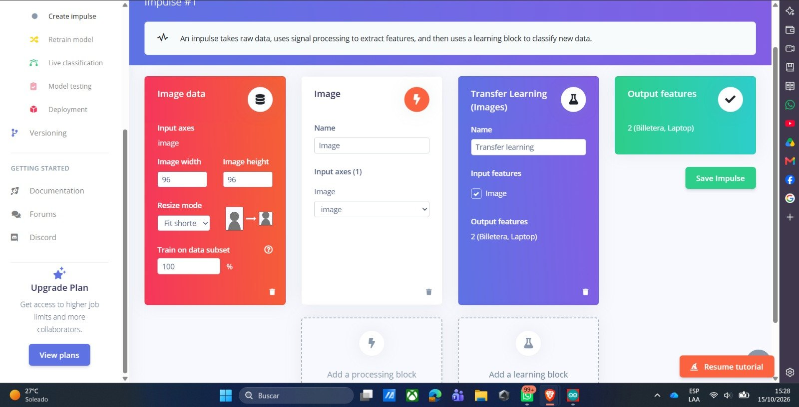<br>
  <em>Figura 9: Impulse con bloque de imagen (96x96) y bloque Transfer Learning.</em><br>
</p>

Se observan los cuatro componentes del impulse: datos de imagen, bloque de procesamiento, bloque de aprendizaje y las características de salida (2: Billetera, Laptop). A diferencia de *Classification*, que aprende patrones a partir de características de los datos de entrada, *Transfer Learning (Images)* usa una red neuronal previamente entrenada y adapta parte de su aprendizaje a nuestras imágenes, lo que permite entrenar un clasificador con un conjunto de imágenes relativamente pequeño.
 
### 3.4 Generación de características
 
En **Impulse design > Image** ejecutamos *Generate features* para procesar las imágenes y preparar el modelo.
 
<p align="center">
  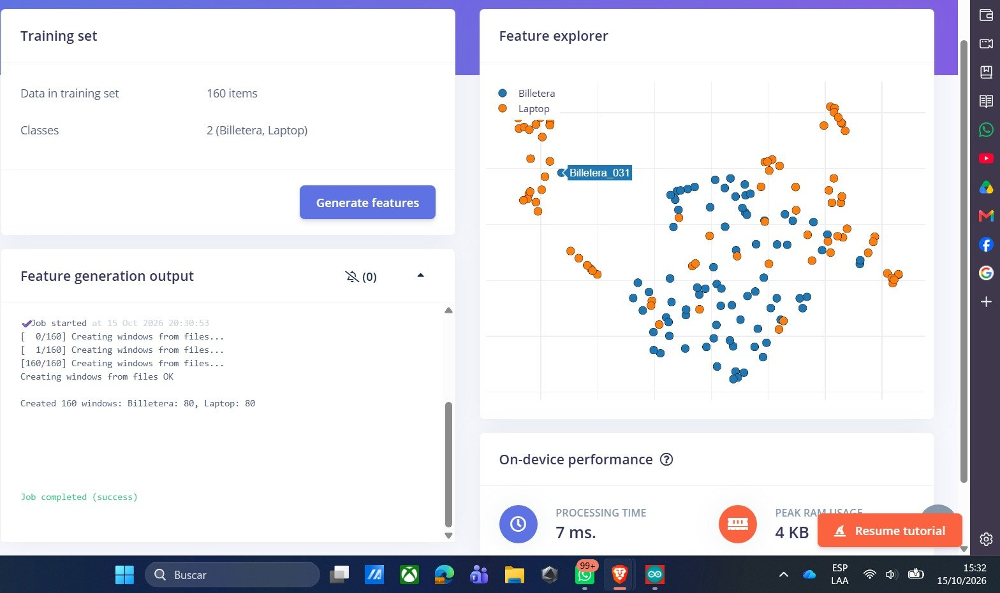<br>
  <em>Figura 10: Generación de características a partir de las imágenes de entrenamiento.</em><br>
</p>

El registro indica que se crearon 160 ventanas (Billetera: 80, Laptop: 80) y que el trabajo finalizó con éxito, lo que confirma un conjunto de entrenamiento balanceado. El *Feature explorer* proyecta las muestras en dos dimensiones; se aprecia que las dos clases se mezclan parcialmente en esta etapa. Las estimaciones en el dispositivo indican un tiempo de procesamiento de 7 ms y un pico de RAM de 4 KB.
 
<p align="center">
  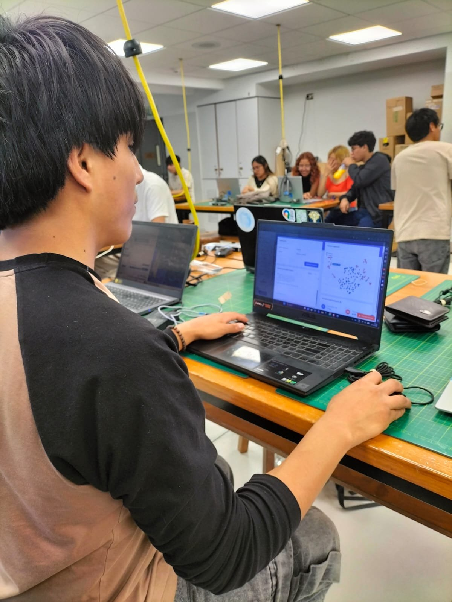<br>
  <em>Figura 11: Equipo trabajando en Edge Impulse durante el procesamiento.</em><br>
</p>
 
### 3.5 Entrenamiento (Transfer learning)
 
En **Impulse design > Transfer learning** revisamos la arquitectura de la red y pulsamos *Save & train*.
 
<p align="center">
  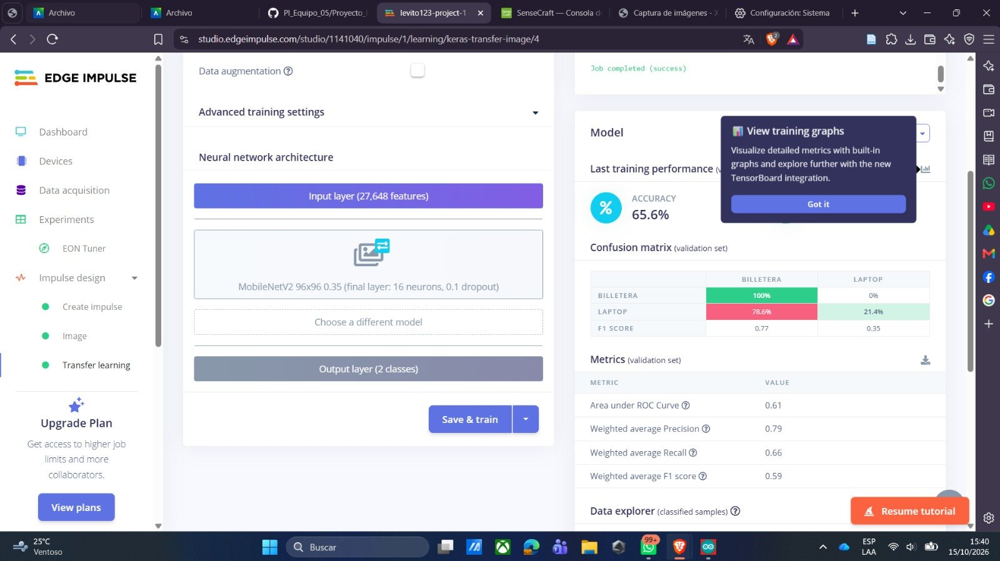<br>
  <em>Figura 12: Configuración y ejecución del entrenamiento en Transfer learning.</em><br>
</p>

Se observa la arquitectura utilizada: una capa de entrada de 27,648 características (imágenes de 96x96 en color), la red *MobileNetV2 96x96 0.35* (capa final de 16 neuronas y *dropout* de 0.1) y una capa de salida de 2 clases. A la derecha se muestra el resultado del entrenamiento: una precisión (*accuracy*) de 65.6% sobre el conjunto de validación.
 
<p align="center">
  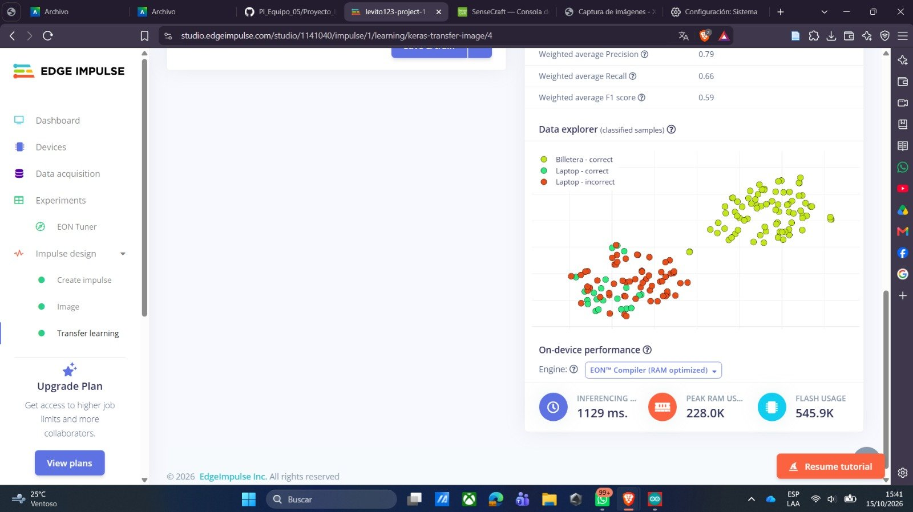<br>
  <em>Figura 13: Resultados del entrenamiento: explorador de datos y desempeño estimado en el dispositivo.</em><br>
</p>

Se muestra el *Data explorer* con las muestras clasificadas correcta e incorrectamente (las muestras de Laptop incorrectas aparecen en rojo) y el desempeño estimado en el dispositivo: inferencia de 1129 ms, 228.0 KB de RAM y 545.9 KB de Flash. Estas cifras corresponden al objetivo *Cortex-M4F 80 MHz* configurado por defecto en el proyecto, por lo que difieren de los tiempos reales medidos luego en el XIAO ESP32S3 (sección 5).
 
<p align="center">
  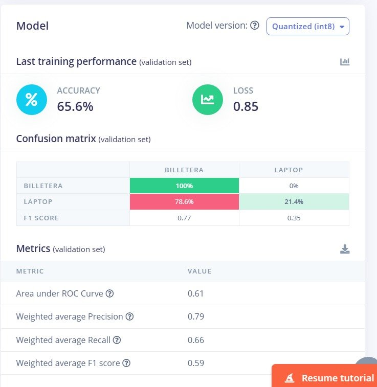<br>
  <em>Figura 14: Resumen del modelo cuantizado (int8) tras el entrenamiento.</em><br>
</p>

Para la versión *Quantized (int8)* se reportan una precisión de 65.6% y una pérdida (*loss*) de 0.85 sobre el conjunto de validación. En la matriz de confusión, las billeteras se clasifican correctamente en el 100% de los casos, mientras que las laptops se aciertan en 21.4% y se confunden con billeteras en 78.6%; las métricas ponderadas son AUC 0.61, precisión 0.79, recall 0.66 y F1 0.59. Son métricas de validación durante el entrenamiento; la evaluación con el conjunto de prueba se presenta a continuación.
 
### 3.6 Rendimiento del Modelo y Gráficos de Dispersión
 
Luego evaluamos el modelo entrenado con el conjunto de prueba (*Model testing*) y los resultados fueron muy buenos: se obtuvo una precisión del 100%. A diferencia de la clasificación individual de la sección 3.7, aquí se evalúan las 40 muestras de prueba (20 por clase) con la versión *Unoptimized (float32)*.
 
<p align="center">
  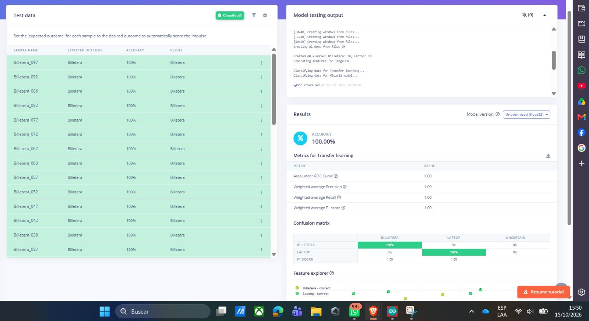<br>
  <em>Figura 15: Resultados de Model testing: matriz de confusión y métricas de rendimiento.</em><br>
</p>

La matriz de confusión muestra un rendimiento perfecto: el 100% de las billeteras se clasificó como "Billetera" y el 100% de las laptops como "Laptop", sin falsos positivos ni falsos negativos. Las métricas (AUC, precisión, recall y F1-Score ponderados) valen 1.00, lo que confirma un equilibrio ideal entre precisión y recall.
 
<p align="center">
  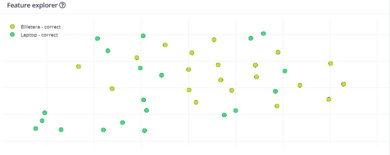<br>
  <em>Figura 16: Gráfico de dispersión (Feature explorer) de las muestras de prueba.</em><br>
</p>

Este gráfico representa cómo se distribuyen las muestras de prueba dentro del espacio de características que aprendió el modelo. Los puntos amarillos corresponden a las billeteras clasificadas correctamente y los verdes a las laptops clasificadas correctamente; no aparece ninguna muestra incorrecta, lo que es coherente con la precisión de 100% obtenida.
 
**Observación.** Los 100% de *Model testing* contrastan con el 65.6% de precisión de validación obtenido durante el entrenamiento (sección 3.5). Una posible explicación es que las imágenes de prueba se capturaron en la misma sesión y bajo condiciones muy similares a las de entrenamiento, por lo que resultan fáciles de clasificar. Por ello, el resultado de prueba debe interpretarse con cautela y no como una garantía de desempeño en condiciones distintas.
 
### 3.7 Clasificación de muestras individuales (Live classification)
 
En **Live classification** cargamos muestras individuales del conjunto de pruebas para observar cómo las clasifica el modelo.
 
<table width="100%">
  <tr>
    <td align="center" valign="top" width="50%">
      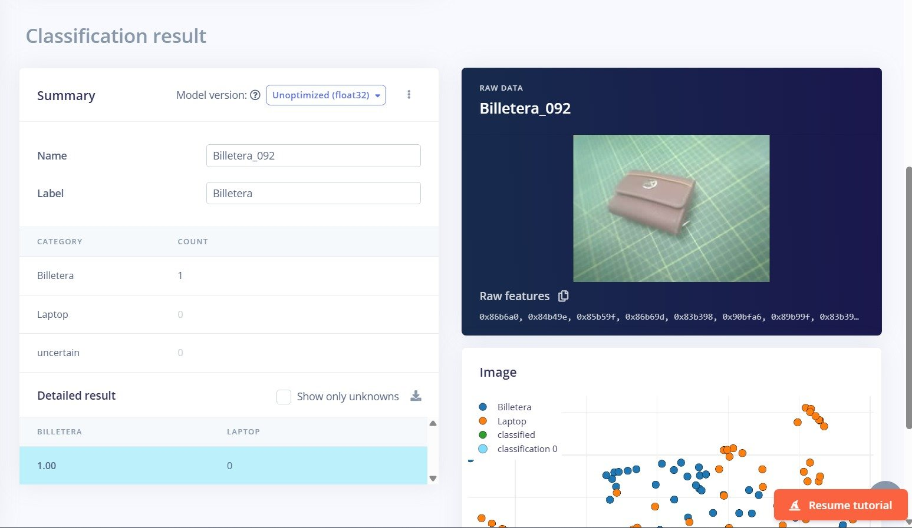<br>
      <em>Figura 17: Clasificación de una muestra aleatoria (Billetera_092) con un 100% de confianza.</em><br>
    </td>
    <td align="center" valign="top" width="50%">
      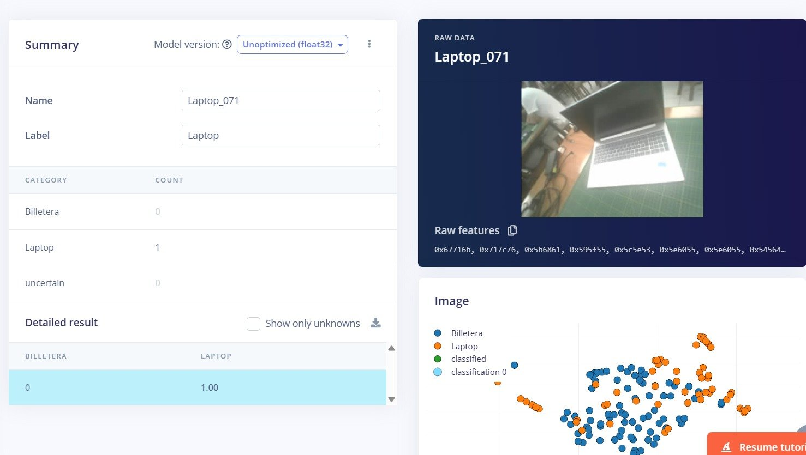<br>
      <em>Figura 18: Clasificación de la muestra Laptop_071 con un 100% de confianza.</em><br>
    </td>
  </tr>
</table>

Cuando cargamos una muestra aleatoria del conjunto de pruebas, en este caso la Billetera_092, el modelo la clasificó correctamente como "Billetera" con un 100% de confianza. En el panel de resultados se ven las probabilidades para cada clase, 1.00 para Billetera y 0 para Laptop, lo que confirma que no hubo ambigüedad en la predicción. La imagen de la billetera sobre la base cuadriculada verde permite comprobar visualmente que la clasificación coincide con el objeto real. Del mismo modo, la muestra Laptop_071 fue clasificada como "Laptop" con probabilidad 1.00, lo que muestra que el modelo también acierta en la segunda clase.
 
### 3.8 Exportación del modelo (Deployment)
 
En **Deployment** elegimos la librería para Arduino con el motor *TensorFlow Lite* y seleccionamos la optimización *Quantized (int8)*, que ofrece menor latencia, menor uso de RAM y menor tamaño en Flash con la misma precisión reportada. Luego pulsamos *Build*.
 
<p align="center">
  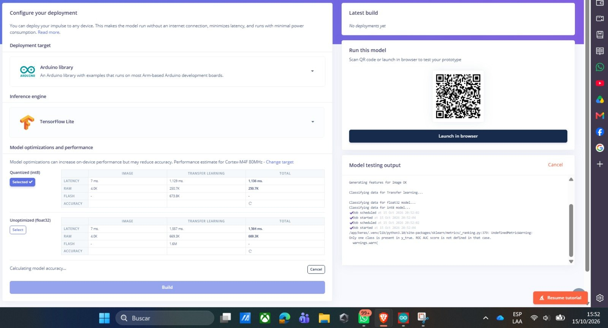<br>
  <em>Figura 19: Configuración del despliegue: librería de Arduino con optimización Quantized (int8).</em><br>
</p>

Se observa la configuración elegida y el proceso de construcción en curso (*Calculating model accuracy*), con la comparación de latencia, RAM y Flash entre la versión cuantizada y la no optimizada.
 
<p align="center">
  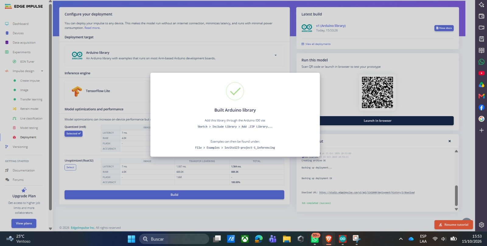<br>
  <em>Figura 20: Librería de Arduino construida correctamente.</em><br>
</p>

Aparece el mensaje *Built Arduino library*, que indica cómo añadir la librería (`Sketch > Include library > Add .ZIP Library`) y dónde encontrar luego los ejemplos (`File > Examples > levito123-project-1_inferencing`). A la derecha se ve la compilación más reciente lista para descargar.
 
## 4. Despliegue en Arduino IDE y error de compilación
 
En Arduino IDE vamos a **Programa > Incluir librería > Añadir biblioteca .ZIP…** y seleccionamos el ZIP descargado desde Edge Impulse (`ei-levito123-project-1-arduino-1.0.1-impulse-#1.zip`).
 
<p align="center">
  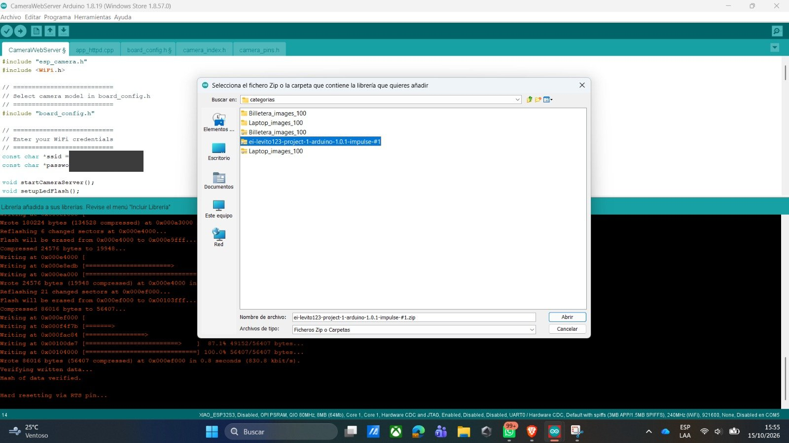<br>
  <em>Figura 21: Instalación de la librería del modelo mediante Añadir biblioteca .ZIP.</em><br>
</p>
El cuadro de diálogo muestra el archivo seleccionado y, al pie del IDE, aparece el mensaje de que la librería fue añadida. Una vez instalada, queda disponible en el menú de ejemplos para continuar con el proyecto.
 
Abrimos el ejemplo `esp32_camera` de la librería del modelo, reemplazamos las definiciones de pines por las del XIAO ESP32S3 y verificamos el código para compilarlo.
 
<p align="center">
  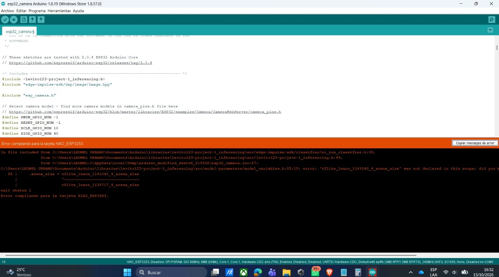<br>
  <em>Figura 22: Error de compilación al verificar el ejemplo esp32_camera.</em><br>
</p>

Al compilar, Arduino IDE mostró el mensaje *Error compilando para la tarjeta XIAO_ESP32S3*. En el código ya aparecen las definiciones de pines del XIAO (por ejemplo, `PWDN_GPIO_NUM -1`, `RESET_GPIO_NUM -1`, `XCLK_GPIO_NUM 10`, `SIOD_GPIO_NUM 40`), por lo que el problema no está en los pines sino en el archivo del modelo, como se detalla a continuación.
 
### 4.1 Análisis del error  (CORREGIR DE SER NECESARIO)
 
El compilador mostró el siguiente mensaje:
 
```text
model_variables.h:85:19: error: 'tflite_learn_1141040_4_arena_size' was not declared in this scope;
did you mean 'tflite_learn_1135717_4_arena_size'?
 
   85 |     .arena_size = tflite_learn_1141040_4_arena_size
exit status 1
Error compilando para la tarjeta XIAO_ESP32S3.
```
 
**Dónde ocurre.** El error se produce en el archivo `model_variables.h` (línea 85), dentro de la carpeta `src/model-parameters` de la librería del modelo. Este archivo es incluido desde `ei_run_classifier.h` y `levito123-project-1_inferencing.h`, que a su vez son llamados por `esp32_camera.ino` (línea 27).
 
**Qué significa.** `model_variables.h` necesita la variable `tflite_learn_1141040_4_arena_size`, que indica la memoria reservada para ejecutar el modelo (*arena size*). Sin embargo, esa variable no está declarada en el archivo del modelo (`src/tflite-model/tflite_learn_*.h`). El compilador sugiere en su lugar `tflite_learn_1135717_4_arena_size`, un nombre con un identificador (1135717) que no corresponde a nuestro modelo (1141040).
 
**Causa más probable.** El identificador 1135717 es el que aparece en el ejemplo de la guía al explicar cómo ajustar *arena_size* cuando falta espacio. Es probable que al aplicar ese ajuste se hayan usado las líneas del ejemplo (con el identificador y el valor de la guía) en el archivo de nuestro modelo, generando una discrepancia entre el nombre que pide `model_variables.h` y el que realmente existe. Esta causa se identificó a partir del mensaje de error, pero no llegó a comprobarse por falta de tiempo.
 
**Solución propuesta (no aplicada por tiempo).** En el archivo `tflite_learn_*.h` los nombres deben conservar el identificador del propio modelo (1141040) y solo cambiar el valor numérico si fuera necesario:
 
```cpp
#define EI_CLASSIFIER_TFLITE_LEARN_1141040_4_ARENA_SIZE 384605
const size_t tflite_learn_1141040_4_arena_size = 384605;
```
 
Como alternativa, se puede volver a añadir la librería descargada de Edge Impulse (para restaurar el archivo original) y modificar únicamente el valor numérico de `arena_size`.
 
### 4.2 Inferencia en Tiempo Real (Monitor Serie): actividad no concluida
 
Por limitaciones de tiempo **no se logró completar esta actividad**: al persistir el error de compilación descrito en la sección 4.1, el programa de inferencia no pudo cargarse en el XIAO ESP32S3 y, por lo tanto, no se obtuvieron lecturas de predicciones en el Monitor Serie. Aun así, el problema pudo identificarse. Como representación del proceso, el equipo simuló cómo se habría realizado: conectar la placa por cable a la laptop y presentar los objetos frente a la cámara mientras se observa el Monitor Serie a 115200 baudios.
 
<table width="100%">
  <tr>
    <td align="center" valign="top" width="50%">
      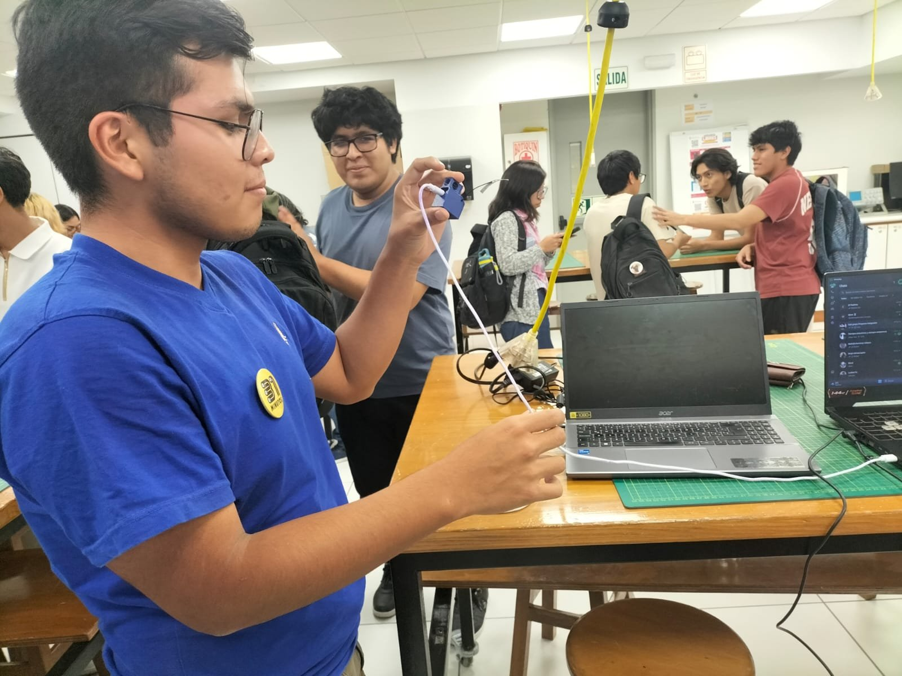<br>
      <em>Figura 23: Simulación del proceso: placa conectada a la laptop y objeto frente a la cámara.</em><br>
    </td>
    <td align="center" valign="top" width="50%">
      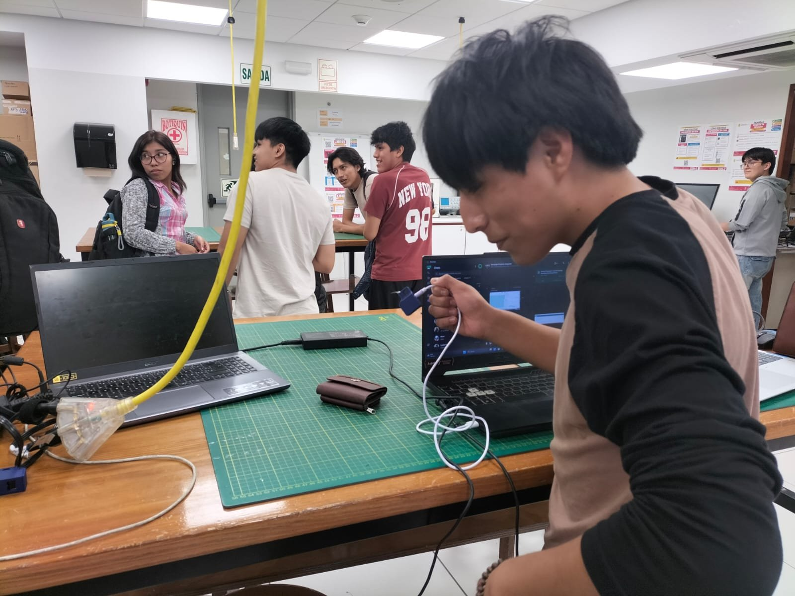<br>
      <em>Figura 24: Simulación del proceso: manipulación de la placa frente al equipo.</em><br>
    </td>
  </tr>
</table>

Estas fotografías son una **representación del procedimiento** y no corresponden a una inferencia real: ilustran cómo sería la prueba con el Monitor Serie, pero no constituyen un resultado. La validación en tiempo real del modelo se realizó con SenseCraft (sección 5).
 
## 5. Visualización con SenseCraft
 
Como alternativa de visualización, probamos la plataforma SenseCraft. Desde el *Dashboard* de Edge Impulse descargamos el modelo *Transfer learning model - TensorFlow Lite (int8 quantized)* y lo cargamos en SenseCraft mediante **Espacio de trabajo > Subir modelo**. Ahí pudimos ver la cámara en vivo con las predicciones en pantalla; la interfaz muestra la vista previa y barras de confianza para cada clase, lo que facilita comprobar rápidamente si el modelo está identificando bien los objetos.
 
<table width="100%">
  <tr>
    <td align="center" valign="top" width="50%">
      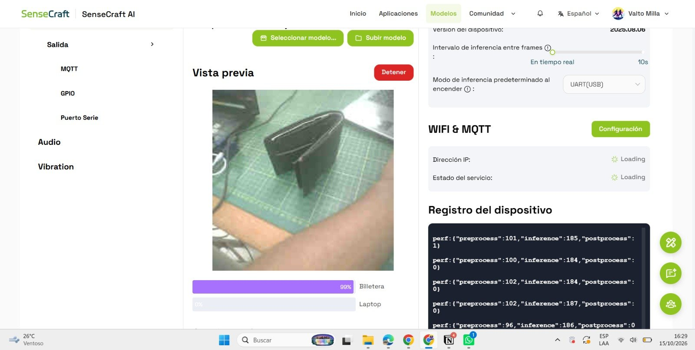<br>
      <em>Figura 25: SenseCraft clasificando la billetera con un 99% de confianza.</em><br>
    </td>
    <td align="center" valign="top" width="50%">
      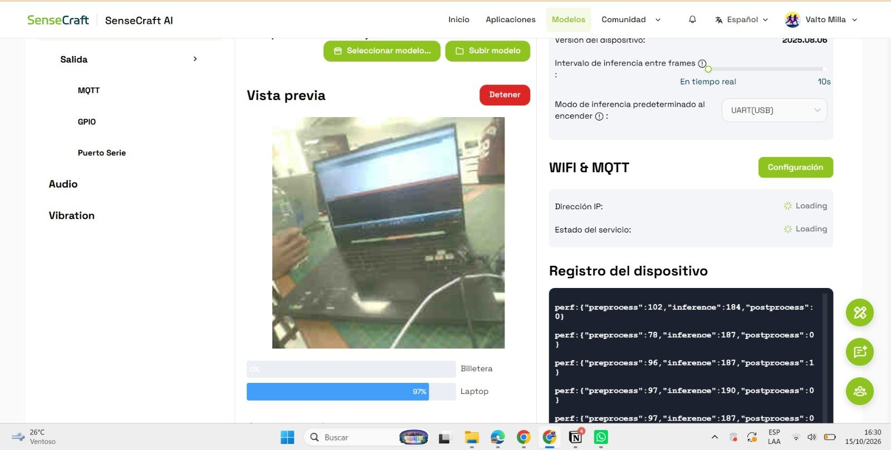<br>
      <em>Figura 26: SenseCraft clasificando la laptop con un 97% de confianza.</em><br>
    </td>
  </tr>
</table>

Con la billetera frente a la cámara, la barra de "Billetera" marca 99% y la de "Laptop" queda prácticamente vacía; al cambiar el objeto, la predicción se actualiza a "Laptop" con 97%. El registro del dispositivo reporta tiempos de preprocesamiento cercanos a 100 ms e inferencia de aproximadamente 185–190 ms por cuadro. Las barras de confianza cambian de manera coherente con el objeto frente a la cámara, lo que respalda los resultados obtenidos en Edge Impulse. SenseCraft resultó una forma muy práctica de validar el funcionamiento del modelo sin escribir código adicional.

---
 
## Conclusión: (MEJORAR) 
Se capturó un dataset de 200 imágenes con el XIAO ESP32S3 Sense, se entrenó en Edge Impulse un modelo de clasificación entre "Billetera" y "Laptop" (100% en el conjunto de prueba y 65.6% de precisión de validación durante el entrenamiento) y se validó su funcionamiento en tiempo real con SenseCraft, con confianzas de 99% y 97%. El despliegue mediante Arduino IDE no pudo concluirse por tiempo debido a un error de compilación relacionado con *arena_size*, cuya causa probable fue identificada y cuya solución quedó planteada.
