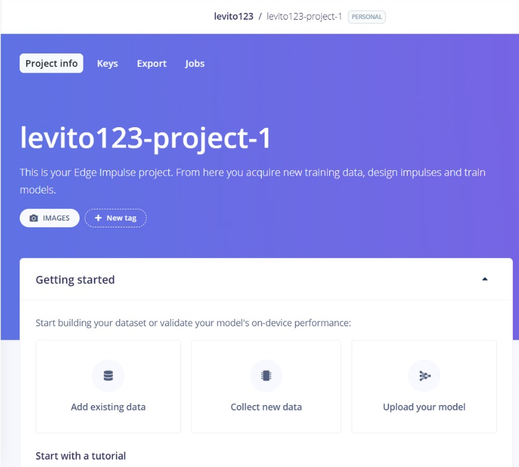
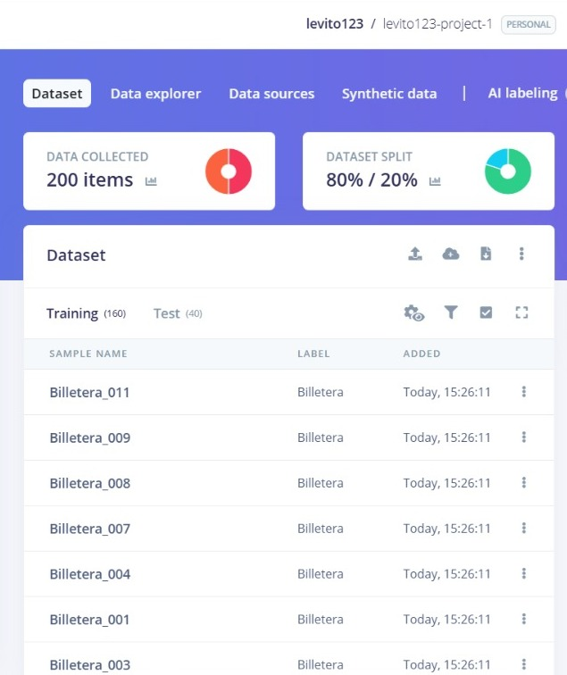
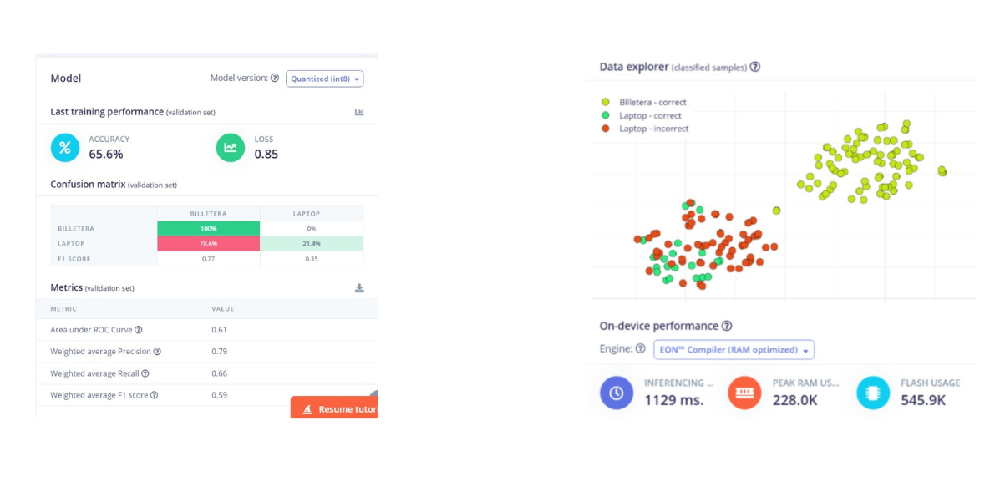

    <h1 style="color: #4cc9f0; margin-bottom: 5px;">Taller de TinyML</h1>
    <h3 style="color: #e0e1dd; margin-top: 0;">Clasificación de Imágenes con XIAO ESP32S3 Sense y Edge Impulse</h3>
    
Universidad Peruana Cayetano Heredia

## Introducción

Este proyecto documenta la implementación de un sistema de visión artificial (TinyML) utilizando la placa XIAO ESP32S3 Sense y la plataforma Edge Impulse. El objetivo principal es entrenar un modelo de aprendizaje automático capaz de clasificar objetos en tiempo real, específicamente distinguir entre una "Billetera" y una "Laptop", desplegando finalmente el modelo directamente en el microcontrolador.

A lo largo de este taller, se abordan desde la configuración inicial del entorno en Arduino IDE y la captura de datos mediante la cámara, hasta el entrenamiento del modelo en la nube y su despliegue final. Las evidencias presentadas a continuación demuestran el correcto funcionamiento del flujo de trabajo, destacando el rendimiento del modelo y su capacidad de inferencia en el dispositivo.

### Materiales y herramientas
 
| Componente | Uso en el taller |
|---|---|
| XIAO ESP32S3 Sense (con cámara) | Captura de imágenes e inferencia del modelo |
| Cable USB-C | Alimentación, programación y monitor serie |
| Arduino IDE | Programación y carga del código en la placa |
| Edge Impulse | Gestión del dataset, entrenamiento y exportación del modelo |
| SenseCraft | Visualización del modelo en tiempo real |
| Red WiFi | Transmisión de video para capturar el dataset |

### Contenido
 
1. [Configuración del entorno en Arduino IDE](#1-configuración-del-entorno-en-arduino-ide)
2. [Preparación de la cámara y captura del dataset](#2-preparación-de-la-cámara-y-captura-del-dataset)
3. [Entrenamiento del modelo en Edge Impulse](#3-entrenamiento-del-modelo-en-edge-impulse)
4. [Despliegue del modelo en Arduino IDE](#4-despliegue-del-modelo-en-arduino-ide)
5. [Visualización con SenseCraft](#5-visualización-con-sensecraft)
---

---

## 1. Creación del Proyecto y Carga de Datos

    Para empezar, se creó una cuenta y un nuevo proyecto en Edge Impulse. Luego se subieron las imágenes que previamente capturamos con la cámara del XIAO ESP32S3. Organizamos todo en dos clases distintas, "Billetera" y "Laptop", y usamos la opción de subida por lotes para que la plataforma asignara automáticamente las etiquetas a cada archivo.

    
     
    <em>Figura 1: Interfaz de creación del proyecto y flujo para añadir datos existentes.</em>

 

## 2. Verificación del Dataset

    Después de cargar las 200 imágenes (100 por cada clase), verificamos que la plataforma las hubiera recibido correctamente. Edge Impulse dividió el conjunto de datos en un 80% para entrenamiento y un 20% para pruebas, lo que nos da una base sólida para validar el modelo más adelante.

    
     
    <em>Figura 2: Confirmación de subida y visualización del dataset dividido (200 items).</em>

    En la captura se confirma que llegaron las 200 imágenes en total, 100 de "Billetera" y 100 de "Laptop". La división 80/20 es bastante útil en este tipo de proyectos porque deja 160 imágenes para que el modelo aprenda y 40 para comprobar qué tan bien generaliza. Además, la lista de muestras etiquetadas nos asegura que el proceso de subida se hizo sin errores.

 

## 3. Rendimiento del Modelo y Gráficos de Dispersión

    Luego evaluamos el rendimiento del modelo entrenado y los resultados fueron bastante buenos, con una precisión del 100% y una pérdida de 0.04. A continuación mostramos dos gráficos de dispersión. El primero refleja la distribución general de todos los datos procesados, donde se ve una separación clara entre "Billetera" y "Laptop". El segundo corresponde a la clasificación de una muestra aleatoria en particular.

    
     
    <em>Figura 3a: Matriz de confusión, métricas de rendimiento y gráfico de dispersión general de los datos.</em>

    La matriz de confusión muestra un rendimiento perfecto, ya que el 100% de las billeteras se clasificaron como "Billetera" y el 100% de las laptops como "Laptop", sin falsos positivos ni falsos negativos. El F1-Score de 1.00 en ambas clases confirma que hay un equilibrio ideal entre precisión y recall. En el gráfico de dispersión general se observa una separación clara entre los grupos de cada clase, lo que indica que el modelo logró aprender características distintivas y útiles para diferenciarlas.

    
     
    <em>Figura 3b: Gráfico de dispersión general mostrando la separación de las clases.</em>

    Este gráfico representa cómo se distribuyen todas las muestras del dataset dentro del espacio de características que aprendió el modelo. Los puntos amarillos son los aciertos de "Billetera" y los verdes los de "Laptop". La separación entre ambos grupos es evidente, lo que explica por qué el modelo alcanzó una precisión tan alta.

    
     
    <em>Figura 3c: Clasificación de una muestra aleatoria (Billetera_092) con un 100% de confianza.</em>

    Cuando cargamos una muestra aleatoria del conjunto de pruebas, en este caso la Billetera_092, el modelo la clasificó correctamente como "Billetera" con un 100% de confianza. En el panel de resultados se ven las probabilidades para cada clase, 1.00 para Billetera y 0.00 para Laptop, lo que confirma que no hubo ambigüedad en la predicción. La imagen de la billetera sobre la alfombra verde permite comprobar visualmente que la clasificación tiene sentido con el objeto real.

 

## 4. Inferencia en Tiempo Real (Monitor Serie)

    Usando el Monitor Serie de Arduino IDE a 115200 baudios, observamos cómo se comporta el modelo en tiempo real. Al colocar una billetera frente a la cámara, el sistema arrojó una confianza superior al 89%. Cuando cambiamos por una laptop, la predicción se actualizó correctamente a "Laptop" con una confianza del 83%, lo que demuestra que el modelo funciona bien una vez desplegado.

    
     
    <em>Figura 4: Salida del Monitor Serie mostrando las predicciones para "Billetera" y "Laptop".</em>

    En el monitor se aprecia que el tiempo de inferencia es de apenas 14 ms, lo que indica que el modelo es lo suficientemente rápido para aplicaciones en tiempo real. Los valores de predicción se mantienen entre 0.89 y 0.76 para "Billetera" cuando ese objeto está frente a la cámara, y cambian a 0.83 para "Laptop" cuando se presenta el otro objeto. La consistencia en las predicciones a lo largo del tiempo refleja que el modelo es estable y confiable en condiciones reales de uso.

 

## 5. Visualización con SenseCraft

    Como alternativa de visualización, también probamos la plataforma SenseCraft. Ahí cargamos el modelo ya entrenado y pudimos ver la cámara en vivo con las predicciones en pantalla. La interfaz muestra la vista previa y barras de confianza para cada clase, lo que facilita comprobar rápidamente si el modelo está identificando bien los objetos en distintas posiciones.

    
     
    <em>Figura 5: Interfaz de SenseCraft mostrando la clasificación en tiempo real de ambos objetos.</em>

    En esta vista se confirma que el modelo responde correctamente cuando se le presenta una billetera o una laptop. Las barras de confianza cambian de manera coherente según el objeto que aparece frente a la cámara, lo que respalda los resultados obtenidos previamente en el monitor serie y en las métricas de Edge Impulse. SenseCraft resultó una forma muy práctica de validar el funcionamiento del modelo sin necesidad de escribir código adicional.

 

---

    <strong>Conclusión:</strong> El taller se completó exitosamente y logramos implementar un sistema de TinyML funcional en el XIAO ESP32S3 Sense. Las evidencias demuestran que el modelo es capaz de clasificar imágenes con alta precisión y baja latencia, lo que valida el uso de Edge Impulse, Arduino IDE y SenseCraft para proyectos de visión artificial en el borde.

