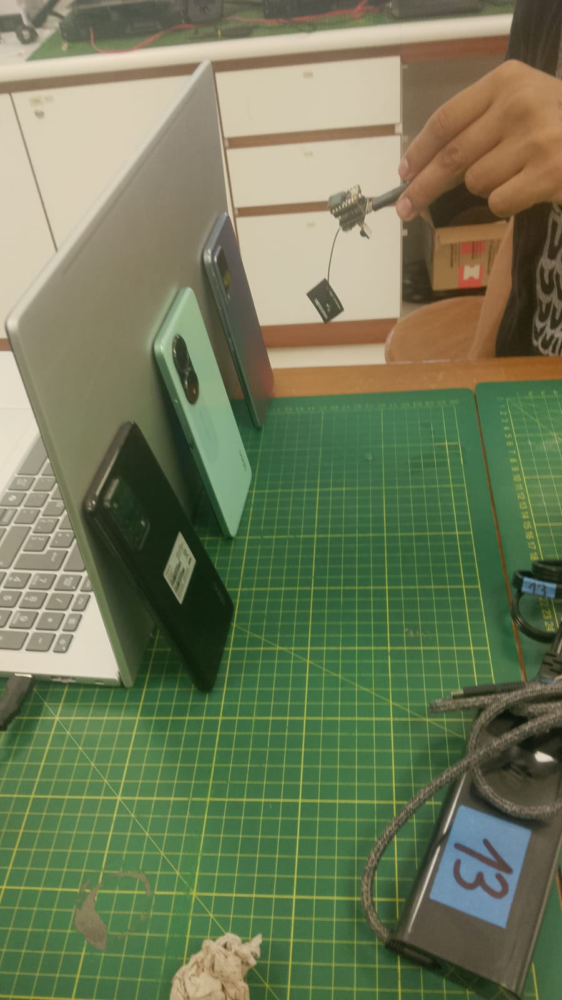
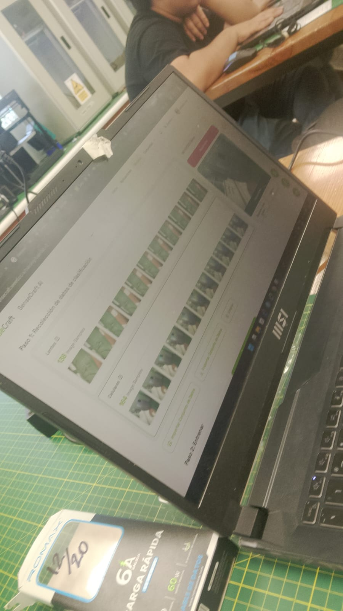
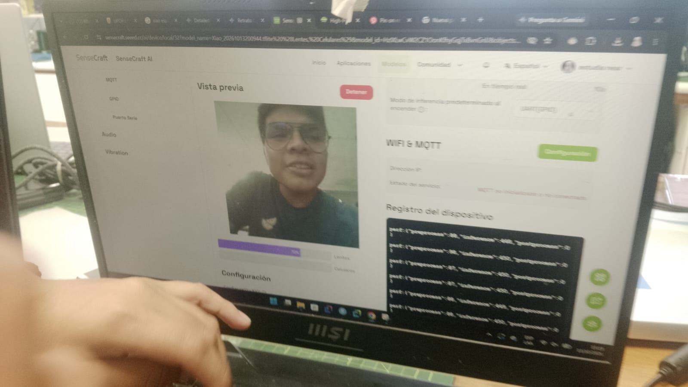
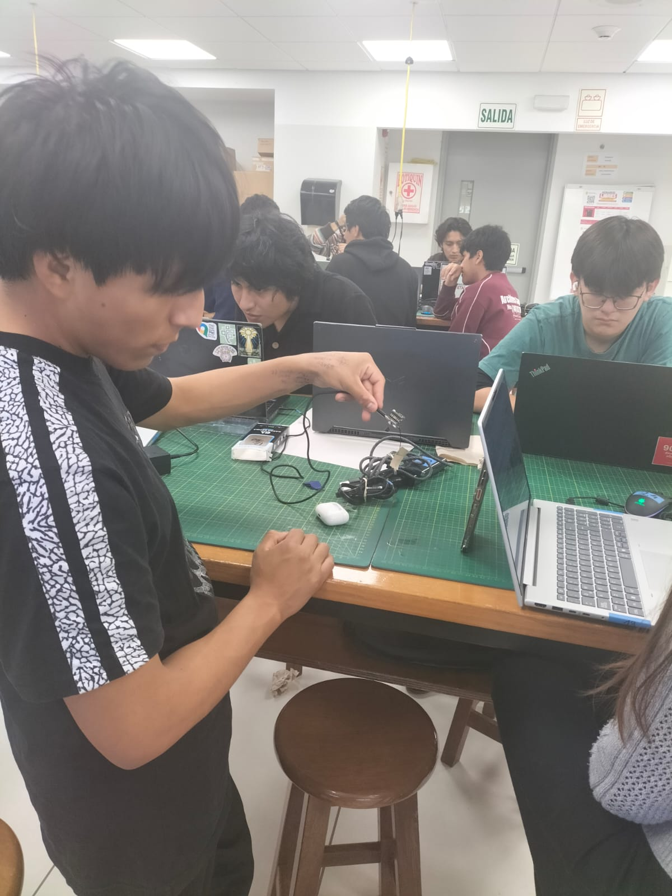

# README 2 – Modelo propio del grupo

## Integrantes
- Leonel Urbano
- Gael Milla

## Objetivo del modelo
Clasificar imágenes en tiempo real usando la XIAO ESP32S3 Sense y SenseCraft AI.

- Clases: lentes y celulares.

## Datos
- Fueron tomados en tiempo real.
- Cantidad de imágenes: 138 de lentes y 138 de celulares
- Archivo: `datos.zip`

## Entrenamiento
- Parámetros usados: Para lentes, 138 fotos de diferentes lentes en diferentes angulos. Para celulares, 138 fotos de diferentes celulares, en diferentes angulos
- El nivel de confianza es del 50%.
- Captura: 
- **Figura5.** Evidencia de Leonel Urbano . En esta imagen, Leonel se encargó de recopilar imagenes de los lentes.
- Data: 

## Vista previa y despliegue
- Vista previa y despliegue del modelo: 
**Figura 5.** Evidencia de Gael milla. En esta imagen, Gael se encargó de Comprobar el correcto funcionamiento del modelo.
## Salida GPIO
- La clase que activa el LED es "lentes"

| Integrante | Captura | Resultado |
|---|---|---|
| [Leonel Urbano] |  | LED encendido al mostrar celular |
| [Gael Milla] |  | LED encendido al mostrar celular |

## Archivos del repositorio
- `datos.zip`
