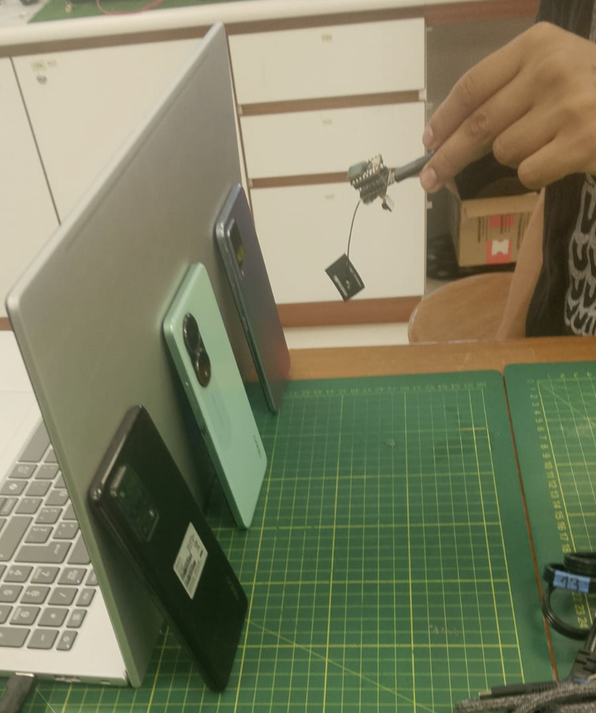
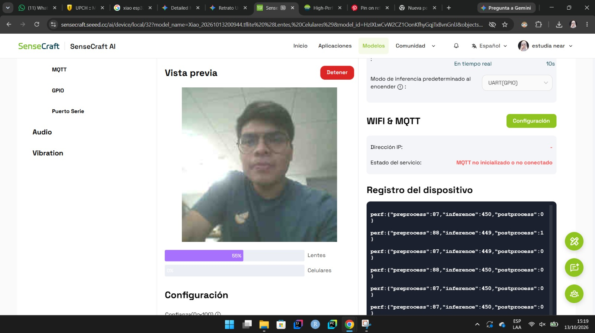

# Taller TinyML con SenseCraft AI: Implementación de un modelo propio

  <strong>Clasificación de lentes y celulares mediante TinyML</strong>
   
  Implementación con Seeed Studio XIAO ESP32S3 Sense.

  
  
  

## Índice

1. [Descripción](#1-descripción)
2. [Objetivos](#2-objetivos)
3. [Integrantes del equipo](#3-integrantes-del-equipo)
4. [Materiales y herramientas](#4-materiales-y-herramientas)
5. [Implementación del modelo](#5-implementación-del-modelo)
6. [Pruebas del modelo](#6-pruebas-del-modelo)
7. [Prueba de salida GPIO](#7-prueba-de-salida-gpio)
8. [Resultados y conclusiones](#8-resultados-y-conclusiones)

---

## 📌 1. Descripción

El presente proyecto consiste en desarrollar e implementar un sistema de clasificación de imágenes mediante técnicas de *Tiny Machine Learning* (TinyML), utilizando la placa **Seeed Studio XIAO ESP32S3 Sense** y la plataforma [SenseCraft AI](https://sensecraft.seeed.cc/ai/).

El modelo tiene como finalidad distinguir dos categorías de objetos: **lentes y celulares**. Para ello, se recopiló un conjunto de imágenes de ambas clases, considerando diferentes modelos, posiciones y ángulos de orientación. Posteriormente, las fotografías se organizaron y etiquetaron para utilizarlas durante el entrenamiento del modelo.

Una vez entrenado, el modelo se desplegó en la placa para realizar predicciones a partir de las imágenes capturadas por la cámara. Asimismo, se realizaron pruebas con el LED integrado como indicador físico de salida, con el propósito de comprobar la respuesta del sistema ante los objetos presentados.

## 🎯 2. Objetivos

### Objetivo general

Desarrollar e implementar un modelo propio de TinyML capaz de clasificar imágenes en tiempo real para distinguir entre lentes y celulares, utilizando la placa XIAO ESP32S3 Sense y la plataforma SenseCraft AI.

### Objetivos específicos

- Recopilar imágenes de diferentes modelos de lentes y celulares.
- Variar las posiciones y los ángulos de los objetos para obtener diversidad visual en el conjunto de datos.
- Organizar y etiquetar las fotografías en las categorías correspondientes.
- Entrenar un modelo de clasificación de imágenes mediante SenseCraft AI.
- Configurar el umbral de confianza utilizado para aceptar las predicciones.
- Desplegar el modelo entrenado en la placa XIAO ESP32S3 Sense.
- Comprobar las predicciones mediante la cámara y evaluar la respuesta del LED integrado.

## 👥 3. Integrantes del equipo

<table>
  <thead>
    <tr>
      <th align="center">Integrante</th>
      <th align="center">Responsabilidad</th>
    </tr>
  </thead>
  <tbody>
    <tr>
      <td align="center">Leonel Urbano</td>
      <td>Recopilación de imágenes y evidencias del entrenamiento.</td>
    </tr>
    <tr>
      <td align="center">Gael Milla</td>
      <td>Comprobación del modelo y evidencias de las pruebas.</td>
    </tr>
  </tbody>
</table>

## 🧰 4. Materiales y herramientas

| Material o herramienta | Descripción |
|---|---|
| Seeed Studio XIAO ESP32S3 Sense | Placa utilizada para ejecutar el modelo de clasificación. |
| Cámara integrada | Captura las imágenes de los objetos presentados al dispositivo. |
| LED integrado | Indicador físico empleado para comprobar la respuesta del sistema. |
| Cable USB-C | Permite conectar la placa al equipo para su configuración y alimentación. |
| SenseCraft AI | Plataforma utilizada para organizar los datos, entrenar el modelo y realizar su despliegue. |
| Conjunto de datos | 276 fotografías distribuidas en dos categorías: lentes y celulares. |
| [classification_dataset_Readme_2.zip](https://github.com/BeyondNate/PI_Equipo_05/blob/main/Proyecto_Integrador/Talleres/Semana09/Taller_TinyML_SenseCraft/classification_dataset_Readme_2.zip) | Archivo del repositorio asociado al conjunto de datos. |

## ⚙️ 5. Implementación del modelo

### 5.1. Preparación del conjunto de datos

Las fotografías fueron recopiladas mediante la captura de diferentes lentes y celulares. Se procuró variar sus posiciones y ángulos de orientación para proporcionar al modelo ejemplos visuales diversos.

El conjunto de datos se organizó en dos categorías, con la siguiente distribución:

| Categoría | Cantidad de imágenes |
|---|---:|
| Lentes 🕶️| 138 |
| Celulares 📱| 138 |
| **Total** | **276** |

Las imágenes se cargaron en SenseCraft AI y se etiquetaron de acuerdo con la clase correspondiente.

**Evidencia de recopilación de imágenes**

<table>
  <tr>
    <td align="center" width="50%">
      
       
      <strong>Figura 1.</strong> Evidencia de la recopilación de imágenes realizada por Leonel Urbano.
    </td>
    <td align="center" width="50%">
      
       
      <strong>Figura 2.</strong> Evidencia del conjunto de datos utilizado para entrenar el modelo.
    </td>
  </tr>
</table>

### 5.2. Entrenamiento y configuración

El modelo se entrenó utilizando las fotografías recopiladas y organizadas en SenseCraft AI. Se seleccionó el tipo de tarea de clasificación de imágenes (*Image Classification*), con el propósito de reconocer las dos categorías establecidas.

Durante la configuración se consideró un umbral de confianza para determinar cuándo aceptar una predicción. El valor registrado en la descripción inicial del procedimiento fue del **53 %**; sin embargo, otra anotación del entrenamiento menciona el 50 %. Por ello, se debe verificar en la configuración final de SenseCraft AI cuál fue el valor realmente utilizado.

Es importante señalar que el umbral de confianza no representa la exactitud del modelo, sino el nivel mínimo de confianza requerido para aceptar una predicción, según la configuración aplicada.

### 5.3. Despliegue del modelo

Después del entrenamiento, el modelo se desplegó en la placa XIAO ESP32S3 Sense siguiendo el procedimiento disponible en SenseCraft AI. La cámara se utilizó para capturar imágenes de los objetos y obtener las predicciones correspondientes.

*Figura 3. Evidencia de Gael Milla durante la comprobación del funcionamiento del modelo.*

## 🧪 6. Pruebas del modelo

Las pruebas tuvieron como finalidad comprobar el funcionamiento del modelo de clasificación de imágenes, verificando su capacidad para reconocer las dos categorías definidas: lentes y celulares. Asimismo, se evaluó la respuesta del LED integrado como indicador físico asociado a la detección de celulares.

El procedimiento contempló las siguientes actividades:

1. Conectar la placa XIAO ESP32S3 Sense al equipo mediante el cable USB-C.
2. Ejecutar el modelo previamente desplegado en la placa.
3. Presentar diferentes lentes frente a la cámara y observar la predicción obtenida.
4. Repetir el procedimiento con diferentes celulares, registrando las predicciones y sus niveles de confianza.
5. Comprobar la activación del LED integrado al presentar celulares frente a la cámara.
6. Verificar que el LED se encienda cuando la confianza de la clase `celular` sea superior al 50 %.

Las pruebas permitieron observar el comportamiento del sistema y comprobar la relación entre las predicciones del modelo y la salida GPIO. No obstante, estas verificaciones funcionales no determinan por sí solas la exactitud general del clasificador. Para evaluar su rendimiento con mayor precisión, sería necesario realizar pruebas con imágenes independientes de las utilizadas durante el entrenamiento y registrar las predicciones correctas e incorrectas.

## 💡 7. Prueba de salida GPIO

Como parte de la implementación, se utilizó el LED integrado en la placa XIAO ESP32S3 Sense como indicador físico de salida, asociado a la clasificación de celulares.

La lógica de control establece que el LED se enciende cuando el modelo identifica la clase **`celular` con un nivel de confianza superior al 50 %**. Si se cumple esta condición, se activa la salida GPIO correspondiente.

| Integrante | Evidencia | Resultado registrado |
|---|---|---|
| Leonel Urbano |  | LED encendido al mostrar un celular, al superar el umbral de confianza del 50 %. |
| Gael Milla |  | LED encendido al mostrar un celular, al superar el umbral de confianza del 50 %. |

Durante las pruebas, se comprobó la respuesta del LED al presentar celulares frente a la cámara. El resultado esperado es que la salida se active cuando la confianza de la clase `celular` sea superior al 50 %.

Este comportamiento permite relacionar la predicción del modelo con una respuesta física del dispositivo, integrando la clasificación de imágenes con el control de una salida GPIO.

## 📊 8. Resultados y conclusiones

- Se desarrolló un sistema de TinyML para clasificar imágenes en dos categorías: lentes y celulares, utilizando la placa XIAO ESP32S3 Sense y la plataforma SenseCraft AI.
- Se recopiló un conjunto de datos equilibrado de 276 fotografías, compuesto por 138 imágenes de lentes y 138 de celulares. La variación de posiciones y ángulos permitió incorporar diversidad visual durante el entrenamiento.
- Se entrenó y desplegó un modelo de clasificación de imágenes capaz de generar predicciones a partir de las capturas obtenidas mediante la cámara de la placa.
- Se integró el LED de la placa como indicador físico de salida, configurándolo para encenderse cuando la confianza de la clase `celular` supera el 50 %. De esta manera, se vinculó la clasificación realizada por el modelo con una respuesta física del dispositivo.
- Las pruebas permitieron comprobar el funcionamiento del sistema y la activación del LED bajo la condición establecida. Sin embargo, todavía es necesario evaluar cuantitativamente el rendimiento del clasificador para determinar su nivel de exactitud.
- Como mejora futura, se recomienda utilizar imágenes que no hayan participado en el entrenamiento y registrar las predicciones correctas e incorrectas. Con estos resultados, se podrán calcular métricas como la exactitud y elaborar una matriz de confusión para identificar posibles errores de clasificación.

### Archivos del repositorio

| Archivo | Descripción |
|---|---|
| [classification_dataset_Readme_2.zip](https://github.com/BeyondNate/PI_Equipo_05/blob/main/Proyecto_Integrador/Talleres/Semana09/Taller_TinyML_SenseCraft/classification_dataset_Readme_2.zip) | Archivo asociado al conjunto de datos recopilado para el proyecto. |
