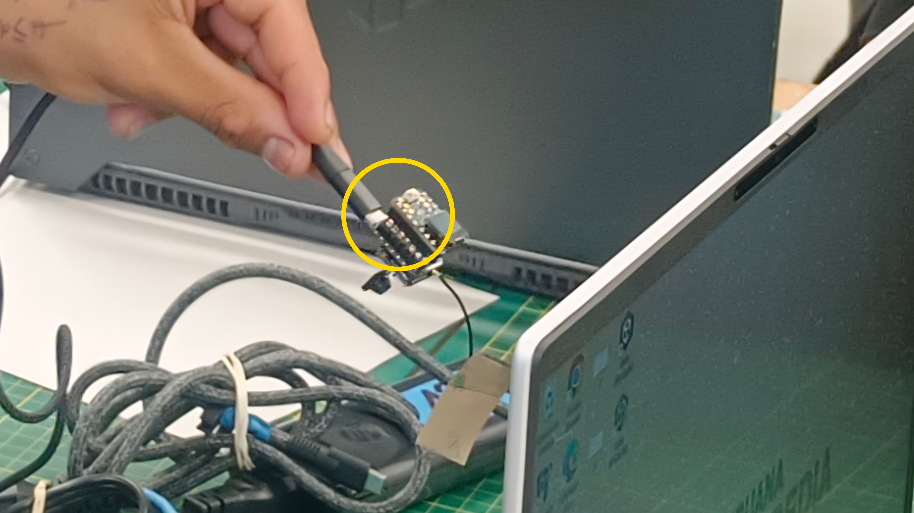
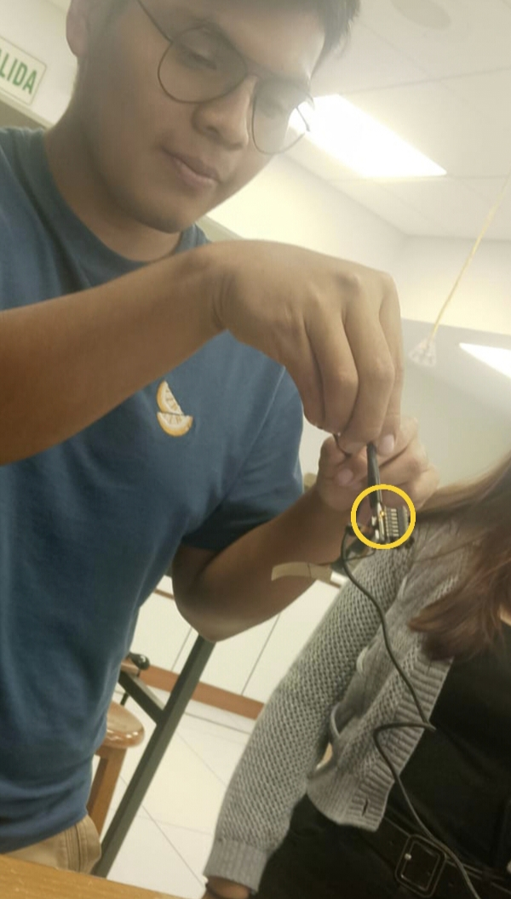

# Taller TinyML con SenseCraft AI: Implementación de un modelo propio

  <strong>Clasificación de lentes y celulares mediante TinyML</strong>
   
  Implementación con Seeed Studio XIAO ESP32S3 Sense.

  
  
  

## Índice

1. [Descripción](#1-descripción)
2. [Objetivos](#2-objetivos)
3. [Integrantes del equipo](#3-integrantes-del-equipo)
4. [Materiales y herramientas](#4-materiales-y-herramientas)
5. [Implementación del modelo](#5-implementación-del-modelo)
6. [Pruebas del modelo](#6-pruebas-del-modelo)
7. [Prueba de salida GPIO](#7-prueba-de-salida-gpio)
8. [Resultados y conclusiones](#8-resultados-y-conclusiones)

---

## 1. Descripción

El presente proyecto consiste en desarrollar e implementar un sistema de clasificación de imágenes mediante técnicas de *Tiny Machine Learning* (TinyML), utilizando la placa **Seeed Studio XIAO ESP32S3 Sense** y la plataforma [SenseCraft AI](https://sensecraft.seeed.cc/ai/).

El modelo tiene como finalidad distinguir dos categorías de objetos: **lentes y celulares**. Para ello, se recopiló un conjunto de imágenes de ambas clases, considerando diferentes modelos, posiciones y ángulos de orientación. Posteriormente, las fotografías se organizaron y etiquetaron para utilizarlas durante el entrenamiento del modelo.

Una vez entrenado, el modelo se desplegó en la placa para realizar predicciones a partir de las imágenes capturadas por la cámara. Asimismo, se realizaron pruebas con el LED integrado como indicador físico de salida, con el propósito de comprobar la respuesta del sistema ante los objetos presentados.

## 2. Objetivos

### Objetivo general

Desarrollar e implementar un modelo propio de TinyML capaz de clasificar imágenes en tiempo real para distinguir entre lentes y celulares, utilizando la placa XIAO ESP32S3 Sense y la plataforma SenseCraft AI.

### Objetivos específicos

- Recopilar imágenes de diferentes modelos de lentes y celulares.
- Variar las posiciones y los ángulos de los objetos para obtener diversidad visual en el conjunto de datos.
- Organizar y etiquetar las fotografías en las categorías correspondientes.
- Entrenar un modelo de clasificación de imágenes mediante SenseCraft AI.
- Configurar el umbral de confianza utilizado para aceptar las predicciones.
- Desplegar el modelo entrenado en la placa XIAO ESP32S3 Sense.
- Comprobar las predicciones mediante la cámara y evaluar la respuesta del LED integrado.

## 3. Integrantes del equipo

| Integrante | Responsabilidad |
|---|---|
| Leonel Urbano | Recopilación de imágenes de muestra para el conjunto de datos y registro de evidencias del entrenamiento. |
| Gael Milla | Comprobación del funcionamiento del modelo mediante la vista previa y registro de evidencias de las pruebas. |

## 4. Materiales y herramientas

| Material o herramienta | Descripción |
|---|---|
| Seeed Studio XIAO ESP32S3 Sense | Placa utilizada para ejecutar el modelo de clasificación. |
| Cámara integrada | Captura las imágenes de los objetos presentados al dispositivo. |
| LED integrado | Indicador físico empleado para comprobar la respuesta del sistema. |
| Cable USB-C | Permite conectar la placa al equipo para su configuración y alimentación. |
| SenseCraft AI | Plataforma utilizada para organizar los datos, entrenar el modelo y realizar su despliegue. |
| Conjunto de datos | 276 fotografías distribuidas en dos categorías: lentes y celulares. |
| [classification_dataset_Readme_2.zip](https://github.com/BeyondNate/PI_Equipo_05/blob/main/Proyecto_Integrador/Talleres/Semana09/Taller_TinyML_SenseCraft/classification_dataset_Readme_2.zip) | Archivo del repositorio asociado al conjunto de datos. |

## 5. Implementación del modelo

### 5.1. Preparación del conjunto de datos

Las fotografías fueron recopiladas mediante la captura de diferentes lentes y celulares. Se procuró variar sus posiciones y ángulos de orientación para proporcionar al modelo ejemplos visuales diversos.

El conjunto de datos se organizó en dos categorías, con la siguiente distribución:

| Categoría | Cantidad de imágenes |
|---|---:|
| Lentes 🕶️| 138 |
| Celulares 📱| 138 |
| **Total** | **276** |

Las imágenes se cargaron en SenseCraft AI y se etiquetaron de acuerdo con la clase correspondiente.

**Evidencia de recopilación de imágenes**

*Figura 1. Evidencia de la recopilación de imágenes realizada por Leonel Urbano.*

**Organización de los datos**

*Figura 2. Evidencia del conjunto de datos utilizado para entrenar el modelo.*

### 5.2. Entrenamiento y configuración

El modelo se entrenó utilizando las fotografías recopiladas y organizadas en SenseCraft AI. Se seleccionó el tipo de tarea de clasificación de imágenes (*Image Classification*), con el propósito de reconocer las dos categorías establecidas.

Durante la configuración se consideró un umbral de confianza para determinar cuándo aceptar una predicción. El valor registrado en la descripción inicial del procedimiento fue del **53 %**; sin embargo, otra anotación del entrenamiento menciona el 50 %. Por ello, se debe verificar en la configuración final de SenseCraft AI cuál fue el valor realmente utilizado.

Es importante señalar que el umbral de confianza no representa la exactitud del modelo, sino el nivel mínimo de confianza requerido para aceptar una predicción, según la configuración aplicada.

### 5.3. Despliegue del modelo

Después del entrenamiento, el modelo se desplegó en la placa XIAO ESP32S3 Sense siguiendo el procedimiento disponible en SenseCraft AI. La cámara se utilizó para capturar imágenes de los objetos y obtener las predicciones correspondientes.

*Figura 3. Evidencia de Gael Milla durante la comprobación del funcionamiento del modelo.*

## 6. Pruebas del modelo

Las pruebas tuvieron como finalidad comprobar que el modelo pudiera reconocer las dos categorías definidas a partir de las imágenes capturadas por la cámara.

El procedimiento contempló las siguientes actividades:

1. Conectar la placa XIAO ESP32S3 Sense al equipo mediante el cable USB-C.
2. Ejecutar el modelo previamente desplegado.
3. Presentar diferentes lentes frente a la cámara y observar la predicción obtenida.
4. Repetir el procedimiento con diferentes celulares.
5. Registrar las predicciones y comprobar si corresponden con los objetos presentados.
6. Verificar la respuesta del LED integrado durante las pruebas de salida.

Estas pruebas permiten observar el comportamiento del sistema; sin embargo, no constituyen por sí solas una medición de su exactitud. Para evaluar el rendimiento con mayor precisión, sería necesario utilizar imágenes independientes de las empleadas durante el entrenamiento y registrar las predicciones correctas e incorrectas.

## 7. Prueba de salida GPIO

Como parte de la implementación, se utilizó el LED integrado en la placa como indicador físico asociado a una de las clases reconocidas por el modelo.

La configuración documentada establece que la clase **`lentes`** es la que activa el LED. No obstante, las evidencias registradas indican que el LED se encendió al mostrar un celular. Esta discrepancia debe verificarse para determinar si se debe a una clasificación incorrecta, a la configuración de la salida o a la lógica de control del LED.

| Integrante | Evidencia | Resultado registrado |
|---|---|---|
| Leonel Urbano |  | LED encendido al mostrar un celular. |
| Gael Milla |  | LED encendido al mostrar un celular. |

Para completar la validación, se recomienda comprobar el comportamiento del LED con ambas categorías y verificar que la clase predicha coincida con la condición configurada para activar la salida.

## 8. Resultados y conclusiones

- Se desarrolló un proyecto de TinyML orientado a la clasificación de imágenes en dos categorías: lentes y celulares, utilizando la placa XIAO ESP32S3 Sense y la plataforma SenseCraft AI.
- Se recopiló un conjunto de datos equilibrado de 276 fotografías, con 138 imágenes por categoría. La variación de posiciones y ángulos buscó proporcionar diversidad visual durante el entrenamiento.
- Se realizó el entrenamiento y despliegue de un modelo de clasificación de imágenes para generar predicciones a partir de las capturas de la cámara.
- Se realizaron pruebas de funcionamiento mediante la vista previa del modelo y el uso del LED integrado como indicador físico de salida.
- Se identificó una discrepancia entre la clase configurada para activar el LED y el resultado descrito en las evidencias. Es necesario revisar la predicción obtenida y la lógica de control de la salida GPIO antes de confirmar su funcionamiento correcto.
- Como mejora futura, se recomienda evaluar el modelo con imágenes no utilizadas durante el entrenamiento y calcular métricas de rendimiento, como la exactitud y la matriz de confusión.

### Archivos del repositorio

| Archivo | Descripción |
|---|---|
| [classification_dataset_Readme_2.zip](https://github.com/BeyondNate/PI_Equipo_05/blob/main/Proyecto_Integrador/Talleres/Semana09/Taller_TinyML_SenseCraft/classification_dataset_Readme_2.zip) | Archivo asociado al conjunto de datos recopilado para el proyecto. |
