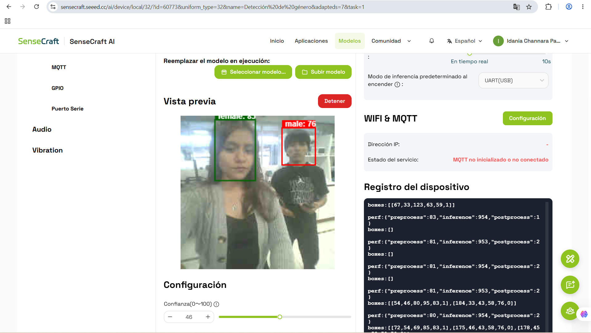
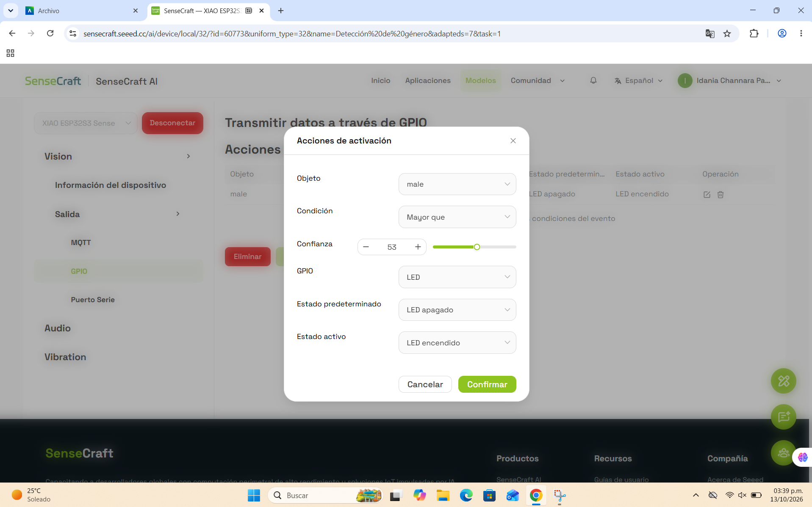
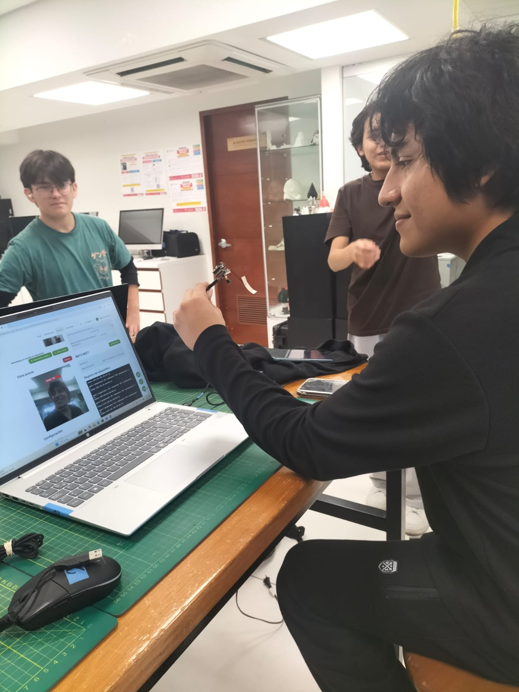
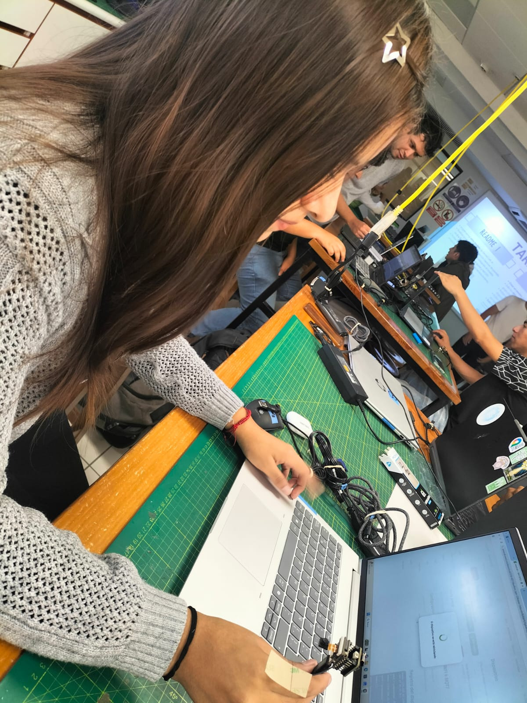
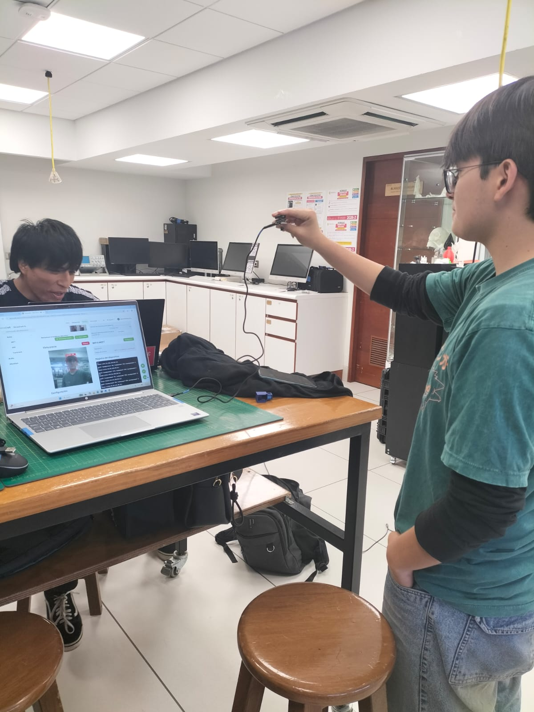
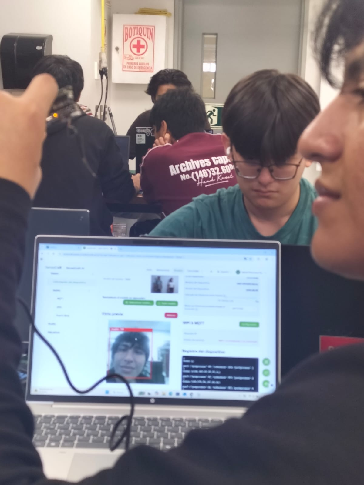
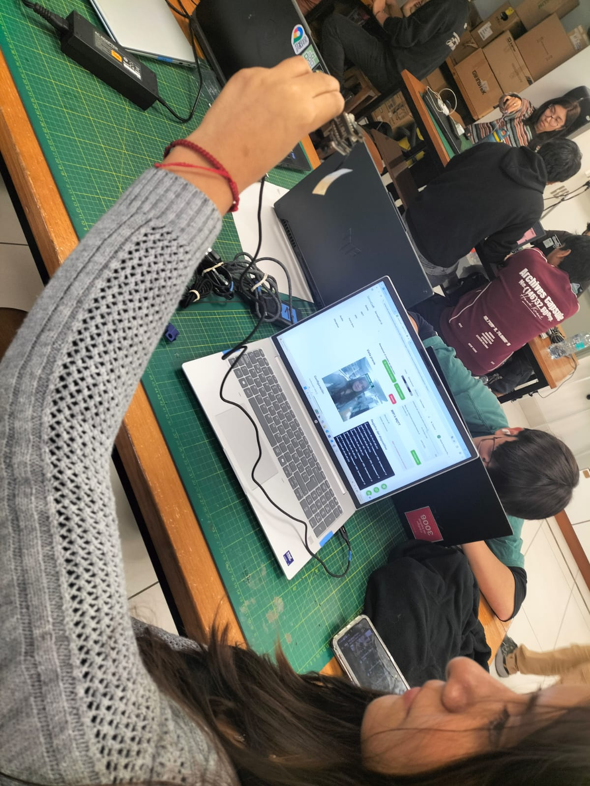
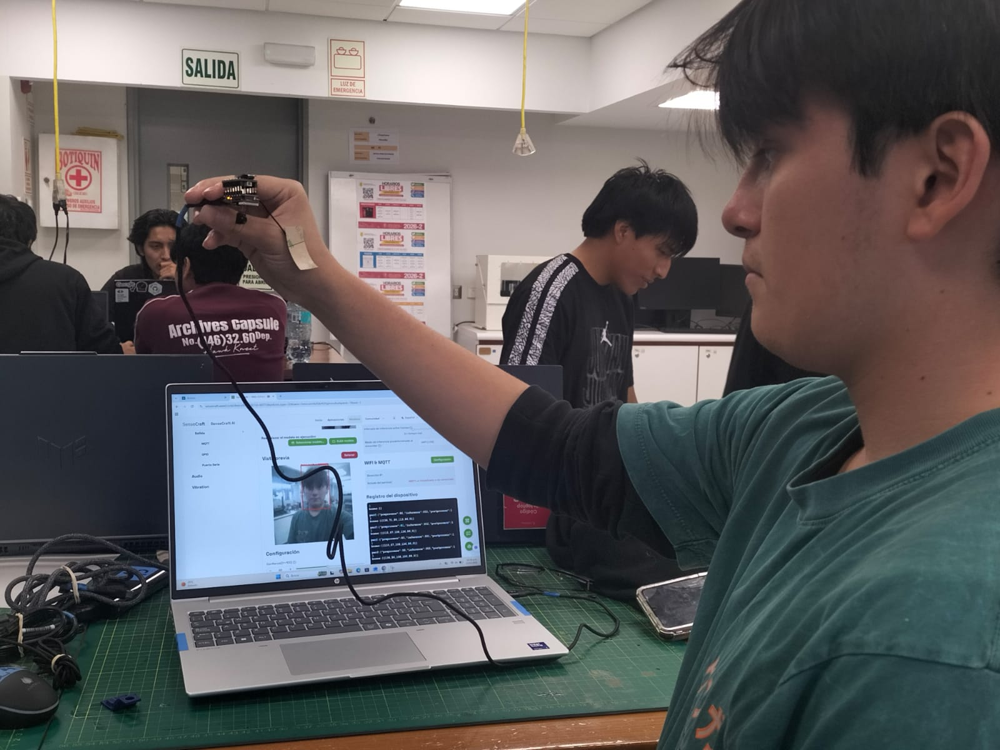

# Taller TinyML con SenseCraft AI: implementación de un modelo y prueba de salida GPIO

**Proyecto Integrador – Equipo 05 | Semana 09**

---

## Tabla de contenido

1. [Descripción](#1-descripción)
2. [Objetivos](#2-objetivos)
3. [Integrantes del equipo](#3-integrantes-del-equipo)
4. [Materiales y herramientas](#4-materiales-y-herramientas)
5. [Implementación del modelo](#5-implementación-del-modelo)
6. [Pruebas del modelo](#6-pruebas-del-modelo)
7. [Prueba de salida GPIO](#7-prueba-de-salida-gpio)
8. [Resultados y conclusiones](#8-resultados-y-conclusiones)
9. [Referencias](#9-referencias)

---

## 1. Descripción

Este documento presenta la implementación de un modelo de visión por computador en la plataforma **SenseCraft AI**, las pruebas de reconocimiento realizadas por los integrantes del equipo y la configuración de una **salida GPIO** que enciende el LED integrado del dispositivo cuando el modelo detecta la clase configurada.

## 2. Objetivos

- Implementar otro modelo de SenseCraft AI.
- Realizar pruebas del modelo con capturas de pantalla de 2 a 3 integrantes del equipo.
- Probar la salida GPIO, evidenciando el ajuste y el LED encendido ante el reconocimiento correspondiente.

## 3. Integrantes del equipo

| Nombre | Rol | Participación |
|--------|-----|---------------|
| Brad Cardenas | Tester | [Describir] |
| Idania Parhuay | Tester | Implementación del modelo preestablecido de SenseCraft AI |
| Marcelo Alarcon | Tester | [Describir] |

## 4. Materiales y herramientas

| Elemento | Detalle |
|----------|---------|
| Dispositivo | Seeed Studio XIAO ESP32S3 Sense |
| Cámara | Módulo de cámara incluido en la placa de expansión Sense (conexión tipo módulo) |
| Indicador de salida | LED integrado en la placa XIAO ESP32S3 |
| Plataforma | [SenseCraft AI](https://sensecraft.seeed.cc/ai/) |
| Alimentación y datos | Cable USB-C |

---

## 5. Implementación del modelo

### 5.1. Modelo seleccionado

| Característica | Detalle |
|----------------|---------|
| Nombre del modelo | Swift-YOLO |
| Categoría del modelo | Humano y Comportamiento |
| Tipo | Detección de género |
| Clases que reconoce | male / female |

### 5.2. Procedimiento

1. Ingresar a [SenseCraft AI](https://sensecraft.seeed.cc/ai/) e iniciar sesión.
2. Conectar el dispositivo al computador mediante USB.
3. Ir a la sección **Pretrained Models** y seleccionar el modelo **Detección de género**.
4. Hacer clic en **Deploy Model** y elegir el dispositivo conectado.
5. Esperar a que finalice la carga del modelo en el dispositivo.
6. Verificar en la vista previa (*Preview*) que la cámara muestra las detecciones.

### 5.3. Evidencia de la implementación

**Figura 1.** Evidencia de Idania Parhuay: implementación del modelo en SenseCraft AI. En esta imagen, Idania se encargó de implementar el modelo preestablecido de SenseCraft AI en el dispositivo.

**Figura 2.** Evidencia de Idania Parguay: [descripción de lo que muestra la imagen]. En esta imagen, Idania se encargó de implementar el modelo preestablecido de SenseCraft AI en el dispositivo.

---

## 6. Pruebas del modelo

Se realizaron pruebas de reconocimiento con tres integrantes del equipo para verificar el funcionamiento del modelo.

### 6.1. Prueba con Brad Cardenas

**Figura 3.** Evidencia de Brad Cardenas: [descripción]. En esta imagen, Brad se encargó de [actividad realizada].

### 6.2. Prueba con Idania Parhuay

**Figura 4.** Evidencia de Idania Parguay: [descripción]. En esta imagen, Idania se encargó de [actividad realizada].

### 6.3. Prueba con Marcelo Alarcon

**Figura 5.** Evidencia de Marcelo Alarcon: [descripción]. En esta imagen, Marcelo se encargó de [actividad realizada].

---

## 7. Prueba de salida GPIO

### 7.1. Hardware utilizado

La placa XIAO ESP32S3 Sense incluye un LED integrado, por lo que no fue necesario realizar conexiones externas (LED, resistencia, protoboard ni cables jumper). La salida GPIO configurada en SenseCraft AI controla directamente este LED.

| Componente | Pin del dispositivo |
|------------|---------------------|
| LED integrado de la placa | [GPIO / Pin utilizado] |

### 7.2. Configuración de la salida GPIO

**Figura 6.** Evidencia de [integrante]: configuración de la salida GPIO. En esta imagen, [integrante] se encargó de [actividad realizada].

### 7.3. Resultado: LED encendido al reconocer la clase

Cuando el modelo reconoce **[clase]**, la salida GPIO se activa y el LED se enciende.

**Figura 7.** Evidencia de Brad Cardenas: LED encendido ante el reconocimiento de [clase]. En esta imagen, Brad se encargó de [actividad realizada].

**Figura 8.** Evidencia de Idania Parguay: LED encendido ante el reconocimiento de [clase]. En esta imagen, Idania se encargó de [actividad realizada].

**Figura 9.** Evidencia de Marcelo Alarcon: LED encendido ante el reconocimiento de [clase]. En esta imagen, Marcelo se encargó de [actividad realizada].

---

## 8. Resultados y conclusiones

- El modelo de detección de género fue implementado correctamente en el dispositivo.
- Se verificó su funcionamiento con **[3]** integrantes del equipo, con niveles de confianza entre **[85 %]** y **[92 %]**.
- La salida GPIO se configuró correctamente y el LED se enciende únicamente cuando se reconoce la clase male.
- **Dificultades encontradas:** [Ej.: condiciones de iluminación, umbral de confianza, conexión del dispositivo].
- **Posibles mejoras:** [Ej.: entrenar un modelo propio, controlar otros actuadores, ajustar el umbral de confianza].

## 9. Referencias

- Seeed Studio. *SenseCraft AI*. https://sensecraft.seeed.cc/ai/
- Seeed Studio. *Seeed Studio Wiki*. https://wiki.seeedstudio.com/
