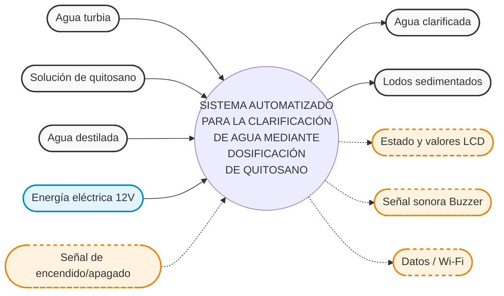
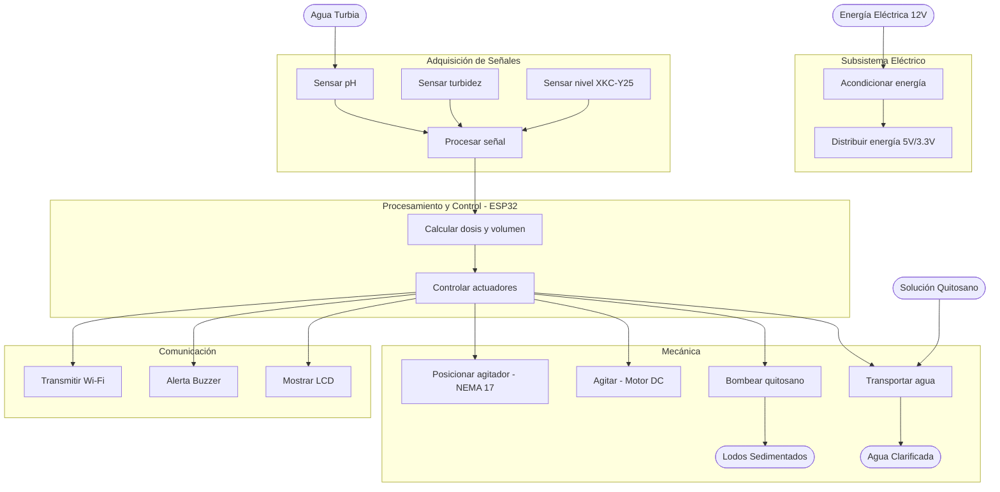

# CLARIFICACIÓN DE AGUA CON QUITOSANO

### Formulación conceptual de la propuesta tecnológica · TRL 2

Proyecto Integrador 2026-II | Universidad Peruana Cayetano Heredia | Equipo 05

27 de octubre de 2026

---

## Ficha del proyecto

| Campo | Información |
|:---|:---|
| **Curso** | Proyecto Integrador 2026-II |
| **Institución** | Universidad Peruana Cayetano Heredia |
| **Tema** | TRL 2 · Sistema automatizado de clarificación de agua mediante dosificación de solución de quitosano en ácido acético al 1 % |
| **Agua de referencia** | Río Lurín (Pachacámac) |
| **Fecha** | 03/11/2026 |

**Integrantes:**

- Marcelo Alarcón Camones
- Brad Cárdenas Parián
- Leonel Urbano Castillo
- Idania Parhuay Meza
- Gael Milla Fasabi

**Ingenieros:** Umbert Lewis De La Cruz, Maria Rejas, Harry Rivera y Renzo Chan

---

## Presentación

En el TRL 1 reunimos los principios científicos que sustentan el sistema: la coagulación-floculación con quitosano, la medición de pH, turbidez y nivel, y la dosificación peristáltica. En este TRL 2 damos el paso siguiente: formulamos el concepto tecnológico, es decir, cómo se combinarían esos principios en una aplicación práctica concreta.

Según la metodología de CONCYTEC, el TRL 2 corresponde a la formulación conceptual de la propuesta tecnológica. Es un nivel de investigación aplicada en el que se exploran aplicaciones prácticas que aún son especulativas, sustentadas en un estado del arte acotado al concepto de aplicación tecnológica; la propiedad intelectual empieza a ganar importancia y el trabajo se desarrolla en laboratorio [7]. Sus indicadores de resultados son (1) artículos científicos que respalden o tengan relación directa con la propuesta, (2) un análisis de patentabilidad y protección, y (3) un perfil o propuesta de proyecto. Este documento se organiza siguiendo esos tres indicadores, precedidos por la formulación del concepto.

El alcance se mantiene acotado: se estudia una etapa de clarificación, no la producción de agua potable. El equipo aún no presenta mediciones ni resultados propios del prototipo; las cifras de la literatura se usan como antecedentes y no como desempeño esperado.

**Pregunta guía:** ¿cómo usar tecnología y experimentación para adaptar la clarificación del agua del río Lurín (Pachacámac) a las características de cada muestra? [8]

---

## Formulación del concepto tecnológico

### Caja negra del sistema

La caja negra delimita el sistema sin comprometerse aún con su implementación: describe qué entra, qué sale y qué perturbaciones actúan sobre él [1]. La Figura 1 resume este límite para el sistema de clarificación.

*Figura 1. Caja negra del sistema de clarificación con quitosano: entradas, salidas y perturbaciones.*

### Esquema de funciones

El esquema de funciones descompone el sistema en las principales funciones que permiten realizar el proceso de forma automatizada. Incluye la adquisición de las señales de pH y turbidez, el procesamiento de los datos, el cálculo del volumen de quitosano, el control de la bomba peristáltica y el agitador, además de la visualización y transmisión de los resultados [1], [2]. La Tabla 1 las relaciona con el bloque de hardware que las realiza.

*Figura 2. Esquema de funciones del sistema, mostrando los flujos de materia, energía y señales.*

**Tabla 1. Subfunciones del sistema y bloque de hardware asociado.**

| N.º | Subfunción | Bloque de hardware |
|:---|:---|:---|
| F1 | Transportar agua cruda al reactor | Bomba de alimentación (MOSFET IRLZ44N, GPIO18) |
| F2 | Detectar el nivel de llenado | Sensor XKC-Y25 (GPIO32) |
| F3 | Medir pH | Módulo PH4502C (GPIO34, divisor 15/20 kΩ) |
| F4 | Medir turbidez inicial y final | Módulo de turbidez (GPIO35, divisor 15/20 kΩ) |
| F5 | Calcular la dosis | ESP32 (tabla experimental pH–turbidez–dosis) |
| F6 | Dosificar la solución de quitosano | Bomba peristáltica (MOSFET, GPIO19) |
| F7 | Agitar/mezclar | Motor DC con paleta (PWM, GPIO33) |
| F8 | Posicionar verticalmente el agitador | NEMA 17 + husillo T8 + TMC2209 (GPIO25/26/27) |
| F9 | Permitir la sedimentación | Reactor de 1 L (función pasiva, por tiempo) |
| F10 | Registrar y mostrar datos | LCD 16×2 I2C (GPIO21/22), buzzer (GPIO23), Wi-Fi |
| F11 | Alimentar y acondicionar señales | LM2596 (12→5 V), divisores 15/20 kΩ, 3,3 V |

### Matriz morfológica

La matriz morfológica cruza cada subfunción con principios de solución alternativos y permite identificar combinaciones viables [3]. La Tabla 2 muestra las 19 funciones del sistema y sus alternativas; la columna de la **Solución 1** corresponde a la combinación adoptada para nuestra **Solución Azul**.

**Tabla 2. Matriz morfológica (Solución 1 = adoptada).**

| N.º | Subsistema / Función | Solución 1 (Adoptada) | Solución 2 (Alternativa) | Solución 3 (Alternativa) |
|:---|:---|:---|:---|:---|
| 1 | Fuente de energía del dispositivo | **Batería de litio 3.7V/5V 5000mAh** | Conexión directa | - |
| 2 | Encendido del equipo (Panel de control) | **Interruptor deslizante** | Interruptor basculante (rocker) | - |
| 3 | Acondicionar energía eléctrica de entrada | **Fuente conmutada (switching)** | Convertidor DC-DC tipo buck | - |
| 4 | Acondicionar energía para sensores | **Regulador LDO 5V** | Módulo step-down regulado | - |
| 5 | Acondicionar energía para módulo de comunicación | **Regulador 5V dedicado** | Convertidor DC-DC aislado | - |
| 6 | Controlar el sistema | **Microcontrolador ESP32 (Wi-Fi + BT)** | - | - |
| 7 | Sensar turbidez del agua | **Sensor de Turbidez 0-1000 NTU (TS-300B)** | Sensor nefelométrico de turbidez | - |
| 8 | Sensar pH del agua | **Sensor de pH con electrodo de vidrio (PH4502C)** | Sensor de pH de estado sólido (ISFET) | Sensor de pH con sonda |
| 9 | Sensar nivel de agua | **Sensor capacitivo sin contacto XKC-Y25** | Control eléctrico de nivel (Boya) | Sensor de Nivel Vertical |
| 10 | Transportar agua turbia al reactor | **Bomba alimentación agua sucia 12V** | - | - |
| 11 | Dosificar solución de quitosano | **Bomba peristáltica** | Bomba dosificadora electromagnética | Bomba de jeringa automatizada |
| 12 | Posicionar agitador | **1 Motor NEMA 17 + Husillo T8** | Actuador lineal 12V DC | Servomotor lineal |
| 13 | Controlar velocidad y tiempo del agitador | **Motor DC (CC) + PWM** | Relé + temporizador | Driver de motor con encoder |
| 14 | Sujetar el dispositivo | **Soporte estructural (Base y Pórtico)** | Brazo articulado | Brazo telescópico |
| 15 | Emitir señal sonora | **Buzzer** | Zumbador | Altavoz pequeño |
| 16 | Mostrar datos al usuario | **Pantalla LCD 16x2** | Pantalla OLED | Pantalla TFT a color |
| 17 | Transmitir datos por red inalámbrica | **Wi-Fi integrado en ESP32** | Módulo Bluetooth | Subsistema Wi-Fi/BT externo |
| 18 | Carcasa del dispositivo portátil | **PLA (Impresión 3D)** | ABS | PETG |
| 19 | Envase de la mezcla calibrada | **Plástico HDPE o PP** | - | Envases con sello hermético |

Esta matriz resuelve las incoherencias detectadas en versiones previas: el **agitador es un motor DC** (F13), el **NEMA 17 con husillo T8** cumple solo el posicionamiento vertical (F12) y el **XKC-Y25** se reincorpora para el nivel (F9).

### Bocetos de las alternativas

Se elaboraron tres bocetos conceptuales; cada uno combina principios de la matriz morfológica.

**Boceto 1 — Solución Azul (elegida).** Reactor de 1 L con tapa que porta sensores y agitador; motor DC con paleta; conjunto del agitador que sube y baja con NEMA 17 + husillo T8; dos bombas (alimentación y dosificación peristáltica); caja de control con LCD; base modular impresa en PLA de 620 × 400 mm. *Ventajas:* modular, repetible, sensores y agitador integrados en la tapa, dosificación fina. *Desventajas:* más piezas impresas y más actuadores.

**Boceto 2 — Alternativa compacta.** Reactor con agitación magnética y dosificación por gravedad; sin posicionamiento vertical. *Ventajas:* simple y barata. *Desventajas:* no permite retirar el agitador ni controlar la inmersión; dosificación menos precisa.

**Boceto 3 — Alternativa de laboratorio.** Reactor con electrodo de pH de laboratorio y nefelómetro comercial, dosificación manual con jeringa. *Ventajas:* alta exactitud de medida. *Desventajas:* no automatiza, mayor costo, no cumple el objetivo de sistema automatizado.

*Figura 3. Bocetos de las tres alternativas conceptuales (Solución Azul, compacta y de laboratorio).*

### Selección del concepto (matriz de decisión)

Los tres bocetos se evaluaron con criterios ponderados (Tabla 3). La Solución Azul obtuvo 4,35/5 y fue la seleccionada.

**Tabla 3. Matriz de decisión (escala 1–5; ponderación entre paréntesis).**

| Criterio | Boceto 1 (Azul) | Boceto 2 | Boceto 3 |
|:---|:---:|:---:|:---:|
| Precisión de dosificación (25 %) | 5 | 3 | 4 |
| Automatización (20 %) | 5 | 3 | 1 |
| Facilidad de fabricación (15 %) | 4 | 5 | 2 |
| Modularidad/mantenimiento (15 %) | 4 | 2 | 3 |
| Costo (15 %) | 3 | 5 | 2 |
| Seguridad y limpieza (10 %) | 4 | 3 | 3 |
| **Puntaje ponderado** | **4,35** | **3,45** | **2,55** |

### Concepto

El sistema recibe una muestra de agua turbia en un reactor de 1 L. Un ESP32 lee pH, turbidez y nivel; consulta una relación experimental pH–turbidez–dosis; activa una bomba peristáltica que entrega la solución de quitosano; agita; deja sedimentar; mide de nuevo la turbidez y registra el resultado en pantalla LCD, con aviso sonoro y datos por Wi-Fi. La solución de trabajo es quitosano disuelto en ácido acético al 1 %, una preparación habitual en la literatura de coagulación [9], [10], [11]. El concepto corresponde a la **Solución Azul (Concepto B)**, que obtuvo el mayor puntaje ponderado (4,35 de 5) en la matriz de decisión del equipo [8]. La Solución Azul surge de la matriz morfológica (Tabla 2) y de la matriz de decisión (Tabla 3).

### Secuencia de operación

1. **Llenado:** la bomba de alimentación transporta el agua al reactor y el sensor XKC-Y25 confirma el nivel.
2. **Medición inicial:** se registran pH y turbidez.
3. **Cálculo de dosis:** el ESP32 consulta la tabla experimental (no se asume una fórmula universal).
4. **Dosificación y agitación:** la bomba peristáltica entrega el volumen definido; el motor DC con paleta mezcla, y el conjunto del agitador se posiciona con el NEMA 17 + husillo T8.
5. **Sedimentación y medición final:** se mide la turbidez final y se calcula la remoción, (Tᵢ − T_f) / Tᵢ × 100.
6. **Reporte:** LCD, buzzer y Wi-Fi.

### Arquitectura de hardware (según el esquemático v1.3, actualizado el 03/11/2026)

| Bloque | Componentes en el esquemático | Función en el concepto |
|:---|:---|:---|
| Control | ESP32 DevKit V1 | Lectura de sensores, cálculo de dosis, secuencia y comunicación |
| Energía | Entrada de 12 V por bornera; convertidor LM2596; 5 V y 3,3 V | Alimentar bombas, motor, sensores y control |
| Sensado | Módulo pH PH4502C, módulo de turbidez y sensor de nivel XKC-Y25 | pH, turbidez y nivel |
| Acondicionamiento | Divisores 15 kΩ / 20 kΩ en las señales de 5 V | Reducir 5 V a unos 2,86 V, dentro del rango de 3,3 V del ADC |
| Bombas | Dos canales con MOSFET IRLZ44N, diodo de protección y resistencias de 100 Ω y 10 kΩ | Transporte de agua y dosificación de quitosano |
| Agitación | Motor DC con paleta, canal PWM | Mezcla del agua con el quitosano |
| Posicionamiento | Motor NEMA 17 con driver TMC2209 (STEP, DIR, EN) y husillo T8 | Subir y bajar el conjunto de agitación |
| Interfaz | LCD 16×2 I2C y buzzer | Estado, valores y avisos |

**Asignación de pines en la v1.3:** pH en GPIO34 y turbidez en GPIO35, ambos con divisor 15 kΩ / 20 kΩ; XKC-Y25 en GPIO32; LCD I2C en GPIO21 y GPIO22; buzzer en GPIO23; MOSFET de la bomba 1 en GPIO18 y de la bomba 2 en GPIO19; motor DC del agitador (PWM) en GPIO33; driver TMC2209 con STEP, DIR y EN en GPIO25, GPIO26 y GPIO27. Ningún pin se repite entre funciones.

### Esquemático electrónico v1.3

*Figura 4. Esquemático «Esquemático_ChitoSan», versión 1.3, hoja A4 única. Creado el 20/10/2026 y actualizado el 03/11/2026; dibujado por el Equipo 5 y revisado por Umbert Lewis.*

**Descripción.** El esquemático está dividido en ocho bloques:

- **Módulo de alimentación:** una bornera de 2 pines recibe +12 V, y un convertidor LM2596 lo reduce a +5 V.
- **Control principal:** un ESP32 DevKit V1 concentra los pines GPIO usados por los demás bloques y alimenta la lógica con 5 V y 3,3 V.
- **Módulo de sensores:** el módulo de pH PH4502C, el módulo de turbidez y el sensor de nivel XKC-Y25 entregan señales que pasan por divisores de 15 kΩ / 20 kΩ hacia GPIO34 (pH), GPIO35 (turbidez) y GPIO32 (nivel).
- **Interfaz de usuario:** una pantalla LCD 1602 con adaptador I2C (GPIO21 y GPIO22) y un buzzer (GPIO23).
- **Control de motor NEMA 17:** un driver TMC2209 con las señales STEP, DIR y EN (GPIO25, GPIO26 y GPIO27), alimentado con 12 V en el motor y 3,3 V en la lógica.
- **Control del motor DC del agitador:** canal PWM en GPIO33 con MOSFET y diodo de protección.
- **Bombas y actuador:** dos canales idénticos con una bomba de 12 V, un MOSFET IRLZ44N, un diodo de protección y resistencias de 100 Ω y 10 kΩ, comandados desde GPIO18 y GPIO19.
- **Soportes:** cuatro agujeros de montaje M3.

**Aporte al proyecto.** Es la evidencia de que la arquitectura de control del concepto es realizable con componentes comerciales: cubre las señales de entrada exigidas (pH, turbidez y nivel antes y después del tratamiento), el cálculo y la secuencia en el ESP32, el accionamiento de las dos bombas (agua y quitosano), la agitación con motor DC, el posicionamiento del agitador con el NEMA 17 + husillo T8 y la interfaz con LCD y buzzer. Los divisores de tensión protegen las entradas del ESP32, y la asignación de pines permite comenzar la programación y las calibraciones del TRL 3. La v1.3 corrige los dos vacíos de la v1.2: reincorpora el XKC-Y25 y añade el canal PWM del motor DC del agitador.

**Nota de estado.** En TRL 2 el esquemático se presenta como diseño propuesto; aún no ha sido fabricado ni validado.

### Diseño de la placa de circuito impreso (PCB)

*Figura 5. Diseño de la PCB del sistema ChitoSan, de 96,4 mm de ancho, con cuatro agujeros de montaje en las esquinas (versión correspondiente al esquemático v1.3).*

**Descripción.** La placa traduce el esquemático v1.3 a un diseño físico de una sola cara de componentes. Se distinguen:

- ESP32 DevKit V1: en la parte inferior central, con la antena hacia el borde para no quedar tapada por cobre.
- Alimentación: el módulo LM2596 y la bornera de entrada de 12 V, abajo a la derecha.
- Bombas: dos canales con sus MOSFET, diodos de protección, resistencias y borneras de salida, en el costado derecho.
- TMC2209: en la esquina superior derecha, con el conector del motor NEMA 17.
- Sensores: el módulo de turbidez arriba a la izquierda, con sus divisores de tensión; un conector de varios pines en la parte superior para el módulo de pH; y el conector del XKC-Y25.
- Agitador: canal PWM con MOSFET y diodo para el motor DC.
- Interfaz: el conector del LCD I2C a la izquierda y el buzzer abajo a la izquierda.

La serigrafía incluye el logo ChitoSan Equipo 5 y el escudo de la UPCH.

**Aporte al proyecto.** Pasa el control de un esquema a una placa ordenada y repetible. Esto reduce los errores de cableado de una protoboard, agrupa la electrónica en el espacio de la caja de control y facilita el mantenimiento, porque los módulos (ESP32, TMC2209, LM2596) se pueden reemplazar. También cumple las exigencias de seguridad (conexiones fijas, sin cables sueltos) y de componentes reemplazables, y deja lista la base para las calibraciones y la programación del TRL 3.

**Estado de la placa.** En TRL 2 se presenta como un diseño propuesto, aún sin fabricar ni validar. Corresponde al esquemático v1.3 y debe pasar la verificación de reglas de diseño (DRC) de EasyEDA antes de fabricarse.

### Modelo 3D en Onshape

Las figuras siguientes son capturas del ensamblaje final en Onshape. El archivo exportado (asemblyfinal_1.stl, unos 149 000 triángulos) tiene un volumen envolvente de 620 × 400 × 479 mm, con una base de 620 × 400 mm. La unidad del STL se confirma en milímetros; el valor anterior (62 × 40 "unidades") correspondía a centímetros y ya fue corregido.

**Elementos que se distinguen en el modelo:**

- Una base plana modular de 620 × 400 mm con el escudo de la UPCH y el logo «ChitoSan Team» grabados.
- Un reactor cilíndrico transparente en el centro, con tapa de borde naranja, apoyado sobre un anillo con tres patas.
- Un pórtico en U con un travesaño que aloja el motor DC del agitador, cuyo eje baja por el reactor y termina en una paleta de agitación; el conjunto sube y baja con el NEMA 17 + husillo T8.
- Sobre la tapa, los sensores (sonda de pH, módulo de turbidez y XKC-Y25) y los orificios de paso.
- Dos recipientes cilíndricos transparentes con tapa, a ambos lados del reactor.
- Una caja de control rectangular con ventana para la pantalla, en la esquina posterior izquierda.
- Tres soportes pequeños con bomba o motor sobre la base y un recipiente cilíndrico bajo en el frente.
- Un motor NEMA 17 montado sobre el pórtico, acoplado al husillo T8 que posiciona verticalmente el conjunto del agitador.

#### Vista isométrica

*Figura 6. Vista isométrica del ensamblaje final ChitoSan (Solución Azul) en Onshape, modelado por el Equipo 5 (diseño y modelado: B. Cárdenas) y exportado como asemblyfinal_1.stl. Dimensiones envolventes: 620 × 400 × 479 mm, con una base de 620 × 400 mm. Elementos visibles: base modular con el escudo de la UPCH y el logo del equipo; reactor transparente de 1 L con tapa; pórtico en U; motor DC del agitador con eje y paleta; NEMA 17 + husillo T8 para el posicionamiento vertical; sensores sobre la tapa; dos recipientes cilíndricos laterales; caja de control con ventana de pantalla; soportes de bomba. Material previsto: PLA, con componentes comerciales.*

**Descripción.** Muestra la disposición general: el reactor transparente en el centro, rodeado por el pórtico en U; a cada lado, un recipiente cilíndrico; la caja de control al fondo a la izquierda; y los soportes de bomba y el recipiente bajo sobre la base. Se ven la paleta del agitador dentro del reactor, la tapa con sensores y el NEMA 17 acoplado al husillo T8 sobre el pórtico.

**Aporte al proyecto.** Es la referencia visual de la Solución Azul. Confirma que la estructura es compacta y modular, que el agitador y los sensores se instalan en la tapa del reactor y que el conjunto puede fabricarse con impresión 3D (PLA) y componentes comerciales. También sirve para explicar a un evaluador cómo se relacionan tratamiento, dosificación, agitación y electrónica.

#### Vista en planta

*Figura 7. Vista en planta (superior) del ensamblaje final en Onshape. La base mide 620 × 400 mm. Distribución: caja de control en la esquina posterior izquierda (aprox. 170 × 110 mm); recipientes laterales de unas 150 mm de diámetro; reactor central de unas 120 mm de diámetro, cruzado por el travesaño del pórtico, con el NEMA 17 encima; soporte de bomba detrás del reactor, dos soportes en el frente y un recipiente cilíndrico bajo al centro del frente. Los elementos de marca (escudo UPCH y logo ChitoSan Team) están grabados en la base.*

**Descripción.** Se ve la base con el escudo de la UPCH y el logo del equipo; la caja de control rectangular con la ventana de la pantalla en la esquina superior izquierda; un recipiente circular a cada lado; el reactor circular al centro, cruzado por el travesaño del pórtico con el motor NEMA 17 sobre él; un soporte de bomba detrás del reactor y dos en la zona frontal; y un recipiente cilíndrico bajo en el centro del frente.

**Aporte al proyecto.** Permite verificar la ubicación y el espacio de cada módulo, el alcance del agitador sobre el reactor y la cercanía de las bombas a sus recipientes. Es la base para definir el recorrido de mangueras y cables, y respalda el requisito de una geometría compacta, modular y fácil de operar desde el frente.

#### Vista frontal

*Figura 8. Vista frontal del ensamblaje final en Onshape. Dimensiones aproximadas: ancho 620,0 y altura total 479,0 mm. Alturas relativas desde la base: recipientes laterales, unas 110 mm; tapa del reactor, unas 210; pórtico, unas 290; NEMA 17, entre 400 y 480, acoplado al husillo T8. Elementos visibles: eje y paleta del agitador dentro del reactor, sonda de pH y módulo de turbidez colgando de la tapa, anillo con patas bajo el reactor y soportes de bomba junto a los recipientes.*

**Descripción.** Se aprecian las alturas relativas y el interior del reactor: el eje del agitador baja desde el motor DC del travesaño hasta una paleta cerca del fondo; en la tapa cuelgan una sonda de pH con punta naranja y un módulo de turbidez; bajo el reactor están el anillo con patas y un bloque con componentes; a los lados quedan los recipientes con sus tapas y los soportes de bomba. El NEMA 17 está arriba, acoplado al husillo T8.

**Aporte al proyecto.** Entrega las cotas verticales críticas: la profundidad de inmersión de la sonda y de la paleta, el espacio libre para retirar la tapa con los sensores y la relación de alturas entre recipientes y reactor, relevante para el llenado, la dosificación y el vaciado. Ayuda a decidir la carrera necesaria del conjunto NEMA 17 con husillo T8.

#### Vista lateral

*Figura 9. Vista lateral del ensamblaje final en Onshape. Dimensiones aproximadas: profundidad 400,0 y altura total 479,0 mm. Elementos visibles: caja de control con frente inclinado (a la derecha de la imagen), reactor transparente con la sonda de punta naranja en su interior, pórtico visto de canto con el eje central del agitador, un soporte de bomba y un pequeño módulo a la izquierda, y el NEMA 17 acoplado al husillo en la parte superior.*

**Descripción.** Muestra el perfil del equipo: la caja de control a la derecha, con su frente inclinado; el reactor transparente en el centro con una sonda de punta naranja en su interior; el pórtico visto de canto con su eje central; y, a la izquierda, un soporte de bomba y un pequeño módulo. El NEMA 17 aparece en la parte superior, acoplado al husillo.

**Aporte al proyecto.** Confirma la profundidad total del conjunto y permite revisar interferencias entre el pórtico, el reactor y los módulos de bombeo. También ayuda a comprobar que la pantalla de la caja de control quede visible y accesible para el operador.

### Planos de fabricación (piezas a imprimir)

Las piezas imprimibles se diseñaron a partir del modelo 3D y se acotaron en milímetros, con la base fijada en 620 × 400 mm. La Tabla 4 resume las piezas, su función y las observaciones de impresión; los planos acotados se presentan en la Figura 10. Las tolerancias generales siguen la norma ISO 2768-1 (clase m) [5] y la representación se ajusta a ISO 128-1 [4]. El material previsto es PLA [6].

**Tabla 4. Piezas impresas en PLA.**

| Pieza | Dimensiones nominales (mm) | Función | Observaciones de impresión |
|:---|:---|:---|:---|
| Base modular | 620 × 400 × 8 | Soporte de todos los módulos; escudo UPCH y logo grabados | Relleno 20 %, 3 perífrasis; agujeros M3 |
| Pórtico en U | ~400 × 120 × 290 (alto) | Soporta el NEMA 17 y guía el husillo T8 | Relleno 30 %; refuerzos en uniones |
| Tapa del reactor | Ø ~120, espesor 6 | Aloja sensores (pH, turbidez) y eje del agitador | Agujeros pasantes para sondas; sellado con junta |
| Anillo con patas | Ø ~130, 3 patas de 60 | Apoya y centra el reactor de 1 L | Relleno 25 % |
| Soportes de bomba (×3) | ~60 × 40 × 50 | Fijan bombas de alimentación y peristáltica | Agujeros para mangueras |
| Caja de control | ~170 × 110 × 80 | Aloja ESP32, PCB, LCD y buzzer; frente inclinado | Ventana para LCD; tapa desmontable |
| Soporte del NEMA 17 | ~60 × 60 × 40 | Fija el motor y alinea el husillo T8 | Agujeros según norma NEMA 17 (31 mm) |

*Figura 10. Planos acotados de las piezas impresas (base, pórtico, tapa, anillo, soportes, caja de control y soporte del NEMA 17), en mm, escala 1:5.*

**Nota de coherencia.** La base se fija en 620 × 400 mm (el STL estaba en centímetros); se corrigió el texto del modelo 3D para eliminar la duda de unidad y se alineó con los planos de la presentación. Las piezas imprimibles son el pórtico, la tapa, el anillo con patas, los soportes de bomba, la caja de control y el soporte del NEMA 17; los componentes comerciales (ESP32, TMC2209, LM2596, bombas, sensores, LCD, buzzer, motor DC y NEMA 17) no llevan plano de impresión, solo su ubicación.

#### Dashboard de monitoreo y visualización del proceso (hipotético)

Como complemento del esquemático electrónico, la PCB y el modelo tridimensional, el equipo desarrolló en Figma una propuesta de dashboard para visualizar el estado del sistema ChitoSan y presentar de forma integrada las variables del tratamiento. Esta interfaz constituye una representación conceptual de la interacción entre el usuario y el prototipo: organiza los datos que el ESP32 deberá adquirir, los cálculos que deberá realizar y las etapas que deberá ejecutar. En esta etapa TRL 2, el diseño de la interfaz no demuestra que exista una conexión funcional con los sensores, las bombas o el microcontrolador.

**Vista general del dashboard**

*Figura 11. Interfaz de registro «Chitosan: Clarificación de agua con quitosano», diseñada por el Equipo 05 en Figma para el Proyecto Integrador 2026-II de la Universidad Peruana Cayetano Heredia. La captura corresponde al flujo de seis pantallas (ingreso, inicio, mediciones iniciales, cálculo de la dosis, estado del proceso y resultados), identificado como TRL 2 (Formulación Conceptual), y presenta un reactor de referencia de 1 L con el Índice de Efectividad como indicador principal.*

**Descripción del diseño en Figma**

El archivo contiene el prototipo de la interfaz de registro del Sistema Automatizado de Clarificación de Agua con Quitosano. Es un flujo de seis pantallas, con el logotipo del equipo en el encabezado y flechas que indican el recorrido:

1. **Ingreso:** panel de marca con ilustración y formulario de usuario, código del equipo y contraseña.
2. **Inicio:** panel de control sin scroll, con el estado del proceso, el resumen del último ensayo y el Índice de Efectividad. Desde aquí se inicia un nuevo ensayo.
3. **Mediciones Iniciales:** registro del pH y la turbidez antes de dosificar.
4. **Cantidad a Dosificar:** dosis objetivo, concentración de la solución madre, volumen a bombear, tiempo de bombeo y ácido acético agregado, con la fórmula visible.
5. **Estado del Proceso:** seguimiento de las etapas Dosificando, Agitando y Sedimentando, con su estado.
6. **Resultados:** mediciones finales y el Índice de Efectividad, con dos anillos: mejora del pH y remoción de turbidez.

Los campos muestran «—» porque todavía no hay datos. Los colores azul y marino provienen del logotipo, y todas las capas son editables.

**Aporte al Proyecto**

- **Interfaz para el operador:** convierte el procedimiento del TRL 2 en pasos guiados, desde la medición inicial hasta el resultado final. Así se reduce el riesgo de omitir una etapa.
- **Registro de datos por ensayo:** cada corrida guarda pH, turbidez, dosis y resultados en un mismo formato. Esto respalda las hipótesis H1 y H2 del TRL 2, porque cada resultado puede alimentar la tabla de dosificación.
- **Indicadores de éxito:** la pantalla de resultados calcula la remoción de turbidez, que es el indicador principal del TRL 2 para comparar con la prueba de jarras. Además, incluye la mejora del pH, que responde al objetivo de llevar el agua a un valor cercano a la neutralidad.
- **Base para el TRL 3:** el flujo coincide con la secuencia de operación del prototipo (llenado, dosificación, agitación, sedimentación y evaluación), así que sirve como especificación para programar la interfaz.
- **Trazabilidad:** el ensayo queda identificado por usuario y equipo, lo que facilita la revisión posterior de los datos.

Conviene aclarar que es un diseño visual. La funcionalidad real depende del firmware y de la calibración de sensores y bomba, que todavía no están hechos.

**Acceso a los archivos de diseño.**

- Archivo editable en Figma: https://www.figma.com/design/gBkksjELsAf9rPYOBMQ7ot/Chitosan---Registro-de-dosificaci%C3%B3n-y-clarificaci%C3%B3n?node-id=0-1&t=Vt8dFOgyxpEyDcj8-1
- Prototipo navegable en Figma: https://www.figma.com/proto/gBkksjELsAf9rPYOBMQ7ot/Chitosan---Registro-de-dosificaci%C3%B3n-y-clarificaci%C3%B3n?node-id=3-2&t=7k83NdpV6whos929-1&scaling=scale-down&content-scaling=fixed&page-id=0%3A1

### Hipótesis de trabajo (por comprobar en TRL 3)

- **H1.** Con pH y turbidez inicial medidos se puede asignar una dosis a partir de una tabla experimental propia, con una remoción de turbidez comparable a la de una prueba de jarras manual.
- **H2.** La medición de turbidez final permite verificar cada ensayo y alimentar la tabla de dosis con datos de cada corrida.
- **H3.** El volumen entregado por la bomba peristáltica puede verificarse y calibrarse con un método de referencia (por ejemplo, pesada), sin asumirlo a partir de la velocidad del motor.

### Dos desafíos de diseño detectados al formular el concepto

**Resolución de la dosis.** Una solución al 1 % (p/v) contiene 10 g/L, es decir, 10 000 mg/L de quitosano. En un reactor de 1 L, 1 mg/L equivale a 0,1 mL de solución, y las dosis reportadas en la literatura van desde 0,5 mg/L hasta 190 mg/L [9], [11], [12], [13]. Eso exige entregar entre 0,05 mL y 19 mL con exactitud. Probablemente convenga trabajar con una dilución intermedia y calibrar la bomba en ese rango.

**Sobredosis.** Hesami y colaboradores observaron reestabilización de la turbidez cuando se superó la concentración óptima de quitosano [11]. El control debe limitar la dosis máxima y la tabla experimental debe incluir ese comportamiento.

---

## Artículos científicos que respaldan la propuesta

A diferencia del TRL 1, que reunió principios, aquí se buscan trabajos con relación directa con la aplicación: quitosano en ácido acético sobre agua de río, dosificación automática de coagulantes con sensores y microcontrolador.

### Quitosano en ácido acético aplicado a aguas superficiales

Hesami, Bina y Ebrahimi estudiaron el quitosano como coagulante auxiliar en agua del río Zayandeh Rood, entre pH 4 y 9 y con turbidez inicial entre 20 y 200 mg/L. Prepararon el quitosano en ácido acético al 1 %, hallaron una concentración óptima de 0,5 mg/L junto con cloruro férrico y observaron reestabilización a concentraciones mayores [11]. Aporta a nuestro concepto la preparación de la solución y el riesgo de sobredosis.

Irawati, Hikmah y Junaidi compararon quitosano disuelto en ácido acético y en ácido clorhídrico para reducir la turbidez de agua eutrófica. Ambos tuvieron su óptimo a 10 mg/L; el disuelto en ácido acético alcanzó 64,78 % de reducción a pH 7, frente a 85,33 % del disuelto en clorhídrico a pH 8, y la concentración del ácido influyó en el resultado [12]. Aporta una advertencia: el solvente cambia el desempeño, de modo que nuestras pruebas deben fijar y registrar la preparación.

Iqbal y colaboradores disolvieron 1 g de quitosano de concha en 100 mL de ácido acético al 1 % y lo probaron con agua de río de 49,5 NTU; reportaron un óptimo de 1 ppm, 99 % de remoción y pH óptimo de 6,32 [13]. Un trabajo de la Universidad Nacional de Costa Rica con agua del río Pirro (15,5 NTU) halló 76,6 % de remoción con 1,0 mg/L a pH 7,09, y señaló que el pH y la turbidez inicial modifican la remoción en agua sintética [14]. Otro estudio, con agua del Río Grande de Añasco (Puerto Rico) a 403, 1220 y 5038 NTU, evaluó quitosano en soluciones ácidas y reportó remociones de carbono orgánico total de 39,8 % a 74,3 % [15]. En el contexto de Sinardi [9] y De-Paz-Arroyo [10], ya considerados en el TRL 1, estos resultados confirman que el desempeño depende del pH, de la turbidez, del solvente y del tipo de agua. Es la razón de ser de medir antes de dosificar. Ninguna de estas cifras se adopta como desempeño esperado del prototipo.

### Dosificación automática con sensores y microcontrolador

Amri y colaboradores (2026) construyeron un sistema de dosificación de policloruro de aluminio con sensor de turbidez, bomba y NodeMCU-ESP32, con envío de datos a la nube, y lo probaron con agua de río, de arrozal y subterránea de 29, 35 y 64 NTU [17]. Es el antecedente más cercano en arquitectura (ESP32, turbidez, bomba, IoT), aunque usa otro coagulante. Viana y colaboradores desarrollaron un turbidímetro de bajo costo basado en procesamiento de imágenes para que un controlador lógico programable dosifique coagulante y lo evaluaron en una planta piloto [16]. Bachri y colaboradores, ya citados en el TRL 1, revisaron 25 estudios y encontraron que la dosis, la turbidez y el pH están entre las variables más usadas, casi siempre a escala de laboratorio o piloto [19]. En el Perú, Guerrero Escobedo usó un sensor económico con Arduino calibrado contra un turbidímetro Hach para estudiar mezclas de coagulantes con agua del canal madre de Chavimochic [18].

Sobre la mecánica de dosificación, Klespitz y Kovács mantienen vigente la advertencia sobre calibración y desgaste del tubo [20], y Zhu y colaboradores insisten en la calibración individual de los sensores de bajo costo [21].

### Relación entre el concepto y la evidencia

| Elemento del concepto | Respaldo | Lo que aún no está respaldado |
|:---|:---|:---|
| Quitosano en ácido acético al 1 % | [11], [12], [13], [15] | Desempeño con agua del río Lurín |
| Dosis dependiente de pH y turbidez | [9], [10], [14] | La tabla propia del equipo |
| Límite de dosis por reestabilización | [11] | El valor límite para nuestro quitosano |
| Dosificación automática con ESP32 y turbidez | [16], [17], [19] | Su uso específico con quitosano |
| Calibración de sensores y bomba | [20], [21] | Curvas propias del TS-300B y de la bomba |

---

## Análisis de patentabilidad y protección

Este es un análisis preliminar de estudiantes. No reemplaza una búsqueda profesional de anterioridades ni la opinión de un abogado o agente de propiedad industrial.

### Marco legal en el Perú

En el Perú las invenciones se protegen ante INDECOPI bajo dos figuras (Decisión 486 de la Comunidad Andina). La patente de invención protege productos o procedimientos durante 20 años y exige novedad, nivel inventivo y aplicación industrial. El modelo de utilidad protege productos, es decir, mejoras de forma o disposición con ventaja técnica sobre algo existente, durante 10 años, y exige un nivel inventivo menor. Ambas vigencias se cuentan desde la presentación [22]. La novedad se pierde si la invención fue divulgada antes de presentar la solicitud, con un período de gracia de un año desde la divulgación [22]. Los diseños industriales se registran hasta por 10 años [23].

### Antecedentes tecnológicos encontrados

| Documento | Qué describe | Relación con el proyecto |
|:---|:---|:---|
| US 4,855,061 [24] | Control de la dosis de coagulante con un sensor de carga y un turbidímetro, mediante un controlador programable | Control automático de dosis con turbidez |
| US 5,160,439 [25] | Control de coagulante con varios parámetros (carga, turbidez, pH, caudal), con relación desarrollada para cada sitio | Dosis a partir de pH y turbidez con relación empírica propia del sitio |
| US 6,241,896 [26] | Determinación automática de la dosis de coagulante con color y turbidez, con microprocesador y bomba | Cálculo automático de dosis con microcontrolador |
| US 11,505,478 B2 [27] | Dosificación automática de coagulante y ajuste de pH según potencial zeta, con tabla de consulta y aprendizaje automático | Tabla de consulta pH–dosis; patente aparentemente vigente |
| US 5,543,056 [28] | Tratamiento de agua potable con polímeros catiónicos naturales, entre ellos quitosano en ácido acético | Uso del quitosano preparado en medio ácido |
| Controlador CoagSense (Process Instruments) [29] | Producto comercial que combina pH, turbidez y otros sensores para controlar una bomba de coagulante | Producto equivalente en agua potable a gran escala |
| Amri et al., 2026 [17] | Dosificación con ESP32 y turbidez para PAC | Arquitectura similar en la literatura |

Las patentes de los años ochenta y noventa probablemente ya expiraron, pero su estado legal debe verificarse. Además, una patente estadounidense solo produce derechos en Estados Unidos; para el Perú importa si existe una solicitud o patente equivalente.

### Evaluación preliminar

**Elementos conocidos.** Cada pieza es conocida: sensores de pH, turbidez y nivel, bomba peristáltica, ESP32, quitosano y dosificación automática según pH y turbidez. La idea general de dosificar un coagulante según parámetros medidos ya está en el estado de la técnica [24]–[27], [17].

**Posibles diferenciadores, aún por demostrar.**

- Combinación de quitosano en ácido acético, tabla experimental pH–turbidez–dosis y medición de turbidez final en un ciclo por lotes de 1 L.
- Disposición mecánica del reactor: tapa con sensores y agitador cuyo conjunto sube y baja con NEMA 17 y husillo T8, en una estructura modular de impresión 3D.
- La base de datos de dosificación para el agua del río Lurín, que será un resultado experimental propio.

**Conclusión provisional.** Una patente de invención parece difícil de sostener en esta etapa, porque la combinación de elementos podría considerarse evidente frente a los antecedentes. El modelo de utilidad es más plausible para la disposición mecánica del reactor, siempre que una búsqueda posterior confirme su novedad y se demuestre una ventaja técnica. Con los datos actuales no podemos afirmar que el concepto sea patentable.

### Otras formas de protección

| Figura | Qué protegería | Comentario |
|:---|:---|:---|
| Derecho de autor | Código del ESP32, esquemático y planos | Surge con la creación; el registro en INDECOPI facilita probar la autoría |
| Secreto empresarial | Tabla de dosificación | Solo si se mantiene confidencial; publicar los datos elimina esta vía |
| Diseño industrial | Apariencia de la carcasa | Aplicable solo si el diseño se vuelve distintivo |
| Licencia abierta | El repositorio del equipo | Alternativa si se prefiere difundir; debe elegirse con conciencia de que impide patentar lo ya divulgado |

### Alertas y acciones recomendadas

1. **Divulgación previa.** La presentación de avance cita el repositorio de GitHub del equipo y el enlace público de Onshape. Si son públicos, ya hubo divulgación y el período de gracia de un año (si aplica) habría empezado. Conviene verificar su visibilidad y decidir antes de publicar más.
2. **Política institucional.** Consultar la política de propiedad intelectual de la UPCH y los derechos de los docentes y estudiantes sobre los resultados del proyecto.
3. **Búsqueda formal.** Repetir la búsqueda en Google Patents, Espacenet y la base de INDECOPI con clasificaciones relacionadas con tratamiento de agua por coagulación y floculación, control de parámetros del tratamiento y medición de turbidez; incluir las palabras «chitosan», «dosing», «turbidity» y «jar».
4. **Registro de laboratorio.** Llevar un cuaderno fechado con diseños, versiones y ensayos, que sirva de prueba de creación.
5. **Licencias de terceros.** Registrar las licencias de las bibliotecas del ESP32 y de los módulos usados.

---

## Perfil o propuesta de proyecto

### Título

Sistema automatizado para la clarificación de agua del río Lurín (Pachacámac) mediante dosificación con quitosano.

### Problema y justificación

La calidad del río Lurín varía según el tramo y la época del año, y su tramo bajo supera los estándares de calidad ambiental microbiológicos [8]. Una dosis fija de coagulante podría no ser adecuada para todas las muestras, y los valores de turbidez disponibles corresponden a puntos y momentos concretos. Por eso el proyecto mide cada muestra y adapta la dosis. Se alinea con el ODS 6 (meta 6.3) como eje principal, el ODS 9 (investigación e innovación), el ODS 12 (uso eficiente de un biopolímero) y, de forma indirecta, el ODS 13 [8].

### Objetivos

**General.** Formular y demostrar a escala de laboratorio un prototipo que clarifique muestras de agua del río Lurín dosificando quitosano según el pH y la turbidez medidos.

**Específicos.**

1. Calibrar los sensores de pH, turbidez y nivel y verificar la dosificación peristáltica.
2. Construir, con jarras y con el prototipo, una tabla experimental pH–turbidez–dosis para muestras del río Lurín.
3. Integrar y programar la secuencia automática de llenado, medición, dosificación, agitación, sedimentación y evaluación.
4. Registrar y comparar turbidez inicial y final y pH inicial en cada ensayo.

### Alcance y exclusiones

Incluye: ensayos de laboratorio con muestras del río Lurín; un reactor de 1 L; mediciones de pH y turbidez; registro de datos. No incluye: producir agua potable (faltarían filtración y desinfección), cumplir normas de agua de consumo, ni operación continua en campo.

### Requerimientos principales

La lista de exigencias del equipo reúne 25 requisitos (22 obligatorios y 3 deseables). Los más críticos para este nivel son: medir pH y turbidez antes del tratamiento y la turbidez al final; calcular la dosis con datos experimentales; dosificar la solución con una bomba; ejecutar la secuencia en orden; mostrar y registrar los datos; y garantizar seguridad, limpieza y transporte con el equipo apagado y vacío [8].

### Plan para pasar a TRL 3 (prueba de concepto experimental)

| Fase | Actividad | Entregable |
|:---|:---|:---|
| 1 | Preparar la solución de quitosano en ácido acético al 1 % y fijar el procedimiento | Protocolo de preparación |
| 2 | Calibrar pH (soluciones patrón), turbidez (patrones y turbidímetro de referencia) y bomba (pesada) | Curvas de calibración |
| 3 | Pruebas de jarras con muestras del río Lurín de distintos puntos | Tabla preliminar pH–turbidez–dosis |
| 4 | Integrar hardware y firmware; ensayo de la secuencia sin agua y con agua | Prototipo funcional |
| 5 | Ensayos de clarificación con el prototipo y comparación con las jarras | Informe con remoción de turbidez |

### Indicadores de éxito propuestos

- Remoción de turbidez (Tᵢ − T_f) / Tᵢ × 100, comparada con la prueba de jarras.
- Error de volumen dosificado frente a la referencia por pesada.
- Repetibilidad de las lecturas de pH y turbidez en réplicas.
- Secuencia completa sin intervención y con registro de datos.

Los umbrales numéricos de aceptación deben fijarse con el equipo y los ingenieros antes de iniciar los ensayos.

### Riesgos

| Riesgo | Efecto | Mitigación |
|:---|:---|:---|
| Lecturas de turbidez inestables por luz, burbujas o flóculos | Dosis incorrecta | Calibración propia, promedios y cubierta del sensor |
| Dosis muy pequeñas con la bomba peristáltica | Error de dosificación | Dilución intermedia y calibración en ese rango |
| Sobredosis y reestabilización | Menor remoción | Límite máximo de dosis |
| Ácido acético sobre sondas, tubos y piezas de PLA | Desgaste o contaminación | Verificar compatibilidad de materiales y enjuagar con agua destilada |
| Variabilidad de las muestras del río | Tabla poco representativa | Muestrear en varios puntos y épocas |
| Plazos del curso | Retrasos | Priorizar jarras y calibración antes de la integración |

### Observaciones de coherencia detectadas en la documentación

- El esquemático v1.3 muestra dos canales de bomba, el driver del NEMA 17 y el canal PWM del motor DC del agitador; la versión anterior no incluía este último. Queda resuelto.
- El XKC-Y25 se reincorporó en el esquemático v1.3 (GPIO32) y en el modelo 3D; queda alineado con la presentación y el TRL 1.
- En el modelo 3D el NEMA 17 está acoplado al husillo T8 sobre el pórtico, y el motor DC del travesaño es el que lleva el eje hacia el reactor. Ambos papeles quedan diferenciados.
- La base del modelo se fijó en 620 × 400 mm y se corrigió la unidad del STL; los planos de impresión usan la misma escala.
- Usar un solo nombre para la fuente de agua: «río Lurín (Pachacámac)», pues Pachacámac es el distrito. El TRL 1 la nombra como río Pachacamac.
- Completar el presupuesto con los precios reales de los componentes: el documento no los estima para no inventarlos.

### Equipo y responsabilidades

Líder y control de calidad: M. Alarcón. Diseño, electrónica y fabricación: B. Cárdenas. Investigación y geometría: L. Urbano. Documentación, comunicaciones y gestión: I. Parhuay. Programación y software: G. Milla [8].

---

## Conclusión

El TRL 2 del proyecto queda formulado como un concepto de laboratorio: un reactor de 1 L, controlado por un ESP32, que mide pH y turbidez, dosifica una solución de quitosano en ácido acético al 1 % con una bomba peristáltica, agita y evalúa la turbidez final. La literatura respalda cada pieza y muestra sistemas de dosificación automática comparables, pero no una combinación idéntica con quitosano. El análisis preliminar indica que la protección más realista por ahora es el derecho de autor y, tal vez, un modelo de utilidad para la disposición mecánica, y alerta sobre la divulgación previa. Lo que falta, y es el objetivo del TRL 3, es demostrar experimentalmente que el prototipo funciona con agua del río Lurín.

---

## Referencias bibliográficas

[1] G. Pahl, W. Beitz, J. Feldhusen y K.-H. Grote, *Engineering Design: A Systematic Approach*, 3.ª ed. Londres, Reino Unido: Springer, 2007.

[2] K. T. Ulrich y S. D. Eppinger, *Product Design and Development*, 7.ª ed. Nueva York, NY, EE. UU.: McGraw-Hill, 2020.

[3] F. Zwicky, *Discovery, Invention, Research through the Morphological Approach*. Nueva York, NY, EE. UU.: Macmillan, 1969.

[4] ISO, *ISO 128-1:2020 — Technical product documentation (TPD): General principles of representation*, Ginebra, Suiza: ISO, 2020.

[5] ISO, *ISO 2768-1:1989 — General tolerances*, Ginebra, Suiza: ISO, 1989.

[6] Fabricante de filamento PLA, “Ficha técnica del filamento PLA,” hoja de datos. Accedido: 03-nov-2026. [En línea]. Disponible: URL del fabricante.

[7] Consejo Nacional de Ciencia, Tecnología e Innovación Tecnológica (CONCYTEC), “Directiva N.° 001-2022-CONCYTEC-P: Uso de la metodología Nivel de Madurez Tecnológica (TRL),” Resolución de Presidencia N.° 020-2022-CONCYTEC-P, Lima, Perú, 2022. [En línea]. Disponible: https://vinculate.concytec.gob.pe/download/RP-020-2022-CONCYTEC-P.pdf

[8] Equipo 05, “Presentación parcial: Desarrollo de un sistema automatizado para la clarificación de agua mediante dosificación de quitosano,” Proyecto Integrador 2026-II, Universidad Peruana Cayetano Heredia, Lima, Perú, 2026.

[9] S. Sinardi et al., “Linking degree of deacetylation to coagulation efficiency of crustacean waste chitosan in water treatment,” Jurnal Presipitasi, vol. 23, no. 2, pp. 533–542, jul. 2026, doi: 10.14710/presipitasi.v23i2.533-542.

[10] G. De-Paz-Arroyo et al., “Synergy between low-cost chitosan and polyaluminum chloride (PAC) improves the flocculation process for river water treatment,” Polymers, vol. 17, no. 13, Art. no. 1822, 2025, doi: 10.3390/polym17131822.

[11] F. Hesami, B. Bina y A. Ebrahimi, “The effectiveness of chitosan as coagulant aid in turbidity removal from water,” International Journal of Environmental Health Engineering, vol. 3, pp. 46–51, abr. 2014, doi: 10.4103/2277-9183.131814.

[12] U. Irawati, F. A. Hikmah y A. B. Junaidi, “The effect of acetic acid and hydrochloric acid as a solvent for chitosan to reduce turbidity in eutrophic water,” International Journal of Environmental Science and Development, vol. 14, no. 5, pp. 287–291, 2023, doi: 10.18178/ijesd.2023.14.5.1446.

[13] Iqbal et al., “Chitosan from mollusk shell as coagulant for raw water,” Konversi, vol. 13, no. 2, pp. 82–86, 2024, doi: 10.20527/k.v13i2.19882. [En línea]. Disponible: https://ppjp.ulm.ac.id/journal/index.php/konversi/article/download/19882/10689

[14] Universidad Nacional de Costa Rica, “Coagulación-floculación con quitosanos de distinto peso molecular y agua del río Pirro,” repositorio institucional. [En línea]. Disponible: https://repositorio.una.ac.cr/items/00976ed7-ba0f-4554-953d-1c159f436107

[15] “Effectiveness of acidic chitosan solutions for total organic carbon removal in drinking water treatment,” PubMed Central, PMC12251864. [En línea]. Disponible: https://www.ncbi.nlm.nih.gov/pmc/articles/PMC12251864/

[16] D. C. Viana, R. A. Braga, B. H. G. Barbosa, A. R. C. R. Campos y D. D. Ferreira, “Turbidímetro baseado em processamento de imagens: elaboração e avaliação de desempenho por meio de uma planta piloto,” Congresso Brasileiro de Automação, Sociedade Brasileira de Automação. [En línea]. Disponible: https://sba.org.br/open_journal_systems/index.php/cba/article/view/3394

[17] F. Amri, B. Dharmawan Hadi, T. Haryanti, R. Lutfiar Rizky, S. Rahayu y A. Wanda Alifah, “Automatic polyaluminium chloride (PAC) dosing control system for water purification using NodeMCU-ESP32,” LOGIC: Jurnal Rancang Bangun dan Teknologi, vol. 26, no. 1, pp. 10–16, mar. 2026, doi: 10.31940/logic.v26i1.10-16.

[18] A. E. Guerrero Escobedo, “Remoción de turbidez de aguas del canal madre de Chavimochic empleando diseño de mezclas de coagulantes,” Dialnet. [En línea]. Disponible: https://dialnet.unirioja.es/descarga/articulo/8092598.pdf

[19] A. Bachri, A. K. Mahamad, W. M. Utomo, S. Saon y A. B. Laksono, “Optimization of coagulation process in water treatment plant using artificial intelligence: A systematic literature review and framework,” Journal of Robotics and Control, vol. 6, no. 5, pp. 2471–2487, 2025, doi: 10.18196/jrc.v6i5.27621.

[20] J. Klespitz y L. Kovács, “Peristaltic pumps – a review on working and control possibilities,” en Proc. IEEE 12th SAMI, Herl’any, Eslovaquia, ene. 2014, pp. 191–194.

[21] Q. Zhu, F. Cherqui y J.-L. Bertrand-Krajewski, “End-user perspective of low-cost sensors for urban stormwater monitoring: a review,” Water Science and Technology, vol. 87, no. 11, pp. 2648–2684, 2023, doi: 10.2166/wst.2023.142.

[22] INDECOPI, “Guía de patentes para investigadores,” Lima, Perú. [En línea]. Disponible: https://investigacion.pucp.edu.pe/wp-content/uploads/2024/06/GUIA_DE_PATENTES_PARA_INVESTIGADORES.pdf

[23] Institut National de la Propriété Industrielle (INPI), “Fiche PI Pérou,” 2025. [En línea]. Disponible: https://www.inpi.fr/sites/default/files/2025-09/Fiche%20PI%20Pe%CC%81rou%202025.pdf

[24] “Method and apparatus for controlling the coagulant dosage for water treatment,” Patente de Estados Unidos US 4,855,061. [En línea]. Disponible: https://patents.google.com/patent/US4855061

[25] “System for controlling coagulant treatment based on monitoring of plural parameters,” Patente de Estados Unidos US 5,160,439.

[26] “Auto dosage determination method and apparatus for coagulant control in the treatment of water,” Patente de Estados Unidos US 6,241,896.

[27] “Automated methods and systems for optimized zeta potential chemical dosing in water treatment systems,” Marmac Water LLC, Patente de Estados Unidos US 11,505,478 B2. [En línea]. Disponible: https://patents.google.com/patent/US11505478

[28] “Method of drinking water treatment with natural cationic polymers,” Patente de Estados Unidos US 5,543,056.

[29] Process Instruments, “CoagSense automatic coagulation controller,” hoja técnica ISB163. [En línea]. Disponible: https://www.processinstruments.net/wp-content/uploads/pdf/ISB163-Automatic-Coagulation-Controller-CoagSense.pdf

---

*Clarificación de agua con quitosano · TRL 2 · Equipo 05 · Proyecto Integrador 2026-II*
