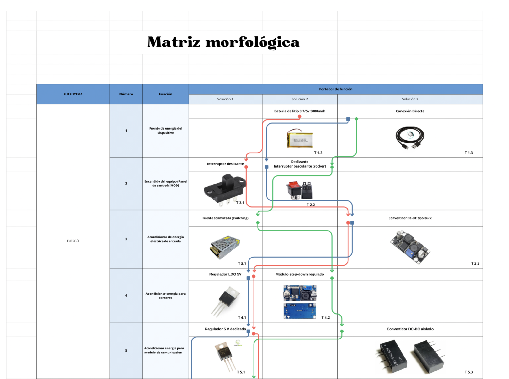
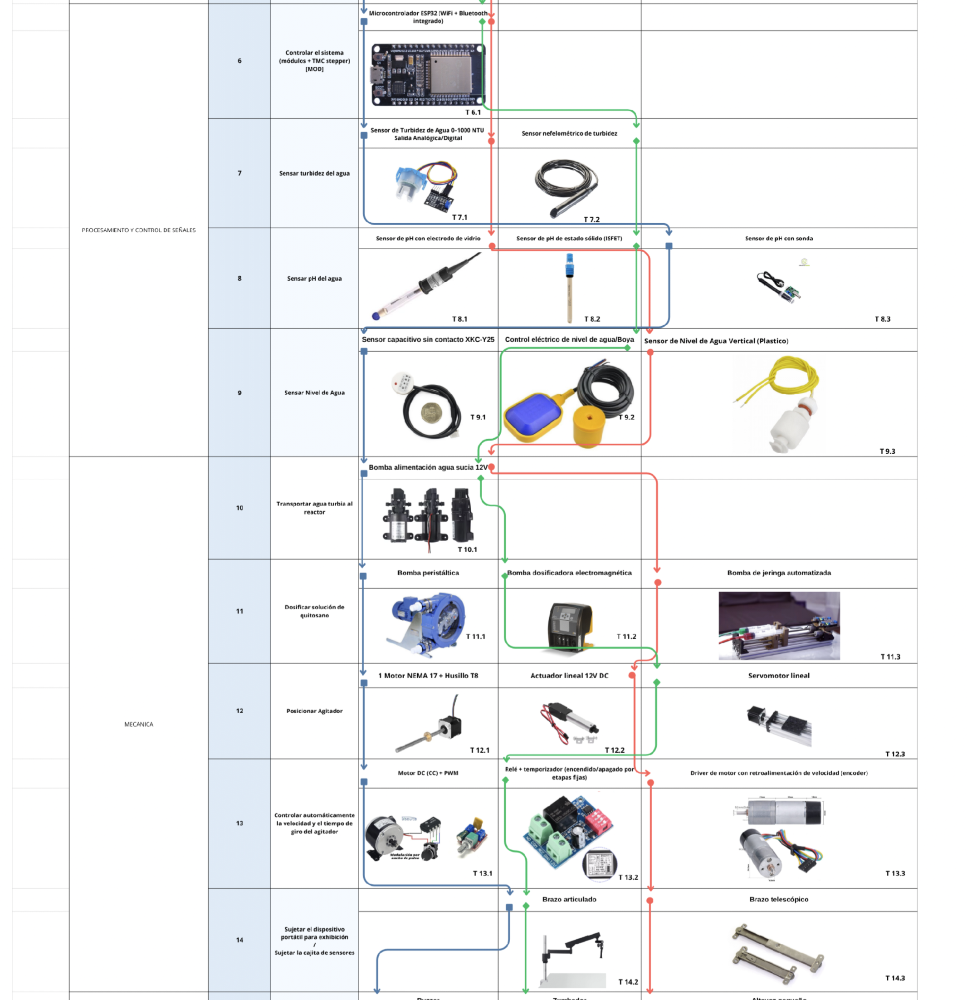
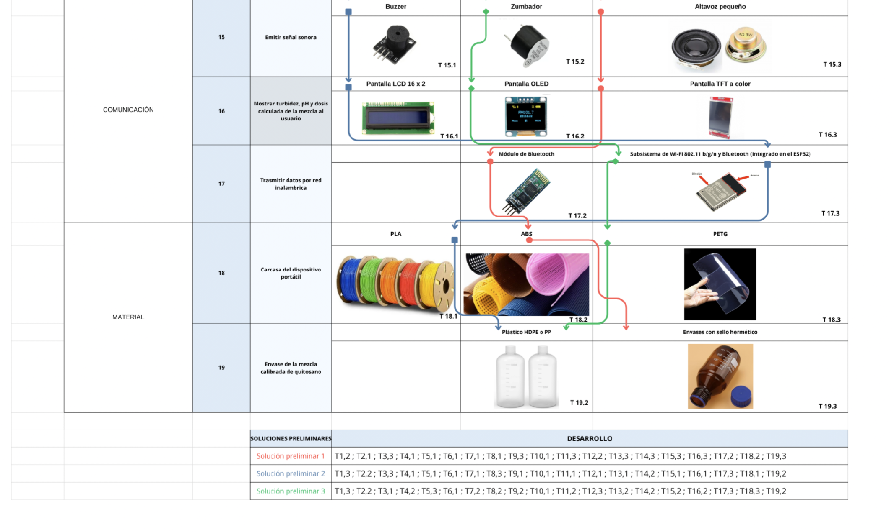
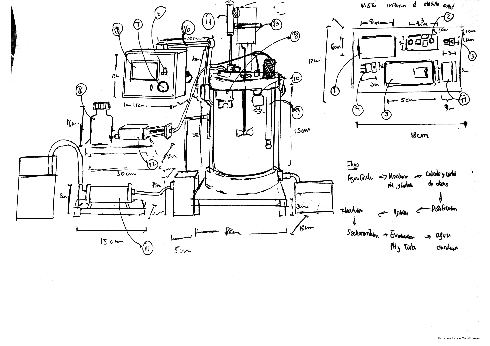
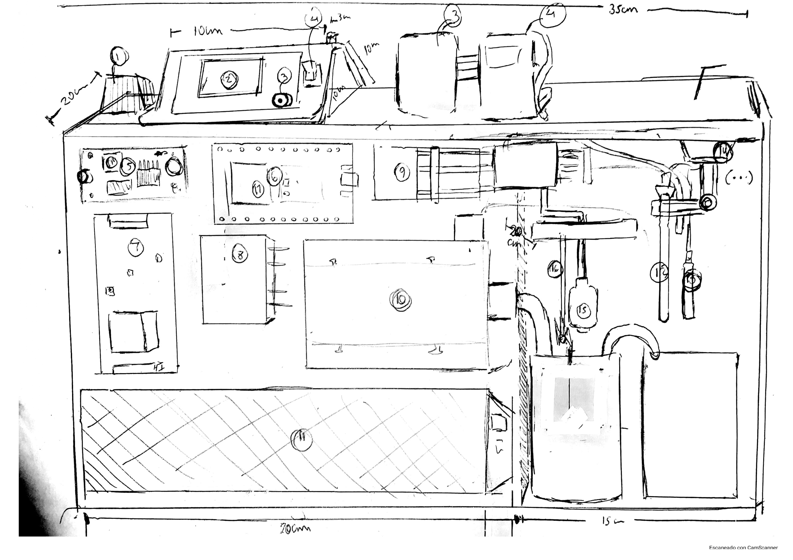
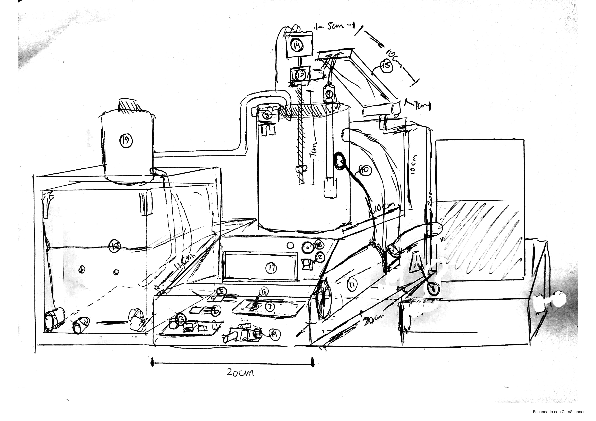

# CLARIFICACIÓN DE AGUA CON QUITOSANO — TRL 2
## Formulación del concepto tecnológico

> **Proyecto:** sistema automatizado de laboratorio para la clarificación de agua del río Lurín (Pachacámac) mediante dosificación de una solución de quitosano en ácido acético al 1 %.

## Datos del informe

| Campo | Información |
|:---|:---|
| **Curso** | Proyecto Integrador 2026-II |
| **Integrantes** | Marcelo Alarcón Camones; Brad Cárdenas Parián; Leonel Urbano Castillo; Idania Parhuay Meza; Gael Milla Fasabi |
| **Ingenieros** | Umbert Lewis De La Cruz, Maria Rejas, Harry Rivera y Renzo Chan |
| **Fecha de actualización** | 03/11/2026 |
| **Institución** | Universidad Peruana Cayetano Heredia |
| **Tema** | TRL 2 de ChitoSan — Formulación conceptual de la propuesta tecnológica |

## Contenido

1. [Introducción](#1-introducción)
2. [Estado del arte: artículos científicos que respaldan la propuesta](#2-estado-del-arte-artículos-científicos-que-respaldan-la-propuesta)
3. [Formulación del concepto tecnológico](#3-formulación-del-concepto-tecnológico)
4. [Arquitectura conceptual](#4-arquitectura-conceptual)
5. [Diseño conceptual](#5-diseño-conceptual)
6. [Evidencias del diseño conceptual](#6-evidencias-del-diseño-conceptual)
7. [Requisitos conceptuales](#7-requisitos-conceptuales)
8. [Análisis de patentabilidad y protección](#8-análisis-de-patentabilidad-y-protección)
9. [Perfil del proyecto](#9-perfil-del-proyecto)
10. [Cumplimiento de los indicadores del TRL 2](#10-cumplimiento-de-los-indicadores-del-trl-2)
11. [Conclusión](#11-conclusión)
12. [Referencias bibliográficas](#referencias-bibliográficas)

---

# 1. Introducción

## 1.1 Qué representa el TRL 2

Según la metodología de CONCYTEC, el TRL 2 corresponde a la formulación conceptual de la propuesta tecnológica: se exploran aplicaciones prácticas aún especulativas, con un estado del arte acotado al concepto, mayor importancia de la propiedad intelectual y trabajo en laboratorio [[1]](#ref1). Sus indicadores son (1) artículos científicos relacionados con la propuesta, (2) un análisis de patentabilidad y protección y (3) un perfil o propuesta de proyecto.

Este informe no demuestra que el sistema funcione, sino que explica cómo se combinarían los principios del TRL 1 (coagulación-floculación con quitosano, medición de pH, turbidez y nivel, y dosificación peristáltica) en una aplicación concreta y qué evidencia respalda cada decisión. Las pruebas corresponden al TRL 3. El alcance es una etapa de clarificación, no la producción de agua potable.

## 1.2 Objetivo del TRL 2

Formular el concepto tecnológico de **ChitoSan**: un sistema de laboratorio que mide el pH y la turbidez de una muestra de agua, calcula la dosis de quitosano con una tabla experimental, la dosifica, mezcla, deja sedimentar y evalúa la turbidez final. Para ello se revisan los antecedentes, se justifican los componentes, se documenta el diseño conceptual, se analiza la protección de la propuesta y se define el plan hacia el TRL 3.

---

# 2. Estado del arte: artículos científicos que respaldan la propuesta

## 2.1 Quitosano en ácido acético aplicado a aguas superficiales

El quitosano actúa por neutralización de carga y puenteo, y su desempeño depende del pH, la turbidez inicial, el solvente y el tipo de agua. Sinardi et al. relacionaron el grado de desacetilación con la remoción de turbidez a distintos pH [[2]](#ref2), y De-Paz-Arroyo et al. evaluaron un quitosano de bajo costo con policloruro de aluminio en agua de río [[3]](#ref3).

Hesami et al. usaron quitosano en ácido acético al 1 % como coagulante auxiliar en agua de río (pH 4 a 9, turbidez de 20 a 200 mg/L) y observaron **reestabilización** al superar la concentración óptima [[4]](#ref4). Irawati et al. mostraron que el solvente cambia el resultado: en ácido acético se alcanzó 64,78 % de reducción de turbidez a pH 7, frente a 85,33 % en ácido clorhídrico a pH 8 [[5]](#ref5). Iqbal et al. disolvieron 1 g de quitosano en 100 mL de ácido acético al 1 % y reportaron 99 % de remoción con agua de río de 49,5 NTU [[6]](#ref6). Estudios con agua del río Pirro [[7]](#ref7) y del Río Grande de Añasco [[8]](#ref8) confirman que el pH y la turbidez inicial modifican la remoción.

En conjunto, estos trabajos respaldan la preparación de la solución y justifican **medir antes de dosificar**. Sus cifras son antecedentes, no el desempeño esperado del prototipo.

## 2.2 Dosificación automática con sensores y microcontrolador

Amri et al. construyeron un sistema de dosificación de policloruro de aluminio con sensor de turbidez, bomba y ESP32, probado con agua de río, de arrozal y subterránea [[9]](#ref9); es el antecedente más cercano en arquitectura, aunque usa otro coagulante. Viana et al. desarrollaron un turbidímetro de bajo costo para que un controlador lógico programable dosifique coagulante en una planta piloto [[10]](#ref10). Bachri et al. revisaron 25 estudios y hallaron que la dosis, la turbidez y el pH están entre las variables más usadas, casi siempre a escala de laboratorio o piloto [[11]](#ref11). En el Perú, Guerrero Escobedo calibró un sensor económico con Arduino frente a un turbidímetro Hach para estudiar coagulantes en agua del canal madre de Chavimochic [[12]](#ref12).

Sobre la calibración, Klespitz y Kovács advierten que la exactitud de la bomba peristáltica depende del tubo y exige recalibrar por desgaste [[13]](#ref13), y Zhu et al. insisten en calibrar cada sensor de bajo costo [[14]](#ref14).

## 2.3 Comparación de antecedentes

*Tabla 1. Relación entre el concepto y la evidencia.*

| Elemento del concepto | Respaldo | Lo que aún no está respaldado |
|:---|:---|:---|
| Quitosano en ácido acético al 1 % | [[4]](#ref4), [[5]](#ref5), [[6]](#ref6), [[8]](#ref8) | Desempeño con agua del río Lurín |
| Dosis dependiente de pH y turbidez | [[2]](#ref2), [[3]](#ref3), [[7]](#ref7) | La tabla propia del equipo |
| Límite de dosis por reestabilización | [[4]](#ref4) | El valor límite para nuestro quitosano |
| Dosificación automática con ESP32 y turbidez | [[10]](#ref10), [[9]](#ref9), [[11]](#ref11) | Su uso específico con quitosano |
| Calibración de sensores y bomba | [[13]](#ref13), [[14]](#ref14) | Curvas propias del TS-300B y de la bomba |

Los antecedentes muestran que es viable dosificar coagulante según parámetros medidos, pero ninguno reúne estos elementos con quitosano ni con agua del río Lurín; ese es el espacio que ChitoSan explora.

---

# 3. Formulación del concepto tecnológico

## 3.1 Concepto de ChitoSan

El sistema recibe una muestra de agua turbia en un reactor de 1 L. Un ESP32 lee pH, turbidez y nivel, consulta una relación experimental pH–turbidez–dosis, activa una bomba peristáltica que entrega la solución de quitosano, agita, deja sedimentar, mide de nuevo la turbidez y muestra el resultado en una pantalla LCD, con aviso sonoro y datos por Wi-Fi. La solución de trabajo es quitosano en ácido acético al 1 %, preparación habitual en la literatura [[4]](#ref4), [[5]](#ref5), [[6]](#ref6).

El concepto corresponde a la **Solución Azul (Concepto B)**, seleccionada en la evaluación ponderada (sección 6.1).

## 3.2 Problema y justificación

La calidad del río Lurín varía según el tramo y la época, y su tramo bajo supera los estándares microbiológicos [[15]](#ref15). Una dosis fija de coagulante podría no servir para todas las muestras, por lo que el proyecto mide cada muestra y adapta la dosis. Se alinea con el ODS 6 (meta 6.3), el ODS 9 y el ODS 12 [[15]](#ref15).

## 3.3 Pregunta de investigación e hipótesis

**Pregunta.** ¿Cómo usar tecnología y experimentación para adaptar la clarificación del agua del río Lurín a las características de cada muestra? [[15]](#ref15)

**Hipótesis de trabajo (por comprobar en el TRL 3).**

- **H1.** Con el pH y la turbidez inicial se puede asignar una dosis a partir de una tabla experimental propia, con una remoción de turbidez comparable a la de una prueba de jarras manual.
- **H2.** La turbidez final permite verificar cada ensayo y alimentar la tabla de dosis.
- **H3.** El volumen entregado por la bomba peristáltica puede verificarse y calibrarse con un método de referencia (por ejemplo, pesada).

## 3.4 Componentes seleccionados

*Tabla 2. Componentes principales y su preparación previa.*

| Componente | Variable o función | Principio | Preparación previa |
|:---|:---|:---|:---|
| **PH4502C** (electrodo de vidrio) | pH | Potenciométrico | Calibración con soluciones patrón |
| **TS-300B** | Turbidez | Óptico (dispersión y atenuación) | Curva propia con patrones y turbidímetro de referencia [[14]](#ref14) |
| **XKC-Y25** | Nivel (presencia de líquido en un punto) | Capacitivo sin contacto | Verificar que confirme 1 L |
| **Bomba peristáltica** | Dosificación de quitosano | Desplazamiento positivo | Calibración por pesada [[13]](#ref13) |
| **ESP32 DevKit V1** | Adquisición, cálculo y control | Microcontrolador | Programación (TRL 3) |
| **Motor DC con paleta** | Agitación | PWM | Definir velocidad y tiempo |
| **NEMA 17 + TMC2209 + husillo T8** | Subir y bajar el agitador | Motor paso a paso | Verificar recorrido |

La lectura analógica de turbidez no equivale a NTU sin una curva propia, y el sensor de nivel no mide volumen continuo.

## 3.5 Secuencia de operación

1. **Llenado:** la bomba de alimentación transporta el agua al reactor y el XKC-Y25 confirma el nivel.
2. **Medición inicial:** se registran pH y turbidez.
3. **Cálculo de dosis:** el ESP32 consulta la tabla experimental (no se asume una fórmula universal).
4. **Dosificación y agitación:** la bomba peristáltica entrega el volumen definido y el motor DC mezcla.
5. **Sedimentación y medición final:** se mide la turbidez final y se calcula la remoción, (Tᵢ − T_f) / Tᵢ × 100.
6. **Reporte:** LCD, buzzer y Wi-Fi.

---

# 4. Arquitectura conceptual

## 4.1 Reactor y estructura mecánica

El sistema se modeló en Onshape sobre una base de 500 × 300 mm, con dos depósitos laterales, el reactor con su soporte, la caja de control y las bombas. Las piezas impresas se prevén en PLA. La caja de control (unos 155 mm de largo, pared de 5 mm) aloja el ESP32, la placa y la pantalla; su tapa mide 110 × 80 mm. Los planos siguen la norma ISO 128-1 [[16]](#ref16) y las tolerancias generales, la ISO 2768-1 [[17]](#ref17) (Figuras 7 a 9).

## 4.2 Dosis y resolución de la bomba

Una solución al 1 % (p/v) contiene 10 000 mg/L de quitosano. En un reactor de 1 L, 1 mg/L equivale a 0,1 mL de solución, y las dosis reportadas van de 0,5 a 190 mg/L [[2]](#ref2), [[4]](#ref4), [[5]](#ref5), [[6]](#ref6), es decir, entre 0,05 y 19 mL. Por eso conviene trabajar con una dilución intermedia y calibrar la bomba en ese rango. Para evitar la reestabilización [[4]](#ref4), el control limitará la dosis máxima.

## 4.3 Arquitectura de hardware

*Tabla 3. Bloques del esquemático v1.3.*

| Bloque | Componentes | Función |
|:---|:---|:---|
| Control | ESP32 DevKit V1 | Lectura de sensores, cálculo de dosis y secuencia |
| Energía | Entrada de 12 V; LM2596; 5 V y 3,3 V | Alimentar bombas, motor, sensores y control |
| Sensado | PH4502C, TS-300B, XKC-Y25 | pH, turbidez y nivel |
| Acondicionamiento | Divisores 15 kΩ / 20 kΩ | Reducir 5 V a unos 2,86 V para el ADC de 3,3 V |
| Bombas | Dos canales con MOSFET IRLZ44N y diodo | Transporte de agua y dosificación |
| Agitación y posicionamiento | Motor DC (PWM); NEMA 17 con TMC2209 y husillo T8 | Mezclar y subir/bajar el agitador |
| Interfaz | LCD 16×2 I2C y buzzer | Estado, valores y avisos |

Asignación de pines: pH en GPIO34, turbidez en GPIO35, XKC-Y25 en GPIO32, LCD I2C en GPIO21 y GPIO22, buzzer en GPIO23, bombas en GPIO18 y GPIO19, motor DC en GPIO33 y TMC2209 (STEP, DIR, EN) en GPIO25, GPIO26 y GPIO27. Ningún pin se repite. El esquemático y la PCB son diseños propuestos, aún sin fabricar ni validar (sección 6.4).

---

# 5. Diseño conceptual

El sistema se describió primero por las funciones que debe cumplir, siguiendo el método de diseño sistemático de Pahl et al., que parte de una caja negra y la descompone en una estructura de funciones conectadas por flujos de materia, energía y señales [[18]](#ref18), [[19]](#ref19).

## 5.1 Caja negra

La Figura 1 delimita el sistema sin comprometerse con su implementación. Las **entradas de materia** son el agua turbia, la solución de quitosano y el agua destilada (enjuague del reactor); la **energía eléctrica** es el flujo de energía, y el **encendido y apagado**, la señal. Las **salidas de materia** son el agua clarificada y los lodos sedimentados; las **salidas de señal** son el estado y los valores en pantalla, la señal sonora y los datos o notificaciones por Wi-Fi.

  

<em>Figura 1. Caja negra del sistema automatizado de clarificación con quitosano. Flechas huecas: materia; línea continua: energía; línea discontinua: señal.</em>

## 5.2 Estructura de funciones

La Figura 2 descompone la función global en seis módulos. **Materia:** recibir el agua, recolectar 1 L, inyectar el quitosano, mezclar, coagular y flocular, sedimentar y separar el agua clarificada de los lodos. **Mecánica:** transportar, dosificar, posicionar y accionar el agitador, accionar la válvula de separación y limpiar el reactor. **Eléctrico:** acondicionar la energía de sensores, actuadores y control. **Adquisición de señales:** sensar pH, turbidez y nivel y digitalizar. **Procesamiento y control:** verificar el nivel, evaluar pH y turbidez, consultar la relación experimental, calcular la dosis, ordenar a los actuadores y comparar valores iniciales y finales. **Comunicación:** emitir la señal visual y sonora y transmitir datos por Wi-Fi.

  

<em>Figura 2. Esquema de funciones (versión 3): módulos de materia, mecánica, eléctrica, adquisición de señales, procesamiento y control, y comunicación.</em>

---

# 6. Evidencias del diseño conceptual

Esta sección reúne las figuras que documentan el diseño. Son evidencias de formulación, no resultados de pruebas.

## 6.1 Matriz morfológica y selección del concepto

La matriz cruzó 19 funciones con hasta tres portadores de función cada una (Figura 3). De sus recorridos salieron tres conceptos (Tabla 4), evaluados con ponderación de criterios según la guía VDI 2206 [[20]](#ref20) (Tabla 5).

  

<em>Figura 3a. Matriz morfológica: funciones 1 a 5 (energía).</em>

  

<em>Figura 3b. Matriz morfológica: funciones 6 a 14 (procesamiento y control, y mecánica).</em>

  

<em>Figura 3c. Matriz morfológica: funciones 15 a 19 (comunicación, carcasa y envase).</em>

*Tabla 4. Conceptos obtenidos de la matriz morfológica.*

| Función | Concepto A (base) | Concepto B | Concepto C |
|:---|:---|:---|:---|
| Dosificar el quitosano | Bomba de jeringa | Bomba peristáltica | Bomba dosificadora electromagnética |
| Controlar el agitador | Driver con encoder | Motor DC + PWM | Relé + temporizador |
| Sensor de turbidez | Analógico (0–1000 NTU) | Analógico (0–1000 NTU) | Nefelométrico |
| Sensor de pH | Electrodo de vidrio | Con sonda | Estado sólido (ISFET) |
| Envase de la mezcla | Botella HDPE o PP | Botella HDPE o PP | Envase con sello hermético |

*Tabla 5. Evaluación ponderada de los conceptos (escala de 1 a 5).*

| Criterio | Peso | A | B | C |
|:---|:---:|:---:|:---:|:---:|
| Precisión de dosificación | 0,20 | 4 | 5 | 4 |
| Costo | 0,15 | 4 | 4 | 3 |
| Complejidad técnica | 0,15 | 4 | 4 | 3 |
| Control del proceso | 0,15 | 4 | 4 | 4 |
| Consumo energético | 0,10 | 4 | 4 | 3 |
| Mantenimiento e higiene | 0,10 | 4 | 4 | 3 |
| Confiabilidad | 0,10 | 4 | 5 | 3 |
| Portabilidad | 0,05 | 4 | 5 | 3 |
| **Total ponderado** | **1,00** | **4,00** | **4,35** | **3,35** |

En el análisis de Pugh, con A como base, B suma +3 y C suma −6. Por eso se seleccionó el **Concepto B (Solución Azul)**. La decisión es preliminar y deberá validarse con ensayos en el TRL 3.

## 6.2 Bocetos conceptuales

Cada boceto ubica los componentes sobre una base común e incluye su lista de componentes (carpeta `04_Skecthes_y_Diagrama` del repositorio). La Solución Azul fue la seleccionada y la que se modeló en Onshape.

  

<em>Figura 4. Boceto de la Solución Roja: primera alternativa conceptual.</em>

  

<em>Figura 5. Boceto de la Solución Verde: segunda alternativa conceptual.</em>

  

<em>Figura 6. Boceto de la Solución Azul: alternativa seleccionada.</em>

## 6.3 Modelo tridimensional y planos

El plano de ensamble (Figura 7) permite verificar el espacio de cada módulo, el recorrido de mangueras y cables y la altura necesaria para el agitador. La caja de control (Figura 8) tiene un frente inclinado para la ventana de la pantalla, y su tapa (Figura 9) mide 110 × 80 mm, con espesor de 5 mm y cuatro orificios de Ø4 mm.

  

  

<em>Figura 7. Plano de ensamble del sistema en Onshape (escala 1:5), con la base de 500 × 300 mm.</em>

  

<em>Figura 8. Plano de la caja de control (escala 1:3): vistas, secciones y detalles.</em>

  

<em>Figura 9. Plano de la tapa del estuche de la caja de control en PLA (escala 1:2).</em>

## 6.4 Diseño electrónico preliminar

El esquemático v1.3 (Figura 10) se divide en ocho bloques: alimentación, control principal, sensores, interfaz, motor NEMA 17, motor DC del agitador, bombas y soportes. Muestra que la arquitectura de control es realizable con componentes comerciales. La PCB (Figura 11) traduce el esquemático a una placa de 96,4 mm de ancho, con cuatro agujeros de montaje, y agrupa la electrónica en la caja de control con módulos reemplazables (ESP32, TMC2209, LM2596). Ambos son diseños propuestos: la PCB debe pasar la verificación DRC de EasyEDA antes de fabricarse.

  

<em>Figura 10. Esquemático «Esquemático_ChitoSan», versión 1.3 (actualizado el 03/11/2026).</em>

  

<em>Figura 11. Diseño de la PCB de ChitoSan correspondiente al esquemático v1.3.</em>

## 6.5 Diseño conceptual del dashboard

El prototipo visual, hecho en Figma, es un flujo de seis pantallas: ingreso, inicio, mediciones iniciales, cantidad a dosificar, estado del proceso y resultados, con el Índice de Efectividad (mejora del pH y remoción de turbidez) como indicador principal. Es solo un diseño visual: los campos muestran «—» porque no hay datos, y su funcionamiento real depende del firmware y de las calibraciones del TRL 3.

<table>
<tr><td align="center" width="33%"> 1. Ingreso</td><td align="center" width="33%"> 2. Inicio</td><td align="center" width="33%"> 3. Mediciones iniciales</td></tr>
<tr><td align="center" width="33%"> 4. Cantidad a dosificar</td><td align="center" width="33%"> 5. Estado del proceso</td><td align="center" width="33%"> 6. Resultados</td></tr>
</table>

<em>Figura 12. Interfaz «Chitosan: Clarificación de agua con quitosano» en Figma: ingreso, inicio, mediciones iniciales, cálculo de la dosis, estado del proceso y resultados.</em>

- Archivo editable: [Figma — diseño](https://www.figma.com/design/gBkksjELsAf9rPYOBMQ7ot/Chitosan---Registro-de-dosificaci%C3%B3n-y-clarificaci%C3%B3n?node-id=0-1&t=Vt8dFOgyxpEyDcj8-1)
- Prototipo navegable: [Figma — prototipo](https://www.figma.com/proto/gBkksjELsAf9rPYOBMQ7ot/Chitosan---Registro-de-dosificaci%C3%B3n-y-clarificaci%C3%B3n?node-id=3-2&t=7k83NdpV6whos929-1&scaling=scale-down&content-scaling=fixed&page-id=0%3A1)

---

# 7. Requisitos conceptuales

La lista de exigencias del equipo reúne 25 requisitos (22 obligatorios y 3 deseables) [[15]](#ref15). Los principales para este nivel son:

1. **Medición.** Medir pH y turbidez antes del tratamiento y la turbidez al final.
2. **Dosis.** Calcular la dosis con datos experimentales, sin asumir una fórmula universal.
3. **Dosificación.** Suministrar el quitosano con una bomba, con cantidad configurable.
4. **Secuencia.** Ejecutar en orden llenado, medición, dosificación, agitación, sedimentación y evaluación.
5. **Agitación.** Permitir configurar la velocidad de mezcla.
6. **Registro.** Mostrar y registrar por ensayo las mediciones, el pH inicial y la dosis aplicada.
7. **Modularidad y mantenimiento.** Estructura modular, fabricable por impresión 3D, con partes en contacto con la muestra fáciles de limpiar.
8. **Seguridad y transporte.** Proteger la electrónica de salpicaduras, permitir detener los actuadores y trasladar el equipo apagado y vacío.
9. **Deseable.** Comunicación inalámbrica para transmitir datos.

---

# 8. Análisis de patentabilidad y protección

Es un análisis preliminar de estudiantes: no reemplaza una búsqueda profesional ni la opinión de un agente de propiedad industrial.

## 8.1 Marco legal en el Perú

Ante INDECOPI, la **patente de invención** protege productos o procedimientos por 20 años y exige novedad, nivel inventivo y aplicación industrial; el **modelo de utilidad** protege mejoras de forma o disposición con ventaja técnica por 10 años y exige un nivel inventivo menor. La novedad se pierde si hay divulgación previa, con un período de gracia de un año [[21]](#ref21).

## 8.2 Antecedentes tecnológicos encontrados

*Tabla 6. Documentos relacionados y su relación con ChitoSan.*

| Documento | Qué describe | Relación con el proyecto |
|:---|:---|:---|
| US 4,855,061 [[22]](#ref22) | Control de la dosis de coagulante con sensor de carga y turbidímetro | Control automático de dosis con turbidez |
| US 5,160,439 [[23]](#ref23) | Control de coagulante con carga, turbidez, pH y caudal | Dosis a partir de pH y turbidez con relación empírica |
| US 6,241,896 [[24]](#ref24) | Dosis de coagulante con color y turbidez, microprocesador y bomba | Cálculo automático de dosis |
| US 11,505,478 B2 [[25]](#ref25) | Dosificación y ajuste de pH según potencial zeta, con tabla de consulta | Tabla de consulta pH–dosis; aparentemente vigente |
| US 5,543,056 [[26]](#ref26) | Tratamiento de agua con polímeros naturales, incluido quitosano en ácido acético | Uso del quitosano en medio ácido |
| CoagSense [[27]](#ref27) | Producto que combina pH y turbidez para controlar una bomba de coagulante | Equivalente comercial a gran escala |

Las patentes antiguas probablemente ya expiraron y una patente estadounidense solo produce derechos en Estados Unidos; debe verificarse si existe una equivalente en el Perú.

## 8.3 Evaluación y estrategia de protección

**Patente de invención.** Cada elemento es conocido y dosificar un coagulante según parámetros medidos ya está en el estado de la técnica [[22]](#ref22)–[[25]](#ref25), [[9]](#ref9); la combinación podría considerarse evidente. Con los datos actuales no se recomienda solicitarla.

**Modelo de utilidad.** Es más plausible para la disposición mecánica del reactor (tapa con sensores y agitador que sube y baja con NEMA 17 y husillo T8, en estructura modular impresa en 3D), siempre que una búsqueda formal confirme su novedad y se demuestre una ventaja técnica.

*Tabla 7. Otras formas de protección.*

| Figura | Qué protegería | Comentario |
|:---|:---|:---|
| Derecho de autor | Código del ESP32, esquemático y planos | Surge con la creación; el registro facilita probar la autoría |
| Secreto empresarial | Tabla de dosificación | Solo si se mantiene confidencial |
| Diseño industrial | Apariencia de la carcasa | Solo si el diseño es distintivo |

## 8.4 Alertas y acciones

1. **Divulgación previa.** Si el repositorio de GitHub y el enlace de Onshape son públicos, ya hubo divulgación y el período de gracia habría empezado; conviene verificarlo antes de publicar más.
2. **Búsqueda formal.** Repetirla en Google Patents, Espacenet e INDECOPI con las palabras «chitosan», «dosing», «turbidity» y «jar».
3. **Registro y política.** Llevar un cuaderno fechado de diseños y ensayos, y consultar la política de propiedad intelectual de la UPCH.

---

# 9. Perfil del proyecto

## 9.1 Título

**Sistema automatizado para la clarificación de agua del río Lurín (Pachacámac) mediante dosificación con quitosano.**

## 9.2 Objetivos

**General.** Formular y demostrar a escala de laboratorio un prototipo que clarifique muestras de agua del río Lurín dosificando quitosano según el pH y la turbidez medidos.

**Específicos.**

1. Calibrar los sensores de pH, turbidez y nivel y verificar la dosificación peristáltica.
2. Construir, con jarras y con el prototipo, una tabla experimental pH–turbidez–dosis.
3. Integrar y programar la secuencia automática del proceso.
4. Registrar y comparar la turbidez inicial y final y el pH inicial en cada ensayo.

## 9.3 Alcance y exclusiones

Incluye ensayos de laboratorio con muestras del río Lurín, un reactor de 1 L, mediciones de pH y turbidez y registro de datos. No incluye producir agua potable (faltarían filtración y desinfección), cumplir normas de agua de consumo ni operar de forma continua en campo.

## 9.4 Plan para pasar al TRL 3

*Tabla 8. Plan de trabajo hacia el TRL 3.*

| Fase | Actividad | Entregable |
|:---:|:---|:---|
| 1 | Preparar la solución de quitosano en ácido acético al 1 % y fijar el procedimiento | Protocolo de preparación |
| 2 | Calibrar pH (patrones), turbidez (patrones y turbidímetro de referencia) y bomba (pesada) | Curvas de calibración |
| 3 | Pruebas de jarras con muestras del río Lurín de distintos puntos | Tabla preliminar pH–turbidez–dosis |
| 4 | Integrar hardware y firmware; probar la secuencia sin agua y con agua | Prototipo funcional |
| 5 | Ensayos de clarificación con el prototipo y comparación con las jarras | Informe con remoción de turbidez |

## 9.5 Indicadores de éxito propuestos

- Remoción de turbidez, (Tᵢ − T_f) / Tᵢ × 100, comparada con la prueba de jarras.
- Error del volumen dosificado frente a la referencia por pesada.
- Repetibilidad de las lecturas de pH y turbidez en réplicas.
- Secuencia completa sin intervención y con registro de datos.

Los umbrales numéricos de aceptación se fijarán con el equipo y los ingenieros antes de iniciar los ensayos.

## 9.6 Riesgos principales

*Tabla 9. Riesgos y mitigación.*

| Riesgo | Mitigación |
|:---|:---|
| Lecturas de turbidez inestables por luz, burbujas o flóculos | Calibración propia, promedios y cubierta del sensor |
| Dosis muy pequeñas con la bomba peristáltica | Dilución intermedia y calibración en ese rango |
| Sobredosis y reestabilización | Límite máximo de dosis |
| Ácido acético sobre sondas, tubos y piezas de PLA | Verificar compatibilidad de materiales y enjuagar con agua destilada |
| Variabilidad de las muestras del río | Muestrear en varios puntos y épocas |

## 9.7 Alcance y limitaciones

El TRL 2 se limita a formular y sustentar el concepto. El sistema no está validado, el esquemático y la PCB no se han fabricado y no existen mediciones propias. Demostrar que el prototipo clarifica agua del río Lurín corresponde al TRL 3.

---

# 10. Cumplimiento de los indicadores del TRL 2

*Tabla 10. Indicadores del TRL 2 y evidencias de ChitoSan.*

| Indicador del TRL 2 | Evidencia en ChitoSan | Sección |
|:---|:---|:---:|
| Artículos científicos relacionados con la propuesta | Estudios sobre quitosano en agua de río y dosificación automática con sensores | 2 |
| Formulación del concepto tecnológico | Reactor de 1 L con ESP32, pH, turbidez, bomba peristáltica y quitosano al 1 % | 3 |
| Diseño conceptual | Caja negra, esquema de funciones, matriz morfológica y bocetos | 5 y 6.1–6.2 |
| Diseño mecánico y electrónico | Modelo y planos en Onshape, esquemático v1.3 y PCB | 4 y 6.3–6.4 |
| Diseño de la interfaz | Flujo de seis pantallas en Figma | 6.5 |
| Análisis de patentabilidad y protección | Antecedentes, evaluación y estrategia | 8 |
| Perfil o propuesta de proyecto | Objetivos, alcance, plan al TRL 3, indicadores y riesgos | 3 y 9 |

---

# 11. Conclusión

El TRL 2 queda formulado como un concepto de laboratorio: un reactor de 1 L, controlado por un ESP32, que mide pH y turbidez, dosifica quitosano en ácido acético al 1 % con una bomba peristáltica, agita y evalúa la turbidez final. La literatura respalda cada pieza y muestra sistemas de dosificación automática comparables, pero no una combinación idéntica con quitosano. La matriz morfológica y la evaluación ponderada llevaron a la Solución Azul, documentada con planos, esquemático, PCB y dashboard conceptual.

El análisis preliminar indica que la protección más realista por ahora es el derecho de autor y, tal vez, un modelo de utilidad para la disposición mecánica, y alerta sobre la divulgación previa. Lo que falta, y es el objetivo del TRL 3, es demostrar experimentalmente que el prototipo funciona con agua del río Lurín.

---

# Referencias bibliográficas

[1] Consejo Nacional de Ciencia, Tecnología e Innovación Tecnológica (CONCYTEC), “Directiva N.° 001-2022-CONCYTEC-P: Uso de la metodología Nivel de Madurez Tecnológica (TRL),” Resolución de Presidencia N.° 020-2022-CONCYTEC-P, Lima, Perú, 2022. [En línea]. Disponible: https://vinculate.concytec.gob.pe/download/RP-020-2022-CONCYTEC-P.pdf

[2] S. Sinardi et al., “Linking degree of deacetylation to coagulation efficiency of crustacean waste chitosan in water treatment,” Jurnal Presipitasi, vol. 23, no. 2, pp. 533–542, jul. 2026, doi: 10.14710/presipitasi.v23i2.533-542.

[3] G. De-Paz-Arroyo et al., “Synergy between low-cost chitosan and polyaluminum chloride (PAC) improves the flocculation process for river water treatment,” Polymers, vol. 17, no. 13, Art. no. 1822, 2025, doi: 10.3390/polym17131822.

[4] F. Hesami, B. Bina y A. Ebrahimi, “The effectiveness of chitosan as coagulant aid in turbidity removal from water,” International Journal of Environmental Health Engineering, vol. 3, pp. 46–51, abr. 2014, doi: 10.4103/2277-9183.131814.

[5] U. Irawati, F. A. Hikmah y A. B. Junaidi, “The effect of acetic acid and hydrochloric acid as a solvent for chitosan to reduce turbidity in eutrophic water,” International Journal of Environmental Science and Development, vol. 14, no. 5, pp. 287–291, 2023, doi: 10.18178/ijesd.2023.14.5.1446.

[6] Iqbal et al., “Chitosan from mollusk shell as coagulant for raw water,” Konversi, vol. 13, no. 2, pp. 82–86, 2024, doi: 10.20527/k.v13i2.19882. [En línea]. Disponible: https://ppjp.ulm.ac.id/journal/index.php/konversi/article/download/19882/10689

[7] Universidad Nacional de Costa Rica, “Coagulación-floculación con quitosanos de distinto peso molecular y agua del río Pirro,” repositorio institucional. [En línea]. Disponible: https://repositorio.una.ac.cr/items/00976ed7-ba0f-4554-953d-1c159f436107

[8] J. Molina-Pinna y F. R. Román-Velázquez, “Effectiveness of acidic chitosan solutions for total organic carbon removal in drinking water treatment,” *Polymers*, vol. 17, no. 13, Art. no. 1832, jun. 2025, doi: 10.3390/polym17131832.

[9] F. Amri, B. Dharmawan Hadi, T. Haryanti, R. Lutfiar Rizky, S. Rahayu y A. Wanda Alifah, “Automatic polyaluminium chloride (PAC) dosing control system for water purification using NodeMCU-ESP32,” LOGIC: Jurnal Rancang Bangun dan Teknologi, vol. 26, no. 1, pp. 10–16, mar. 2026, doi: 10.31940/logic.v26i1.10-16.

[10] D. C. Viana, R. A. Braga, B. H. G. Barbosa, A. R. C. R. Campos y D. D. Ferreira, “Turbidímetro baseado em processamento de imagens: elaboração e avaliação de desempenho por meio de uma planta piloto,” Congresso Brasileiro de Automação, Sociedade Brasileira de Automação. [En línea]. Disponible: https://sba.org.br/open_journal_systems/index.php/cba/article/view/3394

[11] A. Bachri, A. K. Mahamad, W. M. Utomo, S. Saon y A. B. Laksono, “Optimization of coagulation process in water treatment plant using artificial intelligence: A systematic literature review and framework,” Journal of Robotics and Control, vol. 6, no. 5, pp. 2471–2487, 2025, doi: 10.18196/jrc.v6i5.27621.

[12] A. E. Guerrero Escobedo, “Remoción de turbidez de aguas del canal madre de Chavimochic empleando diseño de mezclas de coagulantes,” Dialnet. [En línea]. Disponible: https://dialnet.unirioja.es/descarga/articulo/8092598.pdf

[13] J. Klespitz y L. Kovács, “Peristaltic pumps – a review on working and control possibilities,” en Proc. IEEE 12th SAMI, Herl’any, Eslovaquia, ene. 2014, pp. 191–194.

[14] Q. Zhu, F. Cherqui y J.-L. Bertrand-Krajewski, “End-user perspective of low-cost sensors for urban stormwater monitoring: a review,” Water Science and Technology, vol. 87, no. 11, pp. 2648–2684, 2023, doi: 10.2166/wst.2023.142.

[15] Equipo 05, “Presentación parcial: Desarrollo de un sistema automatizado para la clarificación de agua mediante dosificación de quitosano,” Proyecto Integrador 2026-II, Universidad Peruana Cayetano Heredia, Lima, Perú, 2026.

[16] ISO, *ISO 128-1:2020 — Technical product documentation (TPD): General principles of representation*, Ginebra, Suiza: ISO, 2020.

[17] ISO, *ISO 2768-1:1989 — General tolerances*, Ginebra, Suiza: ISO, 1989.

[18] G. Pahl, W. Beitz, J. Feldhusen y K.-H. Grote, *Engineering Design: A Systematic Approach*, 3.ª ed. Londres, Reino Unido: Springer, 2007.

[19] K. T. Ulrich y S. D. Eppinger, *Product Design and Development*, 7.ª ed. Nueva York, NY, EE. UU.: McGraw-Hill, 2020.

[20] Verein Deutscher Ingenieure (VDI), *VDI 2206: Design Methodology for Mechatronic Systems*. Düsseldorf, Alemania: VDI-Verlag, 2004.

[21] INDECOPI, “Guía de patentes para investigadores,” Lima, Perú. [En línea]. Disponible: https://investigacion.pucp.edu.pe/wp-content/uploads/2024/06/GUIA_DE_PATENTES_PARA_INVESTIGADORES.pdf

[22] “Method and apparatus for controlling the coagulant dosage for water treatment,” Patente de Estados Unidos US 4,855,061. [En línea]. Disponible: https://patents.google.com/patent/US4855061

[23] “System for controlling coagulant treatment based on monitoring of plural parameters,” Patente de Estados Unidos US 5,160,439.

[24] “Auto dosage determination method and apparatus for coagulant control in the treatment of water,” Patente de Estados Unidos US 6,241,896.

[25] “Automated methods and systems for optimized zeta potential chemical dosing in water treatment systems,” Marmac Water LLC, Patente de Estados Unidos US 11,505,478 B2. [En línea]. Disponible: https://patents.google.com/patent/US11505478

[26] “Method of drinking water treatment with natural cationic polymers,” Patente de Estados Unidos US 5,543,056.

[27] Process Instruments, “CoagSense automatic coagulation controller,” hoja técnica ISB163. [En línea]. Disponible: https://www.processinstruments.net/wp-content/uploads/pdf/ISB163-Automatic-Coagulation-Controller-CoagSense.pdf
