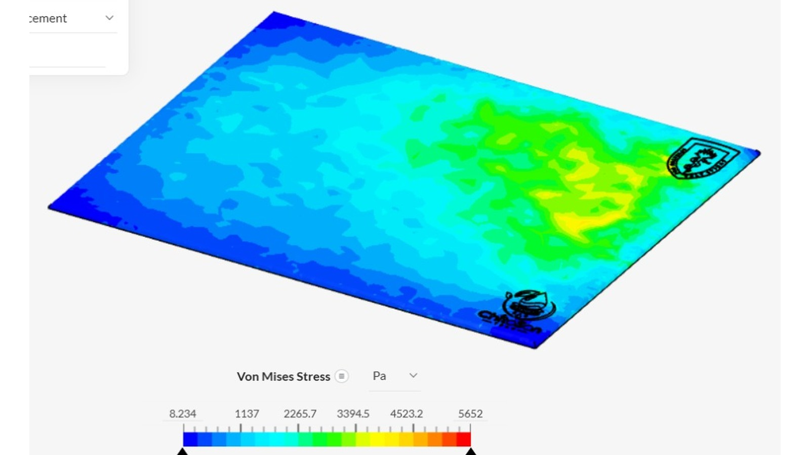
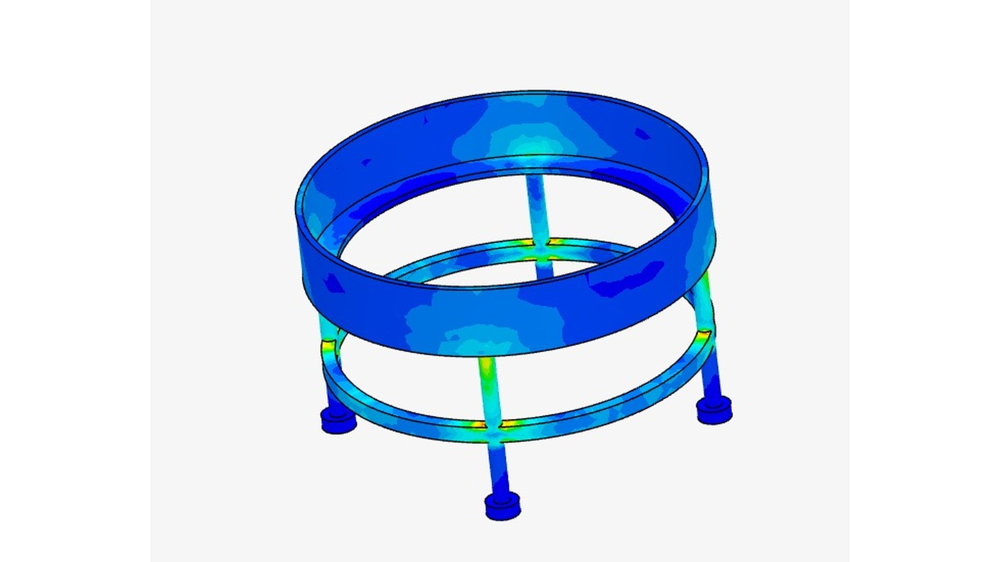
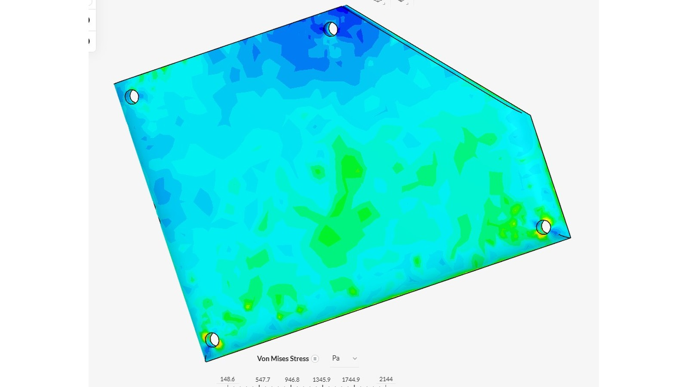
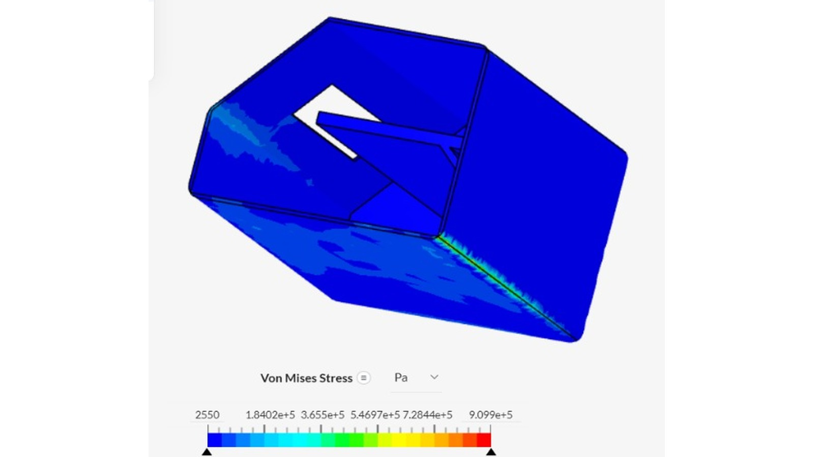

# CLARIFICACIÓN DE AGUA CON QUITOSANO

### Prueba de concepto experimental y analítica del sistema automatizado · TRL 3

Proyecto Integrador 2026-II | Universidad Peruana Cayetano Heredia | Equipo 05

2 de noviembre de 2026

---

## Ficha del proyecto

| Campo | Información |
|:---|:---|
| **Curso** | Proyecto Integrador 2026-II |
| **Institución** | Universidad Peruana Cayetano Heredia |
| **Tema** | TRL 3 · Sistema automatizado de clarificación de agua mediante dosificación de quitosano |
| **Fecha** | 02/11/2026 |

**Integrantes:**

- Marcelo Alarcón Camones
- Brad Cárdenas Parián
- Leonel Urbano Castillo
- Idania Parhuay Meza
- Gael Milla Fasabi

**Ingenieros:** Umbert Lewis De La Cruz, Maria Rejas, Harry Rivera y Renzo Chan

---

## Presentación

De acuerdo con la metodología de CONCYTEC, el TRL 3 corresponde al desarrollo experimental o prueba del concepto tecnológico: se demuestra que los principios básicos previstos sustentan el desarrollo de la tecnología, se comienza a probar su viabilidad mediante estudios analíticos y de laboratorio, y el trabajo se realiza en un entorno de laboratorio [1]. Sus indicadores de resultados son los datos de ensayos experimentales o analíticos y un demo o prototipo para las primeras pruebas experimentales; este documento se organiza siguiendo esos dos indicadores.

En el TRL 1 se identificaron los principios científicos del sistema y en el TRL 2 se formuló el concepto, junto con un plan de cinco fases para llegar a este nivel [2]. En este TRL 3 se presentan las primeras pruebas del módulo de medición que decide la dosis de quitosano, formado por un sensor de turbidez y un sensor de pH leídos por un ESP32, y la simulación estructural en SimScale de cuatro piezas del prototipo diseñadas para fabricarse en PLA.

El estado de la evidencia es el siguiente. El sensor de turbidez entregó lecturas distintas en un agua clara y en un agua turbia. El sensor de pH todavía no está calibrado: su lectura actual está saturada, por lo que se presenta el protocolo de calibración que el equipo aplicará y la tabla donde se registrarán sus resultados. No se presentan ensayos de dosificación de quitosano ni porcentajes de remoción, que corresponden a etapas posteriores.

---

## 1 Demo o prototipo para las primeras pruebas experimentales

El prototipo de esta etapa tiene dos partes: un banco de pruebas de adquisición de señales armado sobre protoboard, con el que se hicieron los ensayos de la sección 2, y las piezas estructurales cuyo diseño está en Onshape ([modelo CAD](https://cad.onshape.com/documents/06947ddb91d11baa99cb7771/w/ae9234bc94d45c112f779e45/e/bae95c7a29d602dc0212cc6e)) y que se verifican en la sección 3.2.

### 1.1 Banco de adquisición de señales

| Componente | Función en el sistema | Conexión en el prototipo |
|:---|:---|:---|
| ESP32 DOIT DevKit V1 | Microcontrolador que adquiere las señales y las envía al monitor serie | Cable USB al computador |
| Sensor de turbidez | Entrega una tensión analógica que varía con las partículas suspendidas | Señal al pin GPIO 33 |
| Módulo de pH PH-4502C con electrodo de vidrio y conector BNC | Acondiciona la señal potenciométrica del electrodo | Señal al pin GPIO 34, a través de un divisor resistivo |
| Divisor resistivo (factor 1,5) | Reduce la salida del módulo de pH al rango admisible del ADC del ESP32 | Resistencias sobre la protoboard |

**Diferencias entre el banco de pruebas y el esquemático del TRL 2.** El banco se armó para las primeras lecturas y no reproduce todavía el circuito del esquemático v1.2 [2]. En el esquemático, la señal de turbidez entra por el GPIO35 y las señales de pH y turbidez pasan por divisores de 15 kΩ y 20 kΩ, que reducen 5 V a unos 2,86 V (factor 1,75). En el banco, la turbidez se leyó por el GPIO33 y el pH por el GPIO34 con un divisor de factor 1,5. Al integrar el circuito definitivo, el programa debe actualizarse con los pines y los factores del esquemático.

El firmware se programó en el IDE de Arduino 2.3.10. Los dos sensores se leen con el ADC del ESP32 configurado a 12 bits (0 a 4095) y con atenuación de 11 dB; la tensión se obtiene con `analogReadMilliVolts()`. En el caso del pH, el programa recupera la tensión original del módulo multiplicando la tensión medida por 1,5. Una versión integrada del programa imprime cada 2 segundos una tabla con el ADC y la tensión de cada sensor.

<b>Figura 1.</b> Montaje del sensor de turbidez: ESP32 conectado a la protoboard y sensor con su cable hacia la placa. <i>(Fuente: elaboración propia, 02/11/2026.)</i>

<b>Figura 2.</b> Montaje del sensor de pH: ESP32 y divisor resistivo en la protoboard, módulo PH-4502C con conector BNC y electrodo de vidrio. <i>(Fuente: elaboración propia, 02/11/2026.)</i>

### 1.2 Piezas estructurales del prototipo

Las piezas diseñadas en Onshape y analizadas en la sección 3.2 son la base, el soporte del reactor, una placa con cuatro orificios y la caja de control. Todas están pensadas para fabricarse en PLA.

---

## 2 Ensayos experimentales

Los ensayos se realizaron el 02/11/2026. Se registró la lectura cruda del ADC y la tensión en el pin del ESP32. En ambos sensores el resultado es una señal eléctrica y no una magnitud en unidades físicas: convertirla a NTU o a unidades de pH exige una curva de calibración propia [3], [4].

### 2.1 Ensayo del sensor de turbidez

**Objetivo.** Comprobar que la señal del sensor cambia cuando se pasa de un agua clara a un agua turbia.

**Procedimiento.** Se cargó en el ESP32 un programa que lee el pin 33 y muestra el ADC y la tensión en el monitor serie (Figura 3). Luego se sumergió el sensor, sostenido a mano, en dos muestras: agua clara contenida en una taza y agua turbia con sedimento contenida en un recipiente metálico, y se registró el valor mostrado en cada una.

<b>Figura 3.</b> Programa de lectura del sensor de turbidez (pin 33, ADC de 12 bits, atenuación de 11 dB) cargado en el ESP32. <i>(Fuente: elaboración propia.)</i>

<b>Figura 4.</b> Ensayo con agua clara: sensor sumergido en la taza (izquierda) y lectura en el monitor serie (derecha). <i>(Fuente: elaboración propia.)</i>

<b>Figura 5.</b> Ensayo con agua turbia y sedimento: sensor sumergido en el recipiente (izquierda) y lectura en el monitor serie (derecha). <i>(Fuente: elaboración propia.)</i>

**Resultados.**

| Muestra | ADC (0–4095) | Tensión en el pin (V) |
|:---|:---:|:---:|
| Agua clara | 1951 | 1,748 |
| Agua turbia con sedimento | 6 | 0,154 |

**Análisis.** La señal bajó de 1,748 V a 0,154 V al pasar del agua clara al agua turbia, una caída de alrededor de 91 %. El sentido del cambio coincide con el principio óptico descrito en el TRL 1: cuando aumentan las partículas llega menos luz al detector. Se obtuvo una sola lectura por muestra, no se midió la turbidez de las muestras con un instrumento de referencia y el sensor se sostuvo a mano; además, la luz ambiental y la suciedad son fuentes de error conocidas en los sensores de bajo costo [3]. Por eso el resultado muestra que el sensor distingue estas dos condiciones, pero no permite todavía expresar la turbidez en NTU ni evaluar niveles intermedios.

### 2.2 Ensayo del sensor de pH

**Objetivo.** Comprobar que la cadena electrónica (electrodo, módulo, divisor resistivo y ADC) transmite la señal del pH hasta el programa.

**Procedimiento.** Se cargó un programa que lee el pin 34, calcula la tensión después del divisor y recupera la tensión original del módulo (Figura 6). Las lecturas se observaron en el monitor serie.

<b>Figura 6.</b> Programa de lectura del sensor de pH (pin 34, divisor con factor 1,5) y lecturas consecutivas en el monitor serie. <i>(Fuente: elaboración propia.)</i>

**Resultados.**

| Programa | ADC (0–4095) | Tensión en el pin (V) | Tensión original del módulo (V) |
|:---|:---:|:---:|:---:|
| Programa de pH (Figura 6), varias lecturas consecutivas | 4095 | 3,134 | 4,701 |
| Programa integrado (Figuras 4 y 5) | 4095 | — | 5,014 |

**Análisis.** En todas las lecturas el ADC marcó 4095, que es su valor máximo. Una lectura fija en el tope de la escala indica saturación, de modo que estos valores no corresponden a una medición de pH. Los dos programas calculan valores distintos de la tensión original (4,701 V y 5,014 V), lo que indica que convierten la lectura de forma diferente y que debe unificarse la conversión. La prueba muestra que el prototipo adquiere y muestra la señal del módulo, pero el sensor aún no está calibrado; la causa de la saturación se determinará durante la calibración que se describe a continuación.

### 2.3 Protocolo de calibración del sensor de pH (en preparación)

El equipo tiene previsto calibrar el sensor de pH con soluciones amortiguadoras de pH conocido, como se hace en otros sistemas de bajo costo, que calibran con soluciones de pH 4,00 y 7,00 [5]. Esta calibración es necesaria porque el electrodo de vidrio requiere calibración frecuente [6]. Se plantea una calibración de dos puntos, que supone una respuesta lineal del electrodo.

**Procedimiento previsto.**

1. Ajustar el *offset* del módulo según las indicaciones de su hoja de datos.
2. Sumergir el electrodo en la solución de pH 7,00, esperar a que la lectura se estabilice y registrar varias lecturas de la tensión original del módulo, $V_7$.
3. Enjuagar el electrodo y repetir el paso 2 con la solución de pH 4,00 para obtener $V_4$.
4. Calcular la pendiente y la ecuación de conversión:

$$m = \frac{V_7 - V_4}{7 - 4} \qquad\qquad pH = 7 + \frac{V - V_7}{m}$$

5. Verificar la calibración con una solución adicional o con una muestra medida con un pHmetro de referencia, y calcular el error.
6. Registrar la temperatura de cada medición, porque la pendiente del electrodo depende de ella [7].

**Registro de resultados de la calibración.**

| Solución | pH nominal | N.° de lecturas | Tensión del módulo, media (V) | Desviación estándar (V) |
|:---|:---:|:---:|:---:|:---:|
| Amortiguadora 1 | 7,00 | **[COMPLETAR]** | **[COMPLETAR]** | **[COMPLETAR]** |
| Amortiguadora 2 | 4,00 | **[COMPLETAR]** | **[COMPLETAR]** | **[COMPLETAR]** |
| Verificación | **[COMPLETAR]** | **[COMPLETAR]** | **[COMPLETAR]** | **[COMPLETAR]** |

Pendiente obtenida $m$ = **[COMPLETAR]** V/pH · Error en la verificación = **[COMPLETAR]** unidades de pH.

---

## 3 Ensayos analíticos

### 3.1 Sensibilidad esperada del electrodo de pH

A 25 °C, la ecuación de Nernst da una pendiente teórica de 59,16 mV por unidad de pH [7]. Entre pH 5 y pH 9, un rango en el que se ha estudiado la remoción de turbidez con quitosano [8], la diferencia de potencial teórica en el electrodo es de 4 × 59,16 mV ≈ 237 mV, antes de la amplificación del módulo. Este valor es el que se contrastará con la pendiente $m$ obtenida en la calibración.

### 3.2 Simulación estructural de las piezas en PLA (SimScale)

**Objetivo.** Verificar, antes de fabricarlas, que las piezas estructurales del prototipo soportan las cargas de operación. Se simularon cuatro piezas diseñadas en Onshape: la base, el soporte del reactor, una placa con cuatro orificios y la caja de control. El material asignado en la simulación es PLA, cuya resistencia depende de parámetros de impresión como la densidad de relleno, la orientación y la altura de capa [9].

**Configuración.** El análisis se realizó en SimScale con 11 pasos de tiempo entre 0 y 0,01 s. La variable analizada es el esfuerzo equivalente de von Mises.

**Resultados.**

| Pieza | Esfuerzo mínimo de la escala | Esfuerzo máximo de la escala | Equivalencia del máximo |
|:---|:---:|:---:|:---:|
| Base | 8,234 Pa | 5 652 Pa | 5,652 kPa = 0,005652 MPa |
| Soporte del reactor | 48,12 Pa | 33 150 Pa | 33,15 kPa = 0,03315 MPa |
| Placa con cuatro orificios | 148,6 Pa | 2 144 Pa | 2,144 kPa = 0,002144 MPa |
| Caja de control | 2 550 Pa | 909 900 Pa | 909,9 kPa = 0,9099 MPa |

| Pieza | Fuerza aplicada | Apoyos o restricciones |
|:---|:---|:---|
| Base | **[COMPLETAR]** | **[COMPLETAR]** |
| Soporte del reactor | **[COMPLETAR]** | **[COMPLETAR]** |
| Placa con cuatro orificios | **[COMPLETAR]** | **[COMPLETAR]** |
| Caja de control | **[COMPLETAR]** | **[COMPLETAR]** |

<b>Figura 7.</b> Esfuerzo de von Mises en la base (PLA). <i>(Fuente: SimScale, elaboración propia.)</i>

<b>Figura 8.</b> Esfuerzo de von Mises en el soporte del reactor (PLA). <i>(Fuente: SimScale, elaboración propia.)</i>

<b>Figura 9.</b> Esfuerzo de von Mises en la placa con cuatro orificios (PLA). <i>(Fuente: SimScale, elaboración propia.)</i>

<b>Figura 10.</b> Esfuerzo de von Mises en la caja de control (PLA). <i>(Fuente: SimScale, elaboración propia.)</i>

**Análisis.** En la base, los esfuerzos más altos se ubican en la parte derecha de la placa. En el soporte del reactor, la mayor parte de la pieza tiene esfuerzos bajos y los más altos aparecen en las patas y en su unión con el anillo inferior. En la placa, los esfuerzos más altos se concentran alrededor de los orificios. En la caja de control, casi toda la superficie tiene esfuerzos bajos y el máximo se localiza en una línea del borde inferior y alrededor de la abertura. El esfuerzo máximo de la escala es de 0,9099 MPa en la caja, que es la pieza más exigida, y de 0,002144 MPa en la placa, que es la menos exigida. La simulación evalúa solo la resistencia mecánica; no considera el efecto químico del ácido acético sobre el PLA, riesgo identificado en el TRL 2 [2] que debe verificarse por separado. Para concluir si las piezas resisten, estos valores deben compararse con la resistencia del filamento PLA utilizado: **[COMPLETAR: resistencia del filamento según su ficha técnica]**.

---

## Referencias bibliográficas

[1] Consejo Nacional de Ciencia, Tecnología e Innovación Tecnológica (CONCYTEC), “Directiva N.° 001-2022-CONCYTEC-P: Uso de la metodología Nivel de Madurez Tecnológica (TRL),” Resolución de Presidencia N.° 020-2022-CONCYTEC-P, Lima, Perú, 2022. [En línea]. Disponible: https://vinculate.concytec.gob.pe/download/RP-020-2022-CONCYTEC-P.pdf

[2] Equipo 05, “Clarificación de agua con quitosano: formulación conceptual de la propuesta tecnológica · TRL 2,” Proyecto Integrador 2026-II, Universidad Peruana Cayetano Heredia, Lima, Perú, 2026. [En línea]. Disponible: https://github.com/BeyondNate/PI_Equipo_05/blob/main/Proyecto_Integrador/Talleres/TRL2/TRL2.md

[3] Q. Zhu, F. Cherqui y J.-L. Bertrand-Krajewski, “End-user perspective of low-cost sensors for urban stormwater monitoring: a review,” *Water Science and Technology*, vol. 87, no. 11, pp. 2648–2684, 2023, doi: 10.2166/wst.2023.142.

[4] L. C. Sperandio, M. S. Colombo, C. M. G. Andrade y C. B. B. Costa, “Development of a low-cost portable turbidimeter for processes,” arXiv:2106.09491, 2021. [En línea]. Disponible: https://arxiv.org/abs/2106.09491

[5] A. A. García Gonzales, “Monitoreo de la calidad del agua para zonas rurales mediante un sistema de sensores de bajo costo basados en IoT,” Tesis para optar el título profesional de Ingeniero de Sistemas e Informática, Universidad Nacional de San Martín, Tarapoto, Perú, 2026. [En línea]. Disponible: https://repositorio.unsm.edu.pe/backend/api/core/bitstreams/7b703913-6a81-469a-a5b5-e6e399c3ab88/content

[6] F. Vivaldi et al., “Recent advances in optical, electrochemical and field effect pH sensors,” *Chemosensors*, vol. 9, no. 2, Art. no. 33, 2021, doi: 10.3390/chemosensors9020033.

[7] R. P. Buck et al., “Measurement of pH. Definition, standards, and procedures (IUPAC Recommendations 2002),” *Pure and Applied Chemistry*, vol. 74, no. 11, pp. 2169–2200, 2002, doi: 10.1351/pac200274112169.

[8] S. Sinardi et al., “Linking degree of deacetylation to coagulation efficiency of crustacean waste chitosan in water treatment,” *Jurnal Presipitasi: Media Komunikasi dan Pengembangan Teknik Lingkungan*, vol. 23, no. 2, pp. 533–542, jul. 2026, doi: 10.14710/presipitasi.v23i2.533-542.

[9] M. N. Ahmad, M. R. Ishak y M. Z. Zulkafle Hannah, “The effect of fused deposition modeling parameters (FDM) on the mechanical properties of polylactic acid (PLA) printed parts,” *Journal of Advanced Research in Applied Mechanics*, vol. 123, no. 1, pp. 238–246, 2024.

---

*Clarificación de agua con quitosano · TRL 3 · Equipo 05 · Proyecto Integrador 2026-II*
