# CLARIFICACIÓN DE AGUA CON QUITOSANO — TRL 3
## Desarrollo experimental o prueba del concepto tecnológico

> **Proyecto:** sistema automatizado de clarificación de agua mediante la dosificación de una solución de quitosano en ácido acético al 1 %, con agua del río Lurín (Pachacámac) como referencia.

| Campo | Información |
|:---:|:---:|
| **Curso** | Proyecto Integrador 2026-II |
| **Integrantes** | Marcelo Alarcón Camones; Brad Cárdenas Parián; Leonel Urbano Castillo; Idania Parhuay Meza; Gael Milla Fasabi |
| **Ingenieros** | Umbert Lewis De La Cruz, Maria Rejas, Harry Rivera y Renzo Chan |
| **Fecha de actualización** | 07/11/2026 |
| **Institución** | Universidad Peruana Cayetano Heredia |
| **Tema** | TRL 3 de Clarificación de agua con quitosano — Prueba de concepto |

## Contenido

1. [Introducción](#1-introducción)
2. [Ensayos analíticos: simulación estructural en SimScale](#2-ensayos-analíticos-simulación-estructural-en-simscale)
3. [Ensayos experimentales: pruebas de sensores y actuadores](#3-ensayos-experimentales-pruebas-de-sensores-y-actuadores)
4. [Demo del prototipo](#4-demo-del-prototipo)
5. [Resultados y discusión](#5-resultados-y-discusión)
6. [Referencias bibliográficas](#referencias-bibliográficas)

---

# 1. Introducción

## 1.1 Qué representa el TRL 3

Según la metodología de CONCYTEC, el TRL 3 corresponde al desarrollo experimental o prueba del concepto tecnológico: se demuestra que los principios básicos previstos sustentan el desarrollo de la tecnología, se comienza a probar su viabilidad mediante estudios analíticos y de laboratorio, y el trabajo se realiza en un entorno de laboratorio [[1]](#ref1). Para ello se exigen dos evidencias: **datos de ensayos experimentales o analíticos** y un **demo o prototipo** para las primeras pruebas.

En el TRL 1 se identificaron los principios científicos del sistema y en el TRL 2 se formuló el concepto, junto con un plan para llegar a este nivel [[2]](#ref2). Por eso este informe no presenta ensayos de dosificación de quitosano ni porcentajes de remoción: esas pruebas corresponden a etapas posteriores.

## 1.2 Qué se prueba en el sistema

El sistema recibe 1 L de agua turbia en un reactor, mide su pH y su turbidez, calcula la dosis de quitosano, la dosifica con una bomba peristáltica, mezcla, deja sedimentar y evalúa el agua clarificada [[2]](#ref2). Un ESP32 coordina todo el proceso. En el TRL 3 se prueban los elementos que miden y accionan ese ciclo:

- **Sensor de turbidez (TS-300B):** entrada principal para decidir la dosis y para evaluar el resultado.
- **Sensor de pH (módulo PH-4502C con electrodo de vidrio):** caracteriza el agua antes de dosificar y verifica el agua clarificada.
- **Sensor de nivel de agua (XKC-Y25, capacitivo sin contacto):** confirma que el reactor alcanzó el nivel de 1 L [[10]](#ref10).
- **Bomba peristáltica:** entrega la solución de quitosano; su volumen debe verificarse y no asumirse [[11]](#ref11).
- **Interruptor de encendido y apagado:** enciende y apaga el sistema.

Las evidencias se presentan en tres secciones:

1. **Ensayo analítico (sección 2):** simulación estructural en SimScale de cinco piezas del prototipo.
2. **Ensayos experimentales (sección 3):** la conversión de las señales en datos y las pruebas de cada sensor y actuador.
3. **Demo del prototipo (sección 4):** el banco de pruebas armado sobre protoboard y el prototipo.

---

# 2. Ensayos analíticos: simulación estructural en SimScale

## 2.1 Objetivo y criterio de aceptación

**Objetivo.** Verificar, antes de fabricarlas, que las piezas estructurales del prototipo soportan las cargas de operación. El modelo está en Onshape ([modelo CAD](https://cad.onshape.com/documents/06947ddb91d11baa99cb7771/w/ae9234bc94d45c112f779e45/e/bae95c7a29d602dc0212cc6e)) y las piezas impresas se prevén en PLA, cuya resistencia depende de parámetros de impresión como la densidad de relleno, la orientación y la altura de capa [[9]](#ref9).

**Criterio de aceptación.** El esfuerzo equivalente de von Mises reúne en un solo valor los esfuerzos que actúan sobre un punto. Según el criterio de la energía de distorsión, un material dúctil no fluye mientras ese valor sea menor que su esfuerzo de fluencia [[12]](#ref12). Por eso el esfuerzo máximo de cada pieza debe quedar muy por debajo del esfuerzo de fluencia del material. El factor de seguridad se calcula como:

$$
FS = \frac{\sigma_{\text{fluencia}}}{\sigma_{\text{máx}}}
$$

El esfuerzo de fluencia del filamento utilizado se tomará de su ficha técnica: **[COMPLETAR]**.

## 2.2 Estudios realizados

Se simularon cinco piezas diseñadas en Onshape: la base, el soporte del reactor, una placa con cuatro orificios, la caja de control y el agitador (Tabla 1).

<em>Tabla 1. Piezas analizadas en SimScale.</em>

| Pieza | Material asignado | Tipo de análisis | Estado | Figura |
|:---:|:---:|:---:|:---:|:---:|
| Base | Acrílico (según el pie de figura) **[COMPLETAR]** | Dinámico | Resuelto | Figura 1 |
| Soporte del reactor | PLA | Dinámico | Resuelto | Figura 2 |
| Placa con cuatro orificios | PLA | Dinámico | Resuelto | Figura 3 |
| Caja de control | PLA | Dinámico | Resuelto | Figura 4 |
| Agitador | PLA | Dinámico | Resuelto | Figura 5 |

## 2.3 Configuración de los estudios

Los análisis se realizaron con 11 pasos de tiempo entre 0 y 0,01 s, y la variable analizada es el esfuerzo equivalente de von Mises. Las cargas y los apoyos de cada pieza se registran en la Tabla 2.

<em>Tabla 2. Fuerza aplicada y apoyos de cada pieza en la simulación.</em>

| Pieza | Fuerza aplicada | Apoyos o restricciones |
|:---:|:---:|:---:|
| Base | Carga vertical distribuida (peso del reactor, soporte y agua) en la zona central y derecha. | Cara inferior fija (empotramiento) o apoyos en las esquinas. |
| Soporte del reactor | Carga vertical hacia abajo en el anillo superior e inferior (peso del reactor de 1 L). | Base de las patas fija (empotramiento en el suelo). |
| Placa con cuatro orificios | Carga vertical distribuida en la cara superior (peso de los componentes montados). | Perímetro exterior o los cuatro orificios restringidos. |
| Caja de control | Carga vertical en la cara superior (peso de la tapa y componentes internos). | Cara inferior o posterior fija (donde se atornilla o apoya). |
| Agitador | Fuerza lateral o torsional en la paleta (resistencia del agua al mezclar). | Extremo superior del eje fijo (donde se acopla al motor). |

## 2.4 Resultados

Las Figuras 1 a 5 muestran la distribución del esfuerzo de von Mises en cada pieza. En todas, el color azul indica esfuerzos cercanos a cero y el rojo, el máximo de la escala.

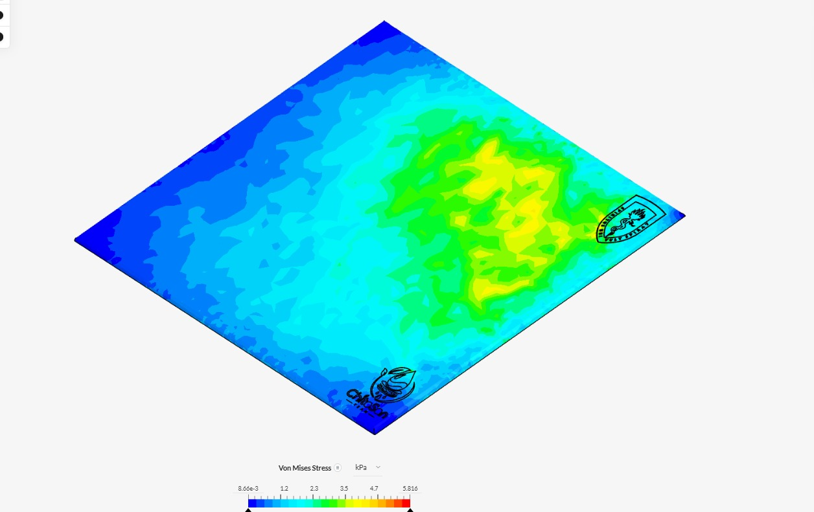

<em>Figura 1. Esfuerzo de von Mises en la base de acrílico (SimScale).</em>

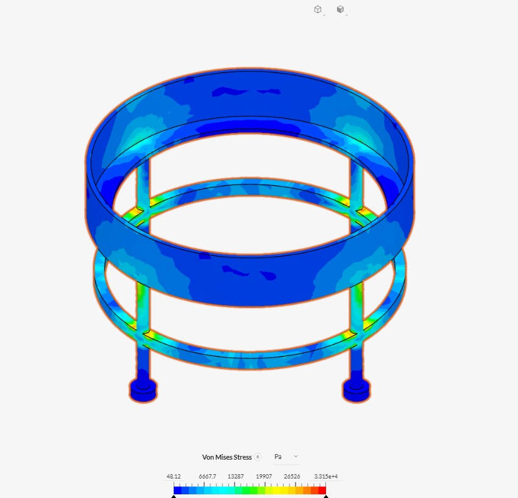

<em>Figura 2. Esfuerzo de von Mises en el soporte del reactor de PLA (SimScale).</em>

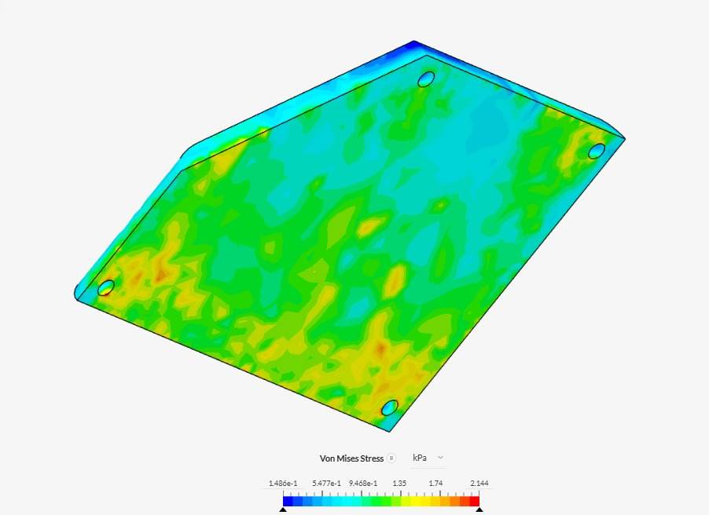

<em>Figura 3. Esfuerzo de von Mises en la placa con cuatro orificios de PLA (SimScale).</em>

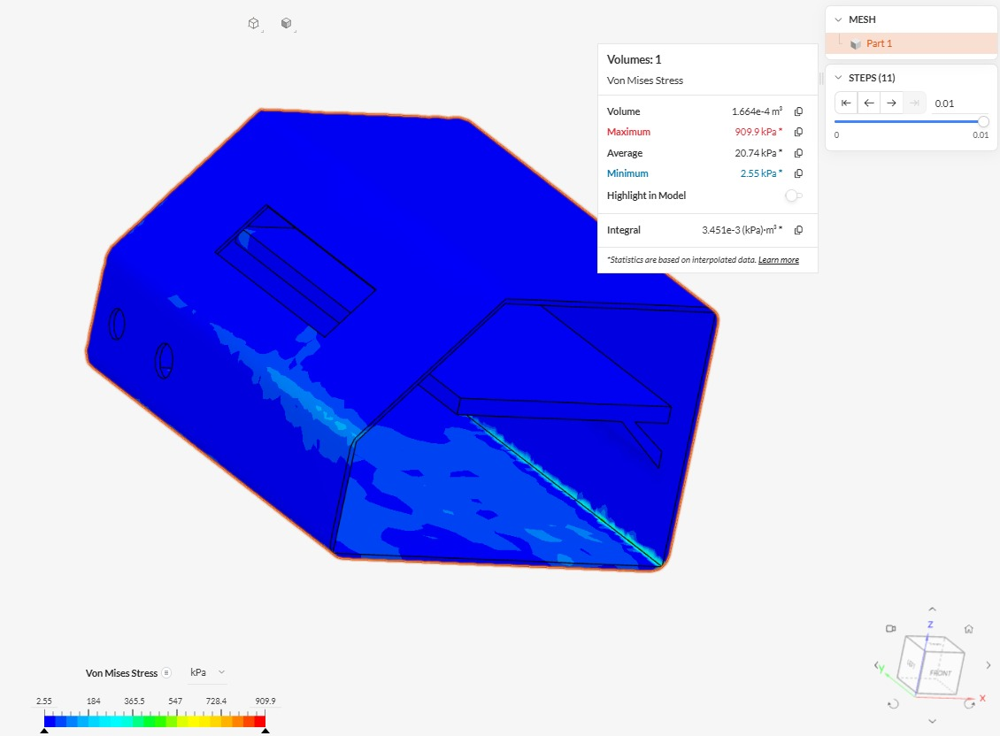

<em>Figura 4. Esfuerzo de von Mises en la caja de control de PLA (SimScale).</em>

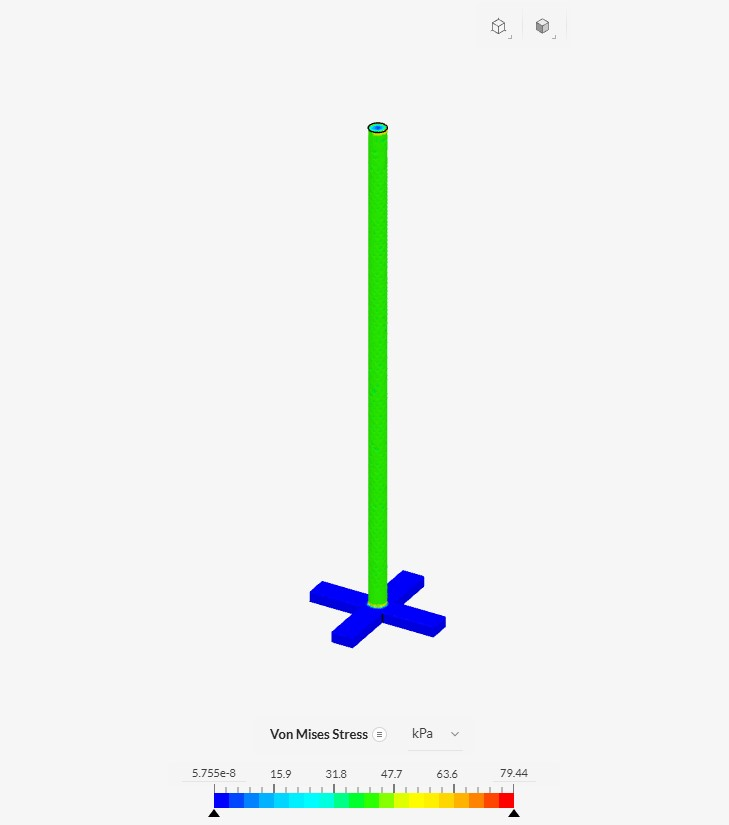

<em>Figura 5. Esfuerzo de von Mises en el agitador de PLA (SimScale).</em>

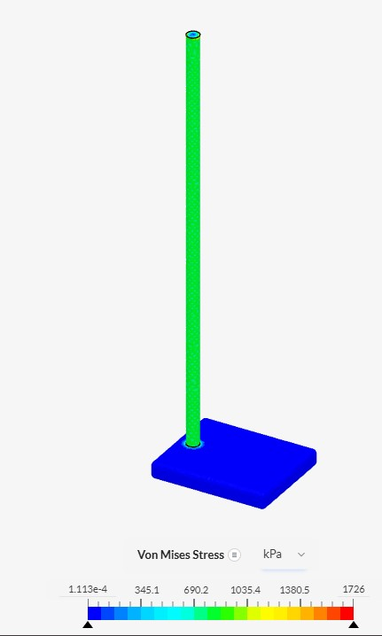

<em>Figura 6. Esfuerzo de von Mises en el soporte de Acero (SimScale).</em>

La Tabla 3 resume el esfuerzo máximo de la escala de cada figura.

<em>Tabla 3. Esfuerzo máximo de von Mises y factor de seguridad por pieza.</em>

| Pieza | Esfuerzo máximo | Equivalencia | Esfuerzo de fluencia del material | FS |
|:---:|:---:|:---:|:---:|:---:|
| Base | 5 652 Pa | 0,005652 MPa | 70 MPa | 12385 |
| Soporte del reactor | 33 150 Pa | 0,03315 MPa | 50 MPa | 1508,3 |
| Placa con cuatro orificios | 2 144 Pa | 0,002144 MPa | 50 MPa | 23320,9 |
| Caja de control | 909 900 Pa | 0,9099 MPa | 50 MPa | 54,9 |
| Agitador | 11 250 Pa | 0,01125 MPa | 50 MPa | 4444,4 |
| Soporte metálico | 1 726 000 Pa | 1,726 MPa | 250 MPa | 144,8 |

**Interpretación.** En la base, los esfuerzos más altos se ubican en la parte derecha de la placa (Figura 1). En el soporte del reactor, la mayor parte de la pieza tiene esfuerzos bajos y los más altos aparecen en las patas y en su unión con el anillo inferior (Figura 2). En la placa, los esfuerzos se concentran alrededor de los orificios (Figura 3). En la caja de control, casi toda la superficie tiene esfuerzos bajos y el máximo se localiza en una línea del borde inferior y alrededor de la abertura (Figura 4). En el agitador, el eje soporta esfuerzos intermedios y la paleta, valores cercanos a cero (Figura 5). La caja de control es la pieza más exigida, con 0,9099 MPa, y la placa la menos exigida, con 0,002144 MPa. En el soporte metálico, el esfuerzo más alto se ubica en la unión entre la varilla y la base y en la tapa donde se aplica la carga; la varilla trabaja con esfuerzos intermedios y la base casi no se exige (Figura 6).

**Alcance del resultado.** La simulación evalúa solo la resistencia mecánica y dura 0,01 s, por lo que no representa una carga mantenida. Tampoco considera el efecto químico del ácido acético sobre el PLA, un riesgo identificado en el TRL 2 [[2]](#ref2) que debe verificarse por separado. Para concluir si las piezas resisten, el esfuerzo máximo debe compararse con la resistencia del filamento (Tabla 3).

---

# 3. Ensayos experimentales: pruebas de sensores y actuadores

## 3.1 Qué mide cada elemento del sistema

El sistema utiliza sensores para caracterizar el agua y actuadores para controlar algunas operaciones del proceso. En esta etapa se verificó el funcionamiento individual de los componentes y, en el caso de los sensores de pH y turbidez, también su adquisición simultánea mediante el ESP32. La Tabla 4 resume la función y el tipo de prueba realizada.

<em>Tabla 4. Elementos probados en el TRL 3.</em>

| Elemento | Variable o función | Principio | Prueba realizada |
|:---:|:---:|:---:|:---:|
| Sensor de turbidez TS-300B | Respuesta relacionada con la turbidez | Óptico (dispersión y atenuación) | Comparación entre agua destilada y agua con tierra de jardín |
| Módulo de pH PH-4502C | pH | Potenciométrico (Nernst) | Lectura y calibración con soluciones de pH 4, 7 y 10 |
| Sensor de nivel XKC-Y25-V | Presencia de líquido en un punto | Capacitivo sin contacto | Detección del agua a diferentes alturas en un recipiente |
| Bomba peristáltica NKP-DC-S10B | Transporte de líquido | Desplazamiento positivo | Bombeo de agua y de un líquido viscoso durante 10 segundos |
| Interruptor KCD1 | Encendido y apagado de la alimentación | Contacto eléctrico | Interrupción y restablecimiento de la alimentación del sistema |

## 3.2 Conversión de las señales en datos

El ESP32 DOIT DevKit V1 recibe las señales analógicas de los sensores mediante su convertidor analógico-digital (ADC), configurado a 12 bits, con valores entre 0 y 4095 y atenuación de 11 dB. La tensión se obtiene mediante `analogReadMilliVolts()`.

- **Turbidez.** Se registra la tensión analógica entregada por el TS-300B. El programa también calcula una estimación de turbidez en NTU. Esta conversión debe considerarse aproximada mientras no se documente y valide una curva propia con patrones de turbidez conocida y un instrumento de referencia [[3]](#ref3), [[4]](#ref4).
- **pH.** La salida del módulo PH-4502C pasa por un divisor resistivo de factor 1,6 antes de llegar al ESP32. Para recuperar la tensión original del módulo, se multiplica la tensión medida por 1,6. Con las lecturas de las soluciones de pH 7,00 y 4,00 se calcula la pendiente:

$$
m = \frac{V_7 - V_4}{7 - 4}
$$

La conversión utilizada es:

$$
pH = 7 + \frac{V - V_7}{m}
$$

Donde $V$ es la tensión original del módulo, $V_7$ es la tensión registrada en la solución de pH 7,00 y $m$ es la pendiente obtenida en la calibración.
- **Nivel.** El XKC-Y25-V detecta la presencia de líquido a la altura donde está instalado. Su salida representa un estado de detección, no una medición continua del volumen [[10]](#ref10).
- **Dosificación.** La bomba peristáltica debe caracterizarse midiendo el volumen entregado durante un tiempo conocido. El caudal se calcula mediante:

$$
Q = \frac{V_{\text{bombeado}}}{t}
\qquad\qquad
t_{\text{dosis}} = \frac{V_{\text{dosis}}}{Q}
$$

En las pruebas realizadas todavía no se midió el volumen bombeado, por lo que no se dispone de un caudal experimental ni de un tiempo de dosificación calculado.

**Sensibilidad esperada del electrodo de pH.** A 25 °C, la ecuación de Nernst establece una pendiente teórica de aproximadamente 59,16 mV por unidad de pH [[7]](#ref7). La pendiente obtenida con las tensiones del módulo incluye también el acondicionamiento electrónico de la placa PH-4502C; por ello, no debe compararse directamente con la pendiente teórica del electrodo sin considerar dicho acondicionamiento.

## 3.3 Procedimiento de las pruebas

Las pruebas se realizaron con un banco de adquisición armado sobre protoboard y alimentado mediante un convertidor DC-DC que entrega 5 V. Las lecturas se visualizaron en el monitor serial del Arduino IDE.

1. **Turbidez:** se conectó el TS-300B al GPIO35 mediante un divisor resistivo. Se colocó el sensor verticalmente dentro de recipientes con agua destilada y agua mezclada con tierra de jardín. Se realizaron al menos tres lecturas por condición, sosteniendo manualmente el sensor para mantener su posición.
2. **pH:** se conectó la salida del módulo PH-4502C al GPIO34 mediante el divisor resistivo. Se utilizaron soluciones amortiguadoras de pH 4, 7 y 10 a temperatura ambiente. Se esperó a que la lectura se estabilizara, se registraron dos o más lecturas por solución y se enjuagó el electrodo entre soluciones.
3. **Nivel:** se instaló el XKC-Y25-V en la pared exterior de un recipiente plástico, a una altura elegida para comprobar su detección. Se llenó el recipiente hasta alcanzar el sensor y se repitió la prueba más de cinco veces, variando la altura del agua. Se observó el indicador LED rojo del módulo. No se pudieron registrar las señales en el monitor serial debido a fallas que presentó el ESP32 durante esa prueba.
4. **Bomba peristáltica:** se probó la bomba NKP-DC-S10B, de 12 V, conectándola directamente a la alimentación de 12 V y 2 A mediante la bornera. Se realizaron tres pruebas de 10 segundos: primero con agua de caño y luego con jugo de plátano como líquido viscoso de prueba. Se observó el transporte del líquido, pero no se midió el volumen bombeado.
5. **Interruptor:** se probó el interruptor KCD1 de tres terminales sobre una protoboard, utilizando cables adecuados y el convertidor DC-DC. Se empleó para interrumpir la alimentación de 12 V que entrega el adaptador. Se realizaron tres ciclos de encendido y apagado y se verificó con el multímetro la presencia o ausencia de tensión en la salida.

## 3.4 Valores de referencia y criterio de aceptación

Cada prueba se compara con el comportamiento esperado del componente. Los criterios de esta etapa son principalmente funcionales; cuando no se cuenta con instrumentos o mediciones cuantitativas, el resultado se limita a la evidencia observada.

<em>Tabla 5. Valores de referencia y criterios de aceptación de cada prueba.</em>

| Elemento | Prueba | Valor de referencia | Criterio de aceptación |
|:---:|:---:|:---:|:---:|
| Turbidez | Agua destilada frente a agua con tierra | La muestra con más partículas debe producir una señal diferente y, según la respuesta observada del montaje, una tensión menor [[3]](#ref3) | Diferencia clara y repetible entre las condiciones |
| pH | Soluciones amortiguadoras de pH 4, 7 y 10 | pH nominal de cada solución | La lectura calculada debe seguir el orden y los valores de las soluciones de referencia |
| Nivel | Agua por debajo y a la altura del sensor | Cambio de estado al llegar el líquido al punto de detección | Detección correcta en las repeticiones realizadas |
| Bomba peristáltica | Bombeo durante 10 segundos | Transporte continuo del líquido | La bomba debe transportar el líquido sin interrupciones visibles; el caudal queda pendiente de medición |
| Interruptor | Tres ciclos de encendido y apagado | Presencia de tensión en encendido y ausencia en apagado | Respuesta correcta en los tres ciclos, verificada con multímetro |

## 3.5 Resultados de las pruebas

La Tabla 6 resume los resultados obtenidos. Los sensores de turbidez y pH cuentan con lecturas eléctricas registradas. El sensor de nivel y el interruptor fueron verificados funcionalmente. La bomba transportó los líquidos de prueba, pero todavía no se midió su caudal.

<em>Tabla 6. Resumen de las pruebas de sensores y actuadores.</em>

| Elemento | Resultado | Lectura o evidencia | Estado |
|:---:|:---:|:---:|:---:|
| Turbidez | Diferencia de señal entre muestras y estimación aproximada de NTU | Agua destilada: 1,748 V; agua turbia: 0,154 V. Prueba posterior con agua de caño: ADC 3475 y 2,838 V | Prueba funcional realizada; calibración en NTU por validar |
| pH | Lecturas con soluciones de pH 4, 7 y 10 y conversión directa a pH | Pendiente calculada: −0,18 V/pH | Calibración de dos puntos realizada; verificación con pH 10 coherente |
| Nivel de agua | El LED rojo del módulo se encendió al detectar el agua | Más de cinco pruebas a diferentes alturas; sin registro serial | Prueba funcional realizada |
| Bomba peristáltica | Bombeo de agua de caño y jugo de plátano | Tres pruebas de 10 segundos; sin medición de volumen | Prueba funcional realizada; caudal pendiente |
| Interruptor | Interrupción y restablecimiento de la alimentación | Tres ciclos verificados con multímetro | Prueba funcional realizada; instalación en caja pendiente |

### 3.5.1 Sensor de turbidez

**Por qué se espera ese comportamiento.** El TS-300B utiliza un principio óptico: la cantidad de luz que alcanza el receptor cambia según las partículas presentes en el agua. En las condiciones de esta prueba, se esperaba una tensión menor al aumentar la cantidad de partículas suspendidas.

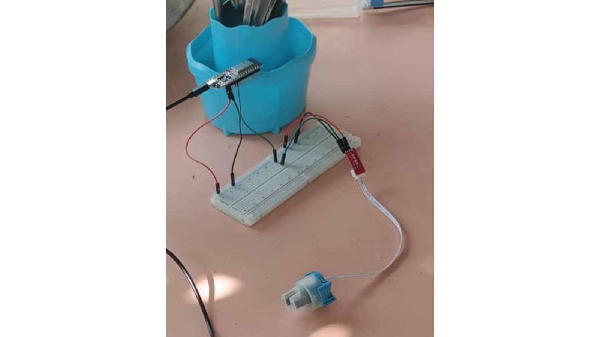

<em>Figura 7. Montaje del sensor de turbidez conectado al ESP32 mediante protoboard.</em>

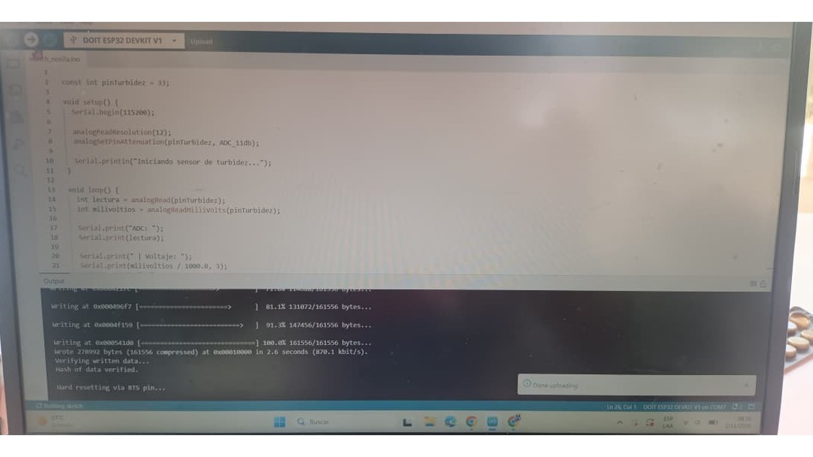

<em>Figura 8. Programa de lectura del sensor de turbidez mediante el ESP32.</em>

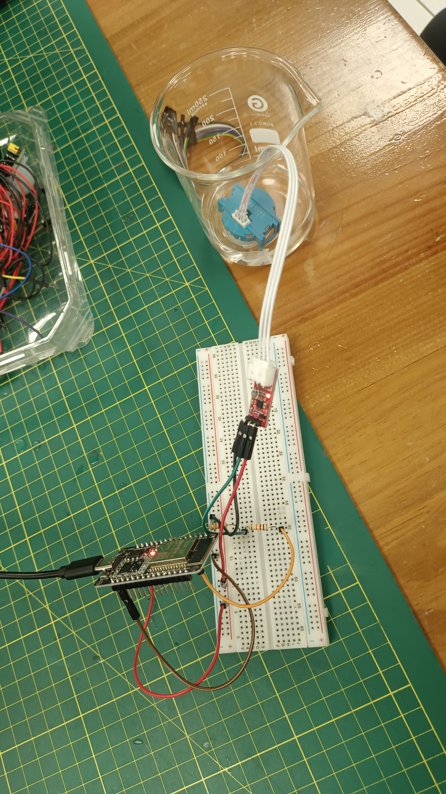

<em>Figura 9. Ensayo con agua destilada.</em>

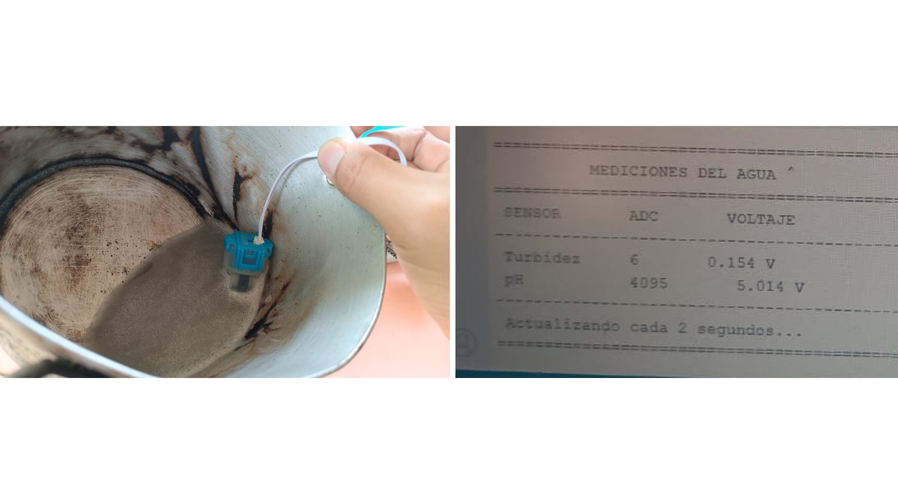

<em>Figura 10. Ensayo con agua mezclada con tierra de jardín.</em>

<em>Tabla 7. Lecturas registradas del sensor de turbidez.</em>

| Muestra | ADC (0–4095) | Tensión en el pin (V) |
|:---:|:---:|:---:|
| Agua destilada (prueba inicial) | 1951 | 1,748 |
| Agua con tierra de jardín (prueba inicial) | 6 | 0,154 |
| Agua de caño (prueba posterior, 05/11/2026) | 3475 | 2,838 |

Las pruebas se realizaron varias veces, con un mínimo de tres lecturas por condición. Sin embargo, la tabla presenta únicamente los valores puntuales que quedaron registrados; no se dispone aquí de los datos individuales necesarios para calcular promedios y desviaciones estándar.

**Comparación con el valor esperado.** En la prueba inicial, la tensión pasó de 1,748 V en agua destilada a 0,154 V en agua con tierra de jardín. La reducción observada fue de aproximadamente 91,2 %, por lo que el sensor distinguió ambas condiciones en el sentido esperado para el montaje. En una prueba posterior realizada el 05/11/2026, el agua de caño produjo una lectura de 2,838 V (ADC 3475). Se cuenta además con una estimación de NTU generada por el programa; no obstante, esta debe considerarse aproximada hasta validarla con patrones de turbidez conocida y un turbidímetro de referencia [[3]](#ref3), [[4]](#ref4).

El sensor se sostuvo manualmente en posición vertical durante las pruebas. Por ello, la posición, la iluminación ambiental y la repetibilidad del montaje pueden influir en las lecturas. Para una calibración cuantitativa posterior será necesario mantener fija la posición del sensor y registrar varias mediciones por muestra.

### 3.5.2 Sensor de pH

**Por qué se espera ese comportamiento.** El electrodo de vidrio genera una diferencia de potencial relacionada con el pH de la solución. El módulo PH-4502C acondiciona esa señal para que pueda ser adquirida por el ESP32 [[6]](#ref6), [[7]](#ref7).

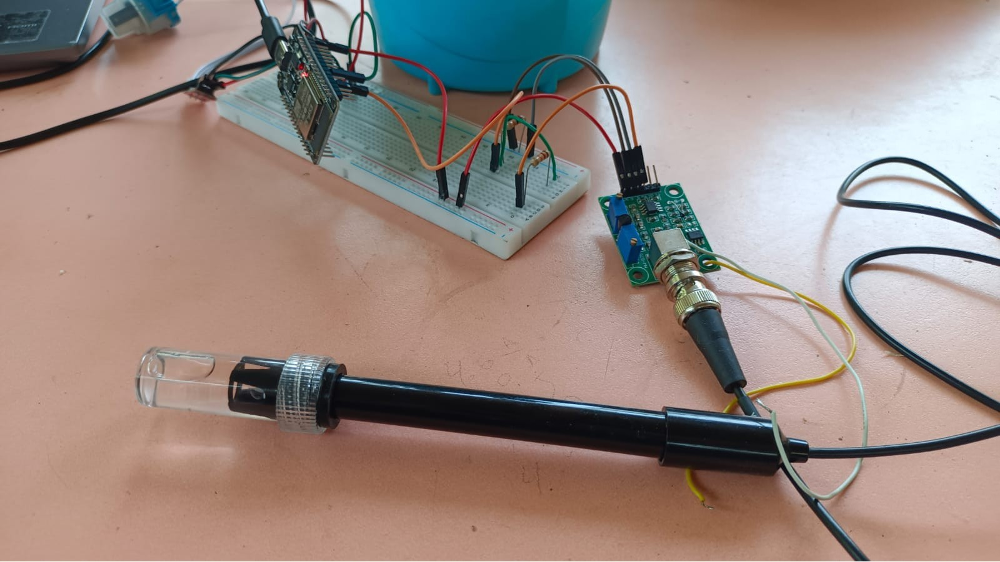

<em>Figura 11. Montaje del sensor de pH con el módulo PH-4502C, el electrodo y el divisor resistivo.</em>

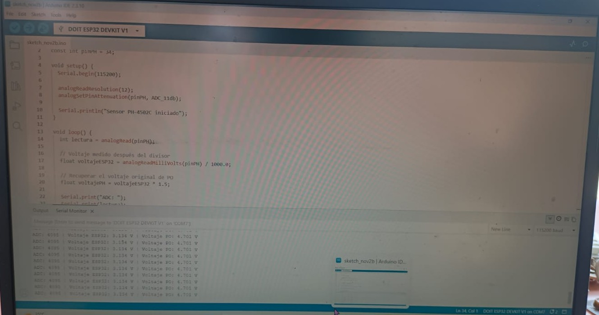

<em>Figura 12. Programa de lectura del sensor de pH y visualización de datos en el monitor serial.</em>

Las pruebas se realizaron con soluciones amortiguadoras de pH 4, 7 y 10, a temperatura ambiente. En cada solución se esperó a que la lectura se estabilizara, se tomaron dos o más lecturas y se enjuagó el electrodo antes de pasar a la siguiente solución. El divisor resistivo utilizado tiene un factor de corrección de 1,6 para recuperar la tensión original del módulo.

<em>Tabla 8. Lecturas registradas durante la calibración del sensor de pH.</em>

| Solución | pH nominal | ADC | Tensión en el pin ESP32 (V) | Tensión original del módulo (V) |
|:---:|:---:|:---:|:---:|:---:|
| Amortiguadora 1 | 4,00 | 2178 | 1,899 | 3,040 |
| Amortiguadora 2 | 7,00 | 1758 | 1,564 | 2,500 |
| Verificación | 10,00 | 1347 | 1,228 | 1,960 |

A partir de las soluciones de pH 4 y 7 se obtuvo:

$$
m = \frac{2,500 - 3,040}{7 - 4}
= -0,180\ \text{V/pH}
$$

Por tanto, la ecuación de conversión es:

$$
pH = 7 + \frac{V - 2,500}{-0,180}
$$

Al sustituir la tensión de 1,960 V registrada con la solución de pH 10:

$$
pH = 7 + \frac{1,960 - 2,500}{-0,180}
= 10,00
$$

**Comparación con el valor esperado.** La lectura calculada para la solución de verificación coincide con su valor nominal de pH 10,00 usando los valores registrados. Esto muestra coherencia entre los tres puntos ensayados. Sin embargo, como no se cuenta con los registros individuales completos, la desviación estándar ni una comparación con un pHmetro de referencia, no se puede establecer todavía el error metrológico del sensor.

### 3.5.3 Sensor de nivel de agua (XKC-Y25-V)

**Por qué se espera ese comportamiento.** El XKC-Y25-V es un sensor capacitivo sin contacto que se instala en la parte exterior de un recipiente no metálico. Cuando el líquido alcanza la zona de detección, el módulo cambia su estado de salida e indica la presencia de agua [[10]](#ref10).

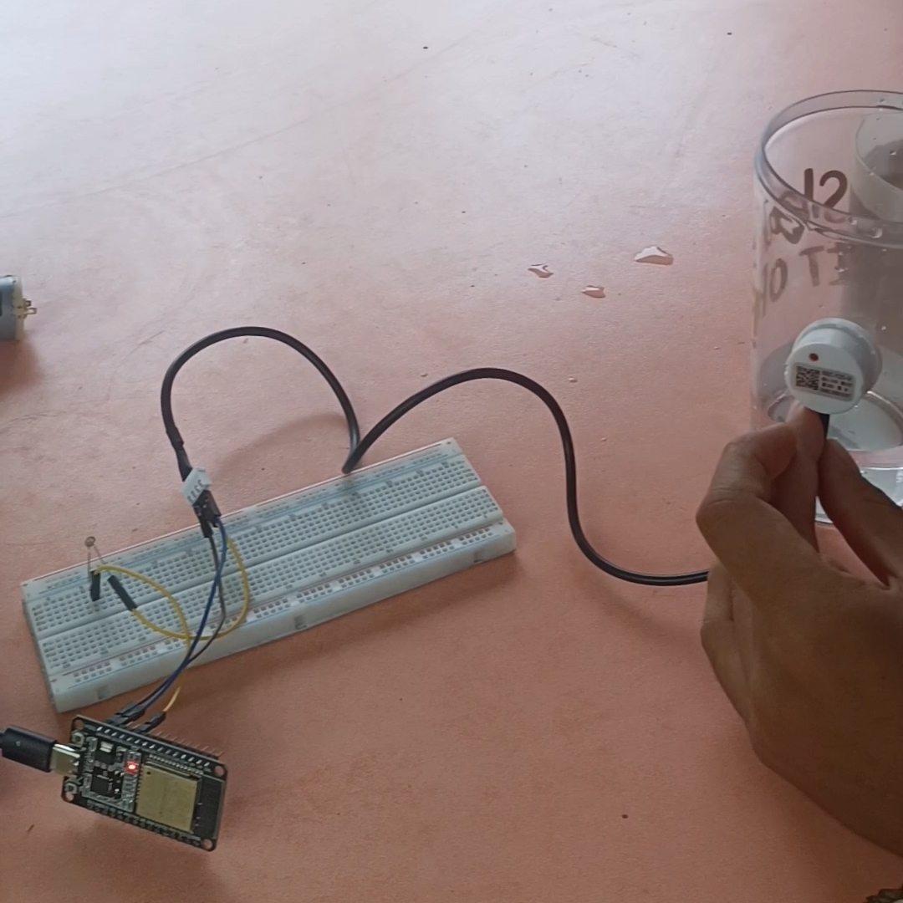

<em>Figura 13. Instalación del sensor de nivel XKC-Y25-V en el recipiente de prueba.</em>

El sensor se conectó al GPIO14 del ESP32. Se colocó a una altura arbitraria para comprobar su funcionamiento, sin utilizar todavía la marca de 1 L como referencia. Se llenó el recipiente hasta alcanzar el punto de detección y se repitió la prueba más de cinco veces a diferentes alturas.

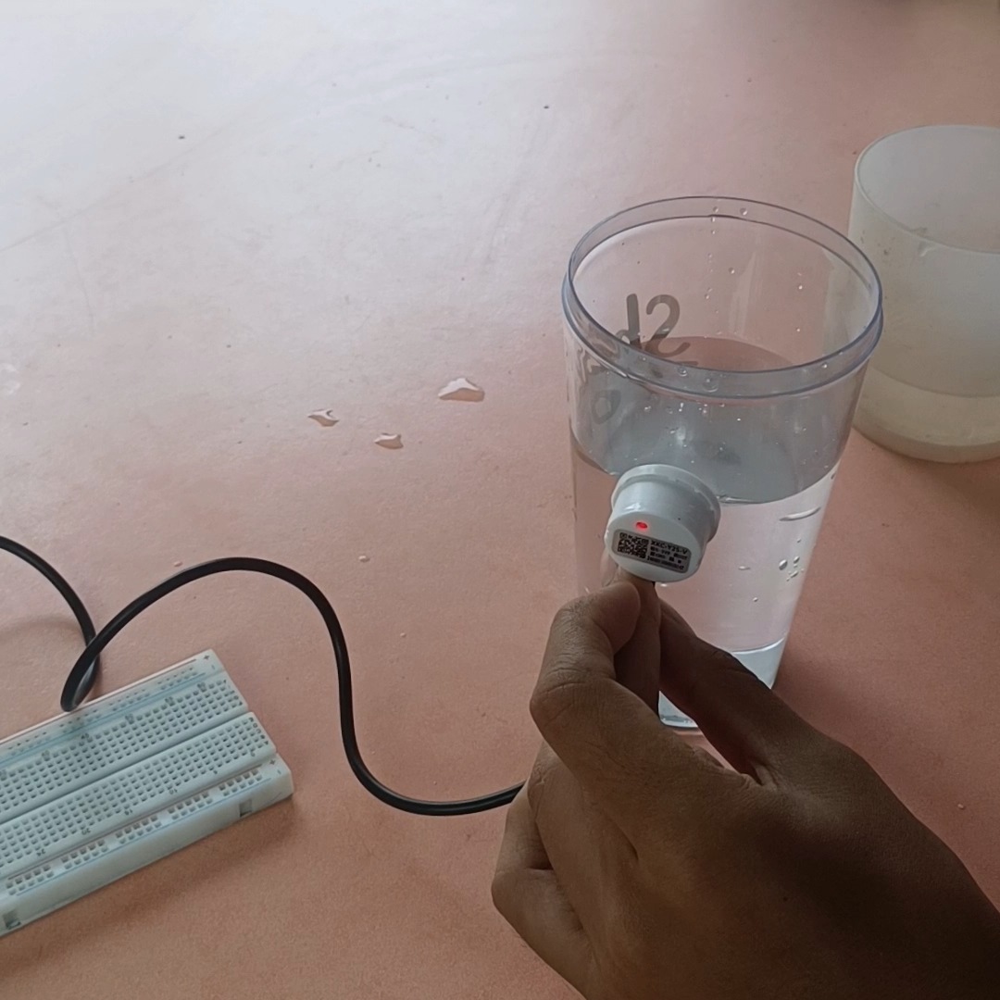

<em>Figura 14. Respuesta visual del sensor de nivel durante la detección del agua.</em>

<em>Tabla 9. Resultados de la prueba funcional del sensor de nivel.</em>

| Condición de prueba | Resultado observado | Evidencia |
|:---:|:---:|:---:|
| Agua por debajo del punto de detección | Se evaluó variando la altura del agua | Prueba física |
| Agua al alcanzar el sensor | Se encendió el LED rojo del módulo | Indicador visual |
| Repeticiones | Más de cinco pruebas a diferentes alturas | Detección observada en todas |

**Comparación con el valor esperado.** El sensor respondió visualmente al detectar el agua y el comportamiento se repitió en más de cinco pruebas realizadas a diferentes alturas. Sin embargo, no fue posible obtener las lecturas en el monitor serial porque el ESP32 presentó fallas durante esa prueba. Por ello, se demuestra la respuesta funcional del módulo mediante su indicador LED, pero queda pendiente registrar y verificar eléctricamente el cambio de estado en el GPIO14. Tampoco se ha validado todavía la detección exacta al alcanzar 1 L.

### 3.5.4 Bomba peristáltica NKP-DC-S10B

**Por qué se espera ese comportamiento.** La bomba peristáltica desplaza el líquido mediante la compresión sucesiva de un tubo flexible por medio de rodillos. El fluido entra en contacto principalmente con el interior del tubo. Para utilizarla en una dosificación controlada es necesario determinar experimentalmente su caudal [[11]](#ref11).

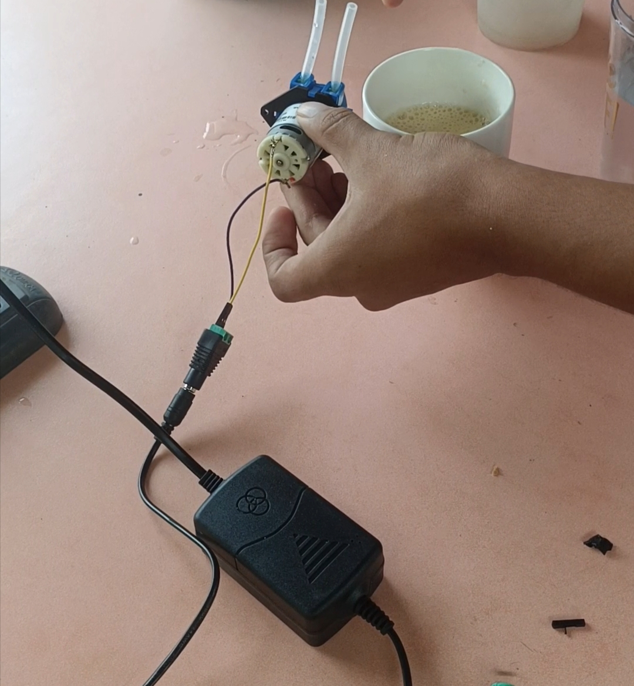

<em>Figura 15. Montaje de prueba de la bomba peristáltica NKP-DC-S10B.</em>

La bomba utilizada fue una NKP-DC-S10B de 12 V. Para la prueba se alimentó directamente desde la bornera conectada al adaptador de 12 V y 2 A, sin integrarla todavía al circuito de control definitivo. Se realizaron tres pruebas de 10 segundos. Primero se utilizó agua de caño y posteriormente jugo de plátano como líquido viscoso para observar el transporte de un fluido con mayor resistencia al movimiento.

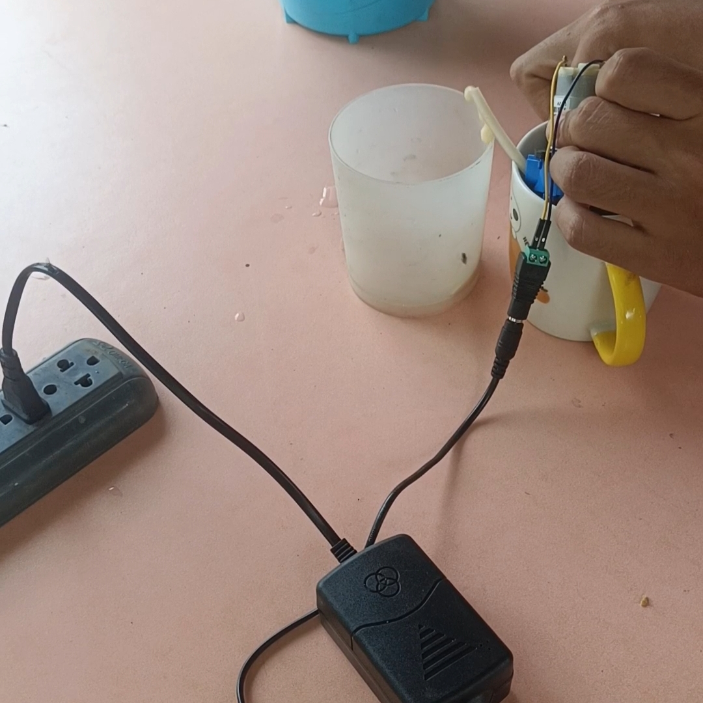

<em>Figura 16. Prueba de funcionamiento de la bomba peristáltica con los líquidos viscoso (jugo de plátano).</em>

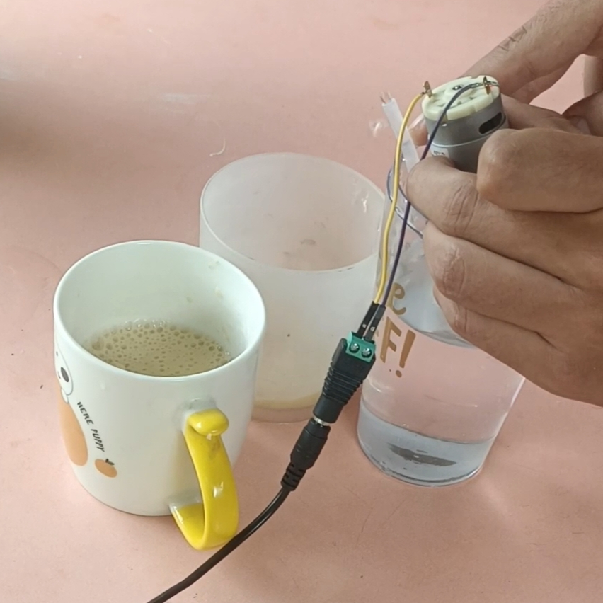

<em>Figura 17. Prueba de funcionamiento de la bomba peristáltica con agua limpia.</em>

<em>Tabla 10. Registro de las pruebas funcionales de la bomba peristáltica.</em>

| Repetición | Tiempo de funcionamiento (s) | Líquido utilizado | Resultado observado |
|:---:|:---:|:---:|:---:|
| 1 | 10 | Agua de caño | Transporte de líquido |
| 2 | 10 | Agua de caño | Transporte de líquido |
| 3 | 10 | Jugo de plátano | Transporte de líquido viscoso |

**Comparación con el valor esperado.** En las tres pruebas se observó que la bomba transportó el líquido. Durante la observación, el bombeo se percibió constante. Sin embargo, no se utilizó una probeta ni una balanza para medir el volumen entregado. En consecuencia, todavía no se puede calcular el caudal en mL/s, la variación entre repeticiones ni el error de dosificación. La prueba demuestra el funcionamiento mecánico básico de la bomba, pero su capacidad de dosificación cuantitativa queda pendiente de calibración.

### 3.5.5 Interruptor de encendido y apagado KCD1

**Por qué se espera ese comportamiento.** El interruptor KCD1 permite abrir o cerrar el circuito de alimentación del sistema. Al cerrar el circuito, la alimentación debe llegar al convertidor DC-DC y al resto del banco; al abrirlo, debe interrumpirse la alimentación.

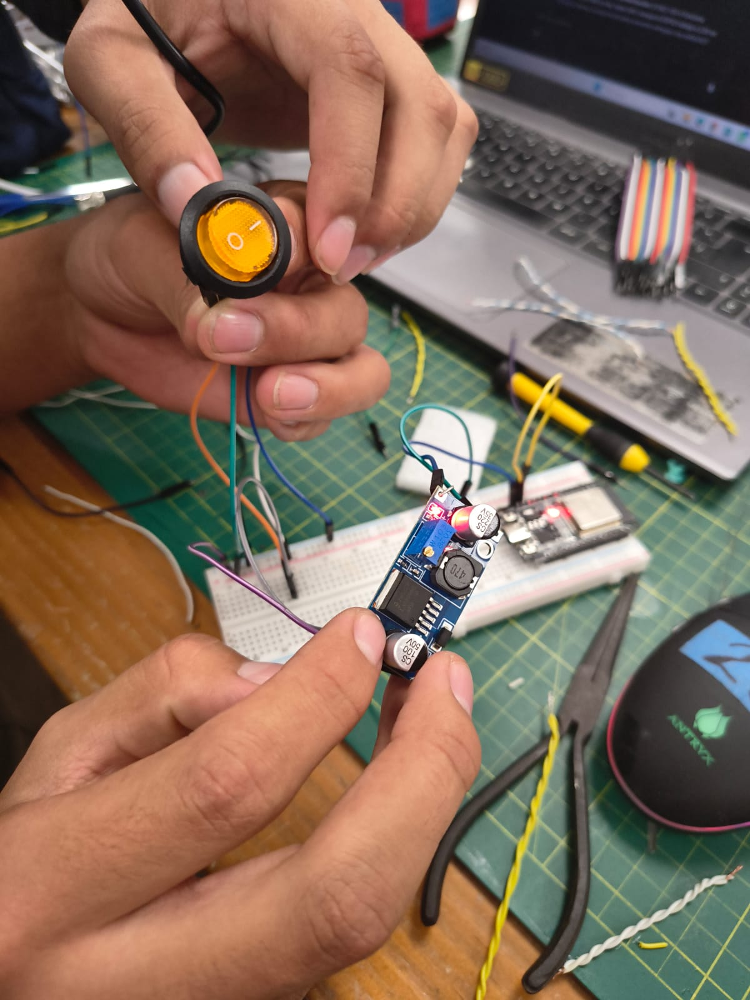

<em>Figura 18. Prueba del interruptor KCD1 encendido sobre protoboard.</em>

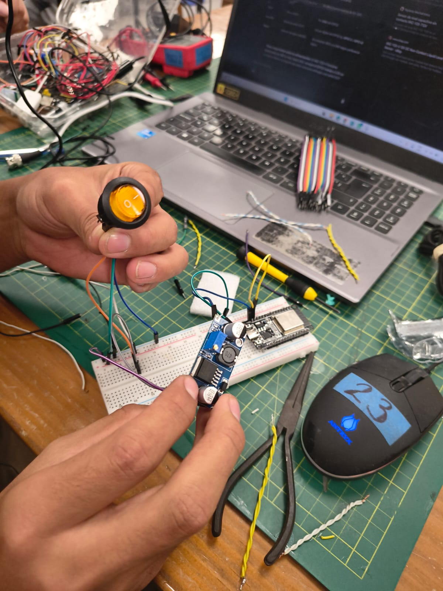

<em>Figura 19. Prueba del interruptor KCD1 apagado sobre protoboard.</em>

El interruptor de tres terminales se probó sobre una protoboard, utilizando cables adecuados y el convertidor DC-DC. Se destinó a interrumpir la alimentación de 12 V y 2 A entregada por el adaptador. Se realizaron tres ciclos de encendido y apagado y se utilizó un multímetro para verificar la presencia o ausencia de tensión en la salida. El interruptor todavía no se instaló en la caja de control del prototipo.

<em>Tabla 11. Resultados de la prueba del interruptor KCD1.</em>

| Acción | Respuesta observada | Resultado |
|:---:|:---:|:---:|
| Apagado → encendido | Se restableció la alimentación y el ESP32 pudo iniciar | Correcto |
| Encendido → apagado | Se interrumpió la alimentación; el multímetro verificó la ausencia de tensión en la salida | Correcto |
| Repeticiones | Tres ciclos de encendido y apagado | Correcto en las pruebas realizadas |

**Comparación con el valor esperado.** El interruptor respondió correctamente en los tres ciclos realizados: permitió alimentar el sistema y cortar la alimentación cuando se accionó. La prueba se verificó con el multímetro. No obstante, el componente aún no está instalado en la caja de control, por lo que queda pendiente comprobar su montaje físico en el prototipo definitivo.

---

# 4. Demo del prototipo

El prototipo de esta etapa tiene dos partes: un banco de pruebas de adquisición de señales armado sobre protoboard, con el que se hicieron los ensayos de la sección 3 (Figuras 6 y 10), y las piezas estructurales cuyo diseño está en Onshape y que se verificaron en la sección 2. La Tabla 13 resume los componentes del banco.

<em>Tabla 13. Componentes del banco de pruebas y su conexión.</em>

| Componente | Función en el sistema | Conexión en el prototipo |
|:---:|:---:|:---:|
| ESP32 DOIT DevKit V1 | Adquiere las señales y las envía al monitor serie | Cable USB al computador |
| Sensor de turbidez TS-300B | Entrega una tensión analógica que varía con las partículas suspendidas | Señal al pin GPIO 33 |
| Módulo de pH PH-4502C con electrodo y conector BNC | Acondiciona la señal potenciométrica del electrodo | Señal al pin GPIO 34, a través de un divisor resistivo de factor 1,5 |
| Sensor de nivel XKC-Y25 | Confirma el nivel de 1 L | Pin GPIO 14 |
| Bomba peristáltica | Dosifica la solución de quitosano | Conexión desde la bornera, 12V 2A |
| Interruptor de encendido y apagado | Enciende y apaga el sistema | Pin central: Entrada, de la bornera 12V 2A. Pin lateral: Continuación a transformador DC-DC y resto de componentes. Pin dorado: GND general |

**Diferencias entre el banco de pruebas y el esquemático del TRL 2.** El banco se armó para las primeras lecturas y no reproduce todavía el circuito del esquemático v1.2 [[2]](#ref2). En el esquemático, la señal de turbidez entra por el GPIO35 y las señales de pH y turbidez pasan por divisores de 15 kΩ y 20 kΩ, que reducen 5 V a unos 2,86 V (factor 1,75). En el banco, la turbidez se leyó por el GPIO33 y el pH por el GPIO34 con un divisor de factor 1,5. Al integrar el circuito definitivo, el programa debe actualizarse con los pines y los factores del esquemático.

La Figura 19 muestra el prototipo con los elementos probados.

<b>[COMPLETAR · INSERTAR IMAGEN AQUÍ]</b> Foto general del prototipo: reactor de 1 L, bombas, sensores de pH, turbidez y nivel, caja de control y pantalla OLED.

<!-- Cuando tengas la foto, súbela a images/ y reemplaza este bloque por:

 -->

<em>Figura 20. Demo del prototipo del sistema de clarificación con quitosano: reactor, sensores, bomba peristáltica y caja de control.</em>

En la figura se identifican los componentes: **[COMPLETAR]** (listar y numerar los elementos que se ven en la foto).

**Video de la demostración.** **[COMPLETAR]** (enlace al video del demo).

---

# 5. Resultados y discusión

**Estructura.** La simulación dinámica de las cinco piezas (Figuras 1 a 5) muestra esfuerzos máximos de entre 0,002144 MPa y 0,9099 MPa, siendo la caja de control la pieza más exigida. Para concluir si resisten, estos valores deben compararse con el esfuerzo de fluencia del filamento (**[COMPLETAR]**, Tabla 3). La simulación no considera el efecto del ácido acético sobre el PLA [[2]](#ref2).

**Turbidez.** El sensor TS-300B entregó 1,748 V en agua clara y 0,154 V en agua turbia (Figuras 8 y 9), lo que confirma que su señal responde al cambio de condición, en el sentido que predice el principio óptico. Falta construir la curva de calibración con patrones para expresar la turbidez en NTU [[3]](#ref3), [[4]](#ref4).

**pH.** El sensor entregó una lectura saturada (Figura 11), por lo que todavía no mide pH. Se definió el protocolo de calibración de dos puntos y la tabla donde se registrarán sus resultados (Tabla 9).

**Nivel, bomba e interruptor.** **[COMPLETAR]** (resumir los resultados de las Figuras 12 a 16 y de las Tablas 10 a 12 cuando estén completas).

**Alcance.** Las pruebas se realizaron con el banco sobre protoboard, sin tratamiento de agua con quitosano. Los ensayos de dosificación y los porcentajes de remoción corresponden a las siguientes etapas.

---

# Referencias bibliográficas

[1] Consejo Nacional de Ciencia, Tecnología e Innovación Tecnológica (CONCYTEC), “Directiva N.° 001-2022-CONCYTEC-P: Uso de la metodología Nivel de Madurez Tecnológica (TRL),” Resolución de Presidencia N.° 020-2022-CONCYTEC-P, Lima, Perú, 2022. [En línea]. Disponible: https://vinculate.concytec.gob.pe/download/RP-020-2022-CONCYTEC-P.pdf

[2] Equipo 05, “Clarificación de agua con quitosano: formulación conceptual de la propuesta tecnológica · TRL 2,” Proyecto Integrador 2026-II, Universidad Peruana Cayetano Heredia, Lima, Perú, 2026. [En línea]. Disponible: https://github.com/BeyondNate/PI_Equipo_05/blob/main/Proyecto_Integrador/Talleres/TRL2/readme.md

[3] Q. Zhu, F. Cherqui y J.-L. Bertrand-Krajewski, “End-user perspective of low-cost sensors for urban stormwater monitoring: a review,” *Water Science and Technology*, vol. 87, no. 11, pp. 2648–2684, 2023, doi: 10.2166/wst.2023.142.

[4] L. C. Sperandio, M. S. Colombo, C. M. G. Andrade y C. B. B. Costa, “Development of a low-cost portable turbidimeter for processes,” arXiv:2106.09491, 2021. [En línea]. Disponible: https://arxiv.org/abs/2106.09491

[5] A. A. García Gonzales, “Monitoreo de la calidad del agua para zonas rurales mediante un sistema de sensores de bajo costo basados en IoT,” Tesis para optar el título profesional de Ingeniero de Sistemas e Informática, Universidad Nacional de San Martín, Tarapoto, Perú, 2026. [En línea]. Disponible: https://repositorio.unsm.edu.pe/backend/api/core/bitstreams/7b703913-6a81-469a-a5b5-e6e399c3ab88/content

[6] F. Vivaldi et al., “Recent advances in optical, electrochemical and field effect pH sensors,” *Chemosensors*, vol. 9, no. 2, Art. no. 33, 2021, doi: 10.3390/chemosensors9020033.

[7] R. P. Buck et al., “Measurement of pH. Definition, standards, and procedures (IUPAC Recommendations 2002),” *Pure and Applied Chemistry*, vol. 74, no. 11, pp. 2169–2200, 2002, doi: 10.1351/pac200274112169.

[8] S. Sinardi et al., “Linking degree of deacetylation to coagulation efficiency of crustacean waste chitosan in water treatment,” *Jurnal Presipitasi: Media Komunikasi dan Pengembangan Teknik Lingkungan*, vol. 23, no. 2, pp. 533–542, jul. 2026, doi: 10.14710/presipitasi.v23i2.533-542.

[9] M. N. Ahmad, M. R. Ishak y M. Z. Zulkafle Hannah, “The effect of fused deposition modeling parameters (FDM) on the mechanical properties of polylactic acid (PLA) printed parts,” *Journal of Advanced Research in Applied Mechanics*, vol. 123, no. 1, pp. 238–246, 2024.

[10] XKC, “Non-contact liquid level sensor instruction manual, XKC-Y25-V,” ver. 1.6, hoja de datos. Accedido: 26-oct-2026. [En línea]. Disponible: https://www.electrokit.com/upload/quick/dc/01/adff_41022296-tds.pdf

[11] J. Klespitz y L. Kovács, “Peristaltic pumps – a review on working and control possibilities,” en *Proc. IEEE 12th Int. Symp. Applied Machine Intelligence and Informatics (SAMI)*, Herl’any, Eslovaquia, ene. 2014, pp. 191–194.

[12] R. G. Budynas y J. K. Nisbett, *Shigley’s Mechanical Engineering Design*, 11.ª ed. Nueva York, NY, EE. UU.: McGraw-Hill Education, 2020.

---

<em>Clarificación de agua con quitosano · TRL 3 · Equipo 05 · Proyecto Integrador 2026-II</em>

