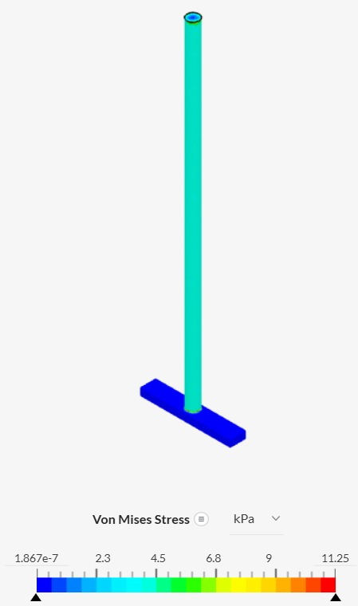

# CLARIFICACIÓN DE AGUA CON QUITOSANO — TRL 3
## Desarrollo experimental o prueba del concepto tecnológico

> **Proyecto:** sistema automatizado de clarificación de agua mediante la dosificación de una solución de quitosano en ácido acético al 1 %, con agua del río Lurín (Pachacámac) como referencia.

| Campo | Información |
|:---:|:---:|
| **Curso** | Proyecto Integrador 2026-II |
| **Integrantes** | Marcelo Alarcón Camones; Brad Cárdenas Parián; Leonel Urbano Castillo; Idania Parhuay Meza; Gael Milla Fasabi |
| **Ingenieros** | Umbert Lewis De La Cruz, Maria Rejas, Harry Rivera y Renzo Chan |
| **Fecha de actualización** | 07/11/2026 |
| **Institución** | Universidad Peruana Cayetano Heredia |
| **Tema** | TRL 3 de Clarificación de agua con quitosano — Prueba de concepto |

## Contenido

1. [Introducción](#1-introducción)
2. [Ensayos analíticos: simulación estructural en SimScale](#2-ensayos-analíticos-simulación-estructural-en-simscale)
3. [Ensayos experimentales: pruebas de sensores y actuadores](#3-ensayos-experimentales-pruebas-de-sensores-y-actuadores)
4. [Demo del prototipo](#4-demo-del-prototipo)
5. [Resultados y discusión](#5-resultados-y-discusión)
6. [Referencias bibliográficas](#referencias-bibliográficas)

---

# 1. Introducción

## 1.1 Qué representa el TRL 3

Según la metodología de CONCYTEC, el TRL 3 corresponde al desarrollo experimental o prueba del concepto tecnológico: se demuestra que los principios básicos previstos sustentan el desarrollo de la tecnología, se comienza a probar su viabilidad mediante estudios analíticos y de laboratorio, y el trabajo se realiza en un entorno de laboratorio [[1]](#ref1). Para ello se exigen dos evidencias: **datos de ensayos experimentales o analíticos** y un **demo o prototipo** para las primeras pruebas.

En el TRL 1 se identificaron los principios científicos del sistema y en el TRL 2 se formuló el concepto, junto con un plan para llegar a este nivel [[2]](#ref2). Por eso este informe no presenta ensayos de dosificación de quitosano ni porcentajes de remoción: esas pruebas corresponden a etapas posteriores.

## 1.2 Qué se prueba en el sistema

El sistema recibe 1 L de agua turbia en un reactor, mide su pH y su turbidez, calcula la dosis de quitosano, la dosifica con una bomba peristáltica, mezcla, deja sedimentar y evalúa el agua clarificada [[2]](#ref2). Un ESP32 coordina todo el proceso. En el TRL 3 se prueban los elementos que miden y accionan ese ciclo:

- **Sensor de turbidez (TS-300B):** entrada principal para decidir la dosis y para evaluar el resultado.
- **Sensor de pH (módulo PH-4502C con electrodo de vidrio):** caracteriza el agua antes de dosificar y verifica el agua clarificada.
- **Sensor de nivel de agua (XKC-Y25, capacitivo sin contacto):** confirma que el reactor alcanzó el nivel de 1 L [[10]](#ref10).
- **Bomba peristáltica:** entrega la solución de quitosano; su volumen debe verificarse y no asumirse [[11]](#ref11).
- **Interruptor de encendido y apagado:** enciende y apaga el sistema.

Las evidencias se presentan en tres secciones:

1. **Ensayo analítico (sección 2):** simulación estructural en SimScale de cinco piezas del prototipo.
2. **Ensayos experimentales (sección 3):** la conversión de las señales en datos y las pruebas de cada sensor y actuador.
3. **Demo del prototipo (sección 4):** el banco de pruebas armado sobre protoboard y el prototipo.

---

# 2. Ensayos analíticos: simulación estructural en SimScale

## 2.1 Objetivo y criterio de aceptación

**Objetivo.** Verificar, antes de fabricarlas, que las piezas estructurales del prototipo soportan las cargas de operación. El modelo está en Onshape ([modelo CAD](https://cad.onshape.com/documents/06947ddb91d11baa99cb7771/w/ae9234bc94d45c112f779e45/e/bae95c7a29d602dc0212cc6e)) y las piezas impresas se prevén en PLA, cuya resistencia depende de parámetros de impresión como la densidad de relleno, la orientación y la altura de capa [[9]](#ref9).

**Criterio de aceptación.** El esfuerzo equivalente de von Mises reúne en un solo valor los esfuerzos que actúan sobre un punto. Según el criterio de la energía de distorsión, un material dúctil no fluye mientras ese valor sea menor que su esfuerzo de fluencia [[12]](#ref12). Por eso el esfuerzo máximo de cada pieza debe quedar muy por debajo del esfuerzo de fluencia del material. El factor de seguridad se calcula como:

$$
FS = \frac{\sigma_{\text{fluencia}}}{\sigma_{\text{máx}}}
$$

El esfuerzo de fluencia del filamento utilizado se tomará de su ficha técnica: **[COMPLETAR]**.

## 2.2 Estudios realizados

Se simularon cinco piezas diseñadas en Onshape: la base, el soporte del reactor, una placa con cuatro orificios, la caja de control y el agitador (Tabla 1).

<em>Tabla 1. Piezas analizadas en SimScale.</em>

| Pieza | Material asignado | Tipo de análisis | Estado | Figura |
|:---:|:---:|:---:|:---:|:---:|
| Base | Acrílico (según el pie de figura) **[COMPLETAR]** | Dinámico | Resuelto | Figura 1 |
| Soporte del reactor | PLA | Dinámico | Resuelto | Figura 2 |
| Placa con cuatro orificios | PLA | Dinámico | Resuelto | Figura 3 |
| Caja de control | PLA | Dinámico | Resuelto | Figura 4 |
| Agitador | PLA | Dinámico | Resuelto | Figura 5 |

## 2.3 Configuración de los estudios

Los análisis se realizaron con 11 pasos de tiempo entre 0 y 0,01 s, y la variable analizada es el esfuerzo equivalente de von Mises. Las cargas y los apoyos de cada pieza se registran en la Tabla 2.

<em>Tabla 2. Fuerza aplicada y apoyos de cada pieza en la simulación.</em>

| Pieza | Fuerza aplicada | Apoyos o restricciones |
|:---:|:---:|:---:|
| Base | **[COMPLETAR]** | **[COMPLETAR]** |
| Soporte del reactor | **[COMPLETAR]** | **[COMPLETAR]** |
| Placa con cuatro orificios | **[COMPLETAR]** | **[COMPLETAR]** |
| Caja de control | **[COMPLETAR]** | **[COMPLETAR]** |
| Agitador | **[COMPLETAR]** | **[COMPLETAR]** |

## 2.4 Resultados

Las Figuras 1 a 5 muestran la distribución del esfuerzo de von Mises en cada pieza. En todas, el color azul indica esfuerzos cercanos a cero y el rojo, el máximo de la escala.

<em>Figura 1. Esfuerzo de von Mises en la base de acrílico (SimScale).</em>

<em>Figura 2. Esfuerzo de von Mises en el soporte del reactor de PLA (SimScale).</em>

<em>Figura 3. Esfuerzo de von Mises en la placa con cuatro orificios de PLA (SimScale).</em>

<em>Figura 4. Esfuerzo de von Mises en la caja de control de PLA (SimScale).</em>

<em>Figura 5. Esfuerzo de von Mises en el agitador de PLA (SimScale).</em>

La Tabla 3 resume el esfuerzo máximo de la escala de cada figura.

<em>Tabla 3. Esfuerzo máximo de von Mises y factor de seguridad por pieza.</em>

| Pieza | Esfuerzo máximo | Equivalencia | Esfuerzo de fluencia del material | FS |
|:---:|:---:|:---:|:---:|:---:|
| Base | 5 652 Pa | 0,005652 MPa | **[COMPLETAR]** | **[COMPLETAR]** |
| Soporte del reactor | 33 150 Pa | 0,03315 MPa | **[COMPLETAR]** | **[COMPLETAR]** |
| Placa con cuatro orificios | 2 144 Pa | 0,002144 MPa | **[COMPLETAR]** | **[COMPLETAR]** |
| Caja de control | 909 900 Pa | 0,9099 MPa | **[COMPLETAR]** | **[COMPLETAR]** |
| Agitador | 11 250 Pa | 0,01125 MPa | **[COMPLETAR]** | **[COMPLETAR]** |

**Interpretación.** En la base, los esfuerzos más altos se ubican en la parte derecha de la placa (Figura 1). En el soporte del reactor, la mayor parte de la pieza tiene esfuerzos bajos y los más altos aparecen en las patas y en su unión con el anillo inferior (Figura 2). En la placa, los esfuerzos se concentran alrededor de los orificios (Figura 3). En la caja de control, casi toda la superficie tiene esfuerzos bajos y el máximo se localiza en una línea del borde inferior y alrededor de la abertura (Figura 4). En el agitador, el eje soporta esfuerzos intermedios y la paleta, valores cercanos a cero (Figura 5). La caja de control es la pieza más exigida, con 0,9099 MPa, y la placa la menos exigida, con 0,002144 MPa.

**Alcance del resultado.** La simulación evalúa solo la resistencia mecánica y dura 0,01 s, por lo que no representa una carga mantenida. Tampoco considera el efecto químico del ácido acético sobre el PLA, un riesgo identificado en el TRL 2 [[2]](#ref2) que debe verificarse por separado. Para concluir si las piezas resisten, el esfuerzo máximo debe compararse con la resistencia del filamento (Tabla 3).

---

# 3. Ensayos experimentales: pruebas de sensores y actuadores

## 3.1 Qué mide cada elemento del sistema

El quitosano actúa por coagulación-floculación, y su desempeño depende del pH y de la turbidez inicial del agua; por ejemplo, la remoción de turbidez con quitosano se ha estudiado entre pH 5 y 9 [[8]](#ref8). Por eso el sistema mide ambas variables antes de dosificar y las vuelve a medir al final. La Tabla 4 resume qué variable aporta cada elemento y cómo se prueba.

<em>Tabla 4. Elementos probados en el TRL 3.</em>

| Elemento | Variable o función | Principio | Prueba realizada |
|:---:|:---:|:---:|:---:|
| Sensor de turbidez TS-300B | Turbidez | Óptico (dispersión y atenuación) | Agua clara frente a agua turbia |
| Módulo de pH PH-4502C | pH | Potenciométrico (Nernst) | Lectura y calibración con soluciones de pH conocido |
| Sensor de nivel XKC-Y25 | Presencia de líquido en un punto | Capacitivo sin contacto | Detección del nivel de 1 L |
| Bomba peristáltica | Volumen de quitosano dosificado | Desplazamiento positivo | Calibración por pesada |
| Interruptor de encendido y apagado | Encendido del sistema | Contacto eléctrico | Accionamiento y respuesta del sistema |

## 3.2 Conversión de las señales en datos

El ESP32 DOIT DevKit V1 recibe las señales de los sensores analógicos con su convertidor analógico-digital (ADC) configurado a 12 bits, es decir, valores enteros entre 0 y 4095, y con atenuación de 11 dB. El programa obtiene la tensión en el pin con la función `analogReadMilliVolts()`. A partir de ella:

- **Turbidez.** Se registra la tensión en el pin. La señal de este sensor no equivale a NTU sin una curva propia con patrones de turbidez conocida [[3]](#ref3), [[4]](#ref4).
- **pH.** La salida del módulo pasa por un divisor resistivo de factor 1,5 antes de llegar al ESP32, y el programa recupera la tensión original del módulo, $V$, multiplicando la tensión medida por 1,5. La conversión a unidades de pH se obtiene con una calibración de dos puntos con soluciones de pH 7,00 y 4,00:

$$
m = \frac{V_7 - V_4}{7 - 4} \qquad\qquad pH = 7 + \frac{V - V_7}{m}
$$

- **Nivel.** El XKC-Y25 detecta presencia o ausencia de líquido en un punto, no el volumen de forma continua [[10]](#ref10); su señal se interpreta como dos estados.
- **Dosificación.** El volumen entregado por la bomba peristáltica se calcula a partir de su caudal, $Q$, que se obtiene pesando el líquido bombeado durante un tiempo $t$ y suponiendo una densidad cercana a 1 g/mL, que debe verificarse:

$$
Q = \frac{V_{\text{bombeado}}}{t} \qquad\qquad t_{\text{dosis}} = \frac{V_{\text{dosis}}}{Q}
$$

**Sensibilidad esperada del electrodo de pH.** A 25 °C, la ecuación de Nernst da una pendiente teórica de 59,16 mV por unidad de pH [[7]](#ref7). Entre pH 5 y pH 9 la diferencia de potencial teórica en el electrodo es de 4 × 59,16 mV ≈ 237 mV, antes de la amplificación del módulo. Este valor se contrastará con la pendiente $m$ obtenida en la calibración.

## 3.3 Procedimiento de las pruebas

Las pruebas de turbidez y de pH se realizaron el 02/11/2026 con el banco de adquisición de la sección 4. Cada elemento siguió un procedimiento propio:

1. **Turbidez:** se cargó un programa que lee el pin 33 y se sumergió el sensor, sostenido a mano, en agua clara y en agua turbia con sedimento, registrando el valor de cada muestra.
2. **pH:** se cargó un programa que lee el pin 34, calcula la tensión después del divisor y recupera la tensión original del módulo.
3. **Nivel:** **[COMPLETAR]** (describir cómo se probó: recipiente, punto de detección y repeticiones).
4. **Bomba peristáltica:** **[COMPLETAR]** (describir tiempos de bombeo, recipiente y balanza o probeta utilizados).
5. **Interruptor:** **[COMPLETAR]** (describir cuántas veces se accionó y qué se verificó).

## 3.4 Valores de referencia y criterio de aceptación

Cada prueba se compara con un valor de referencia, que sirve para aceptar o rechazar el resultado (Tabla 5).

<em>Tabla 5. Valores de referencia y criterios de aceptación de cada prueba.</em>

| Elemento | Prueba | Valor de referencia | Criterio de aceptación |
|:---:|:---:|:---:|:---:|
| Turbidez | Agua clara frente a agua turbia | Más partículas, menos luz en el detector, menor tensión [[3]](#ref3) | La señal debe disminuir de forma clara en el agua turbia |
| pH | Soluciones de pH 7,00 y 4,00; verificación | pH nominal de la solución | Error de verificación menor que **[COMPLETAR]** unidades de pH |
| Nivel | Llenado hasta el punto de 1 L | Nivel marcado en el recipiente | El sensor cambia de estado al llegar el agua, en **[COMPLETAR]** repeticiones |
| Bomba peristáltica | Volumen bombeado por pesada | Masa medida en la balanza | Error del volumen menor que **[COMPLETAR]** % [[11]](#ref11) |
| Interruptor | Encendido y apagado | Estado esperado del sistema | Responde en todos los accionamientos (**[COMPLETAR]**) |

## 3.5 Resultados de las pruebas

La Tabla 6 resume el estado de cada prueba. Las dos primeras ya tienen lecturas; las otras tres se completarán con sus fotografías y datos.

<em>Tabla 6. Resumen de las pruebas de sensores y actuadores.</em>

| Elemento | Resultado | Lectura | Estado |
|:---:|:---:|:---:|:---:|
| Turbidez | Agua clara: 1,748 V; agua turbia: 0,154 V | La señal cambia entre las dos muestras | Realizada; falta curva en NTU |
| pH | ADC saturado en 4095 | No es una medición de pH; el sensor no está calibrado | Pendiente: calibración |
| Nivel de agua | **[COMPLETAR]** | **[COMPLETAR]** | Pendiente |
| Bomba peristáltica | **[COMPLETAR]** | **[COMPLETAR]** | Pendiente |
| Interruptor | **[COMPLETAR]** | **[COMPLETAR]** | Pendiente |

### 3.5.1 Sensor de turbidez

**Por qué se espera ese comportamiento.** El TS-300B es un sensor óptico con un emisor y un receptor de luz: cuando el agua es clara llega más luz al detector, y cuando aumentan las partículas la señal disminuye. La Figura 6 muestra el montaje y la Figura 7 el programa de lectura.

<em>Figura 6. Montaje del sensor de turbidez: ESP32 conectado a la protoboard y sensor con su cable hacia la placa.</em>

<em>Figura 7. Programa de lectura del sensor de turbidez (pin 33, ADC de 12 bits, atenuación de 11 dB) cargado en el ESP32.</em>

<em>Figura 8. Ensayo con agua clara: sensor sumergido en la taza (izquierda) y lectura en el monitor serie (derecha).</em>

<em>Figura 9. Ensayo con agua turbia y sedimento: sensor sumergido en el recipiente (izquierda) y lectura en el monitor serie (derecha).</em>

<em>Tabla 7. Lecturas del sensor de turbidez.</em>

| Muestra | ADC (0–4095) | Tensión en el pin (V) |
|:---:|:---:|:---:|
| Agua clara | 1951 | 1,748 |
| Agua turbia con sedimento | 6 | 0,154 |

**Comparación con el valor esperado.** La señal bajó de 1,748 V a 0,154 V al pasar del agua clara al agua turbia, una caída de alrededor de 91 %. El sentido del cambio coincide con el principio óptico, por lo que la prueba se acepta de forma cualitativa. Se obtuvo una sola lectura por muestra, no se midió la turbidez de las muestras con un instrumento de referencia y el sensor se sostuvo a mano; además, la luz ambiental y la suciedad son fuentes de error conocidas en los sensores de bajo costo [[3]](#ref3). Por eso el resultado muestra que el sensor distingue estas dos condiciones, pero no permite todavía expresar la turbidez en NTU ni evaluar niveles intermedios.

### 3.5.2 Sensor de pH

**Por qué se espera ese comportamiento.** El electrodo de vidrio genera una diferencia de potencial que depende del pH y que el módulo PH-4502C acondiciona antes de enviarla al ESP32 [[6]](#ref6), [[7]](#ref7). Esta lectura solo se convierte en unidades de pH después de calibrar el electrodo, que requiere calibración frecuente [[6]](#ref6).

<em>Figura 10. Montaje del sensor de pH: ESP32 y divisor resistivo en la protoboard, módulo PH-4502C con conector BNC y electrodo de vidrio.</em>

<em>Figura 11. Programa de lectura del sensor de pH (pin 34, divisor con factor 1,5) y lecturas consecutivas en el monitor serie.</em>

<em>Tabla 8. Lecturas del sensor de pH sin calibrar.</em>

| Programa | ADC (0–4095) | Tensión en el pin (V) | Tensión original del módulo (V) |
|:---:|:---:|:---:|:---:|
| Programa de pH (Figura 11), varias lecturas consecutivas | 4095 | 3,134 | 4,701 |
| Programa integrado | 4095 | — | 5,014 |

**Comparación con el valor esperado.** En todas las lecturas el ADC marcó 4095, que es su valor máximo. Una lectura fija en el tope de la escala indica saturación, de modo que estos valores no corresponden a una medición de pH. Los dos programas calculan valores distintos de la tensión original (4,701 V y 5,014 V), lo que indica que convierten la lectura de forma diferente y que debe unificarse la conversión. La prueba muestra que el prototipo adquiere y muestra la señal del módulo, pero el sensor aún no está calibrado; la causa de la saturación se determinará durante la calibración.

**Protocolo de calibración (en preparación).** El equipo calibrará el sensor con soluciones amortiguadoras de pH conocido, como hacen otros sistemas de bajo costo, que calibran con soluciones de pH 4,00 y 7,00 [[5]](#ref5). El procedimiento previsto es:

1. Ajustar el *offset* del módulo según las indicaciones de su hoja de datos.
2. Sumergir el electrodo en la solución de pH 7,00, esperar a que la lectura se estabilice y registrar varias lecturas de la tensión original del módulo, $V_7$.
3. Enjuagar el electrodo y repetir el paso 2 con la solución de pH 4,00 para obtener $V_4$.
4. Calcular la pendiente $m$ y la ecuación de conversión de la sección 3.2.
5. Verificar con una solución adicional o con una muestra medida con un pHmetro de referencia, y calcular el error.
6. Registrar la temperatura de cada medición, porque la pendiente del electrodo depende de ella [[7]](#ref7).

<em>Tabla 9. Registro de la calibración del sensor de pH (por completar).</em>

| Solución | pH nominal | N.° de lecturas | Tensión media (V) | Desviación estándar (V) |
|:---:|:---:|:---:|:---:|:---:|
| Amortiguadora 1 | 7,00 | **[COMPLETAR]** | **[COMPLETAR]** | **[COMPLETAR]** |
| Amortiguadora 2 | 4,00 | **[COMPLETAR]** | **[COMPLETAR]** | **[COMPLETAR]** |
| Verificación | **[COMPLETAR]** | **[COMPLETAR]** | **[COMPLETAR]** | **[COMPLETAR]** |

Pendiente obtenida $m$ = **[COMPLETAR]** V/pH · Error en la verificación = **[COMPLETAR]** unidades de pH.

### 3.5.3 Sensor de nivel de agua (XKC-Y25)

**Por qué se espera ese comportamiento.** El XKC-Y25 presenta una capacitancia estática cuando no hay líquido cerca; al acercarse el líquido, la capacitancia total aumenta y un circuito integrado indica que el líquido llegó al punto de detección. Se coloca sobre recipientes no metálicos, sin tocar el agua [[10]](#ref10).

<b>[COMPLETAR · INSERTAR IMAGEN AQUÍ]</b> Foto del sensor pegado a la pared exterior del reactor o del vaso de 1 L, conectado al ESP32.

<!-- Cuando tengas la foto, súbela a images/ y reemplaza este bloque por:

 -->

<em>Figura 12. Montaje del sensor de nivel de agua XKC-Y25 sobre el reactor de 1 L.</em>

<b>[COMPLETAR · INSERTAR IMAGEN AQUÍ]</b> Foto o captura del monitor serie con el sensor sin líquido y con el agua en el punto de detección.

<!-- Cuando tengas la foto, súbela a images/ y reemplaza este bloque por:

 -->

<em>Figura 13. Prueba del sensor de nivel de agua: lectura sin líquido (izquierda) y con el agua en el punto de detección (derecha).</em>

<em>Tabla 10. Resultados de la prueba del sensor de nivel (por completar).</em>

| Repetición | Condición | Lectura del sensor | ¿Detectó correctamente? |
|:---:|:---:|:---:|:---:|
| 1 | **[COMPLETAR]** | **[COMPLETAR]** | **[COMPLETAR]** |
| 2 | **[COMPLETAR]** | **[COMPLETAR]** | **[COMPLETAR]** |
| 3 | **[COMPLETAR]** | **[COMPLETAR]** | **[COMPLETAR]** |

**Comparación con el valor esperado.** **[COMPLETAR]** (indicar si el sensor cambió de estado al llegar el agua al punto de 1 L y cuántas veces acertó).

### 3.5.4 Bomba peristáltica

**Por qué se espera ese comportamiento.** La bomba peristáltica es de desplazamiento positivo: unos rodillos comprimen un tubo flexible y empujan el líquido atrapado, de modo que el fluido solo toca el tubo. Su exactitud depende del tubo, requiere calibración y el desgaste obliga a recalibrar [[11]](#ref11); por eso el volumen se verifica por pesada.

<b>[COMPLETAR · INSERTAR IMAGEN AQUÍ]</b> Foto del montaje: bomba, tubo de silicona, envase de quitosano y recipiente de recolección sobre la balanza.

<!-- Cuando tengas la foto, súbela a images/ y reemplaza este bloque por:

 -->

<em>Figura 14. Montaje de la prueba de la bomba peristáltica con tubo de silicona y recipiente sobre la balanza.</em>

<b>[COMPLETAR · INSERTAR IMAGEN AQUÍ]</b> Foto de la bomba en funcionamiento o de la balanza mostrando la masa bombeada.

<!-- Cuando tengas la foto, súbela a images/ y reemplaza este bloque por:

 -->

<em>Figura 15. Prueba de la bomba peristáltica: masa bombeada durante un tiempo conocido.</em>

<em>Tabla 11. Calibración de la bomba peristáltica por pesada (por completar).</em>

| Repetición | Tiempo de bombeo (s) | Masa bombeada (g) | Volumen (mL) | Caudal (mL/s) |
|:---:|:---:|:---:|:---:|:---:|
| 1 | **[COMPLETAR]** | **[COMPLETAR]** | **[COMPLETAR]** | **[COMPLETAR]** |
| 2 | **[COMPLETAR]** | **[COMPLETAR]** | **[COMPLETAR]** | **[COMPLETAR]** |
| 3 | **[COMPLETAR]** | **[COMPLETAR]** | **[COMPLETAR]** | **[COMPLETAR]** |

**Comparación con el valor esperado.** **[COMPLETAR]** (caudal medio, variación entre repeticiones y error respecto del volumen programado).

### 3.5.5 Interruptor de encendido y apagado

**Por qué se espera ese comportamiento.** El interruptor abre o cierra el circuito de alimentación del sistema, por lo que al accionarlo el ESP32 debe encenderse y apagarse sin reiniciarse de forma intermitente.

<b>[COMPLETAR · INSERTAR IMAGEN AQUÍ]</b> Foto del interruptor en la caja de control, en posición apagado y encendido, con el sistema respondiendo.

<!-- Cuando tengas la foto, súbela a images/ y reemplaza este bloque por:

 -->

<em>Figura 16. Prueba del interruptor de encendido y apagado: posición apagado (izquierda) y encendido (derecha).</em>

<em>Tabla 12. Resultados de la prueba del interruptor (por completar).</em>

| Acción | Respuesta del sistema | Resultado |
|:---:|:---:|:---:|
| Apagado → encendido | **[COMPLETAR]** | **[COMPLETAR]** |
| Encendido → apagado | **[COMPLETAR]** | **[COMPLETAR]** |

---

# 4. Demo del prototipo

El prototipo de esta etapa tiene dos partes: un banco de pruebas de adquisición de señales armado sobre protoboard, con el que se hicieron los ensayos de la sección 3 (Figuras 6 y 10), y las piezas estructurales cuyo diseño está en Onshape y que se verificaron en la sección 2. La Tabla 13 resume los componentes del banco.

<em>Tabla 13. Componentes del banco de pruebas y su conexión.</em>

| Componente | Función en el sistema | Conexión en el prototipo |
|:---:|:---:|:---:|
| ESP32 DOIT DevKit V1 | Adquiere las señales y las envía al monitor serie | Cable USB al computador |
| Sensor de turbidez TS-300B | Entrega una tensión analógica que varía con las partículas suspendidas | Señal al pin GPIO 33 |
| Módulo de pH PH-4502C con electrodo y conector BNC | Acondiciona la señal potenciométrica del electrodo | Señal al pin GPIO 34, a través de un divisor resistivo de factor 1,5 |
| Sensor de nivel XKC-Y25 | Confirma el nivel de 1 L | Pin **[COMPLETAR]** |
| Bomba peristáltica | Dosifica la solución de quitosano | Conexión **[COMPLETAR]** |
| Interruptor de encendido y apagado | Enciende y apaga el sistema | Pin **[COMPLETAR]** |

**Diferencias entre el banco de pruebas y el esquemático del TRL 2.** El banco se armó para las primeras lecturas y no reproduce todavía el circuito del esquemático v1.2 [[2]](#ref2). En el esquemático, la señal de turbidez entra por el GPIO35 y las señales de pH y turbidez pasan por divisores de 15 kΩ y 20 kΩ, que reducen 5 V a unos 2,86 V (factor 1,75). En el banco, la turbidez se leyó por el GPIO33 y el pH por el GPIO34 con un divisor de factor 1,5. Al integrar el circuito definitivo, el programa debe actualizarse con los pines y los factores del esquemático.

La Figura 17 muestra el prototipo con los elementos probados.

<b>[COMPLETAR · INSERTAR IMAGEN AQUÍ]</b> Foto general del prototipo: reactor de 1 L, bombas, sensores de pH, turbidez y nivel, caja de control y pantalla OLED.

<!-- Cuando tengas la foto, súbela a images/ y reemplaza este bloque por:

 -->

<em>Figura 17. Demo del prototipo del sistema de clarificación con quitosano: reactor, sensores, bomba peristáltica y caja de control.</em>

En la figura se identifican los componentes: **[COMPLETAR]** (listar y numerar los elementos que se ven en la foto).

**Video de la demostración.** **[COMPLETAR]** (enlace al video del demo).

---

# 5. Resultados y discusión

**Estructura.** La simulación dinámica de las cinco piezas (Figuras 1 a 5) muestra esfuerzos máximos de entre 0,002144 MPa y 0,9099 MPa, siendo la caja de control la pieza más exigida. Para concluir si resisten, estos valores deben compararse con el esfuerzo de fluencia del filamento (**[COMPLETAR]**, Tabla 3). La simulación no considera el efecto del ácido acético sobre el PLA [[2]](#ref2).

**Turbidez.** El sensor TS-300B entregó 1,748 V en agua clara y 0,154 V en agua turbia (Figuras 8 y 9), lo que confirma que su señal responde al cambio de condición, en el sentido que predice el principio óptico. Falta construir la curva de calibración con patrones para expresar la turbidez en NTU [[3]](#ref3), [[4]](#ref4).

**pH.** El sensor entregó una lectura saturada (Figura 11), por lo que todavía no mide pH. Se definió el protocolo de calibración de dos puntos y la tabla donde se registrarán sus resultados (Tabla 9).

**Nivel, bomba e interruptor.** **[COMPLETAR]** (resumir los resultados de las Figuras 12 a 16 y de las Tablas 10 a 12 cuando estén completas).

**Alcance.** Las pruebas se realizaron con el banco sobre protoboard, sin tratamiento de agua con quitosano. Los ensayos de dosificación y los porcentajes de remoción corresponden a las siguientes etapas.

---

# Referencias bibliográficas

[1] Consejo Nacional de Ciencia, Tecnología e Innovación Tecnológica (CONCYTEC), “Directiva N.° 001-2022-CONCYTEC-P: Uso de la metodología Nivel de Madurez Tecnológica (TRL),” Resolución de Presidencia N.° 020-2022-CONCYTEC-P, Lima, Perú, 2022. [En línea]. Disponible: https://vinculate.concytec.gob.pe/download/RP-020-2022-CONCYTEC-P.pdf

[2] Equipo 05, “Clarificación de agua con quitosano: formulación conceptual de la propuesta tecnológica · TRL 2,” Proyecto Integrador 2026-II, Universidad Peruana Cayetano Heredia, Lima, Perú, 2026. [En línea]. Disponible: https://github.com/BeyondNate/PI_Equipo_05/blob/main/Proyecto_Integrador/Talleres/TRL2/readme.md

[3] Q. Zhu, F. Cherqui y J.-L. Bertrand-Krajewski, “End-user perspective of low-cost sensors for urban stormwater monitoring: a review,” *Water Science and Technology*, vol. 87, no. 11, pp. 2648–2684, 2023, doi: 10.2166/wst.2023.142.

[4] L. C. Sperandio, M. S. Colombo, C. M. G. Andrade y C. B. B. Costa, “Development of a low-cost portable turbidimeter for processes,” arXiv:2106.09491, 2021. [En línea]. Disponible: https://arxiv.org/abs/2106.09491

[5] A. A. García Gonzales, “Monitoreo de la calidad del agua para zonas rurales mediante un sistema de sensores de bajo costo basados en IoT,” Tesis para optar el título profesional de Ingeniero de Sistemas e Informática, Universidad Nacional de San Martín, Tarapoto, Perú, 2026. [En línea]. Disponible: https://repositorio.unsm.edu.pe/backend/api/core/bitstreams/7b703913-6a81-469a-a5b5-e6e399c3ab88/content

[6] F. Vivaldi et al., “Recent advances in optical, electrochemical and field effect pH sensors,” *Chemosensors*, vol. 9, no. 2, Art. no. 33, 2021, doi: 10.3390/chemosensors9020033.

[7] R. P. Buck et al., “Measurement of pH. Definition, standards, and procedures (IUPAC Recommendations 2002),” *Pure and Applied Chemistry*, vol. 74, no. 11, pp. 2169–2200, 2002, doi: 10.1351/pac200274112169.

[8] S. Sinardi et al., “Linking degree of deacetylation to coagulation efficiency of crustacean waste chitosan in water treatment,” *Jurnal Presipitasi: Media Komunikasi dan Pengembangan Teknik Lingkungan*, vol. 23, no. 2, pp. 533–542, jul. 2026, doi: 10.14710/presipitasi.v23i2.533-542.

[9] M. N. Ahmad, M. R. Ishak y M. Z. Zulkafle Hannah, “The effect of fused deposition modeling parameters (FDM) on the mechanical properties of polylactic acid (PLA) printed parts,” *Journal of Advanced Research in Applied Mechanics*, vol. 123, no. 1, pp. 238–246, 2024.

[10] XKC, “Non-contact liquid level sensor instruction manual, XKC-Y25-V,” ver. 1.6, hoja de datos. Accedido: 26-oct-2026. [En línea]. Disponible: https://www.electrokit.com/upload/quick/dc/01/adff_41022296-tds.pdf

[11] J. Klespitz y L. Kovács, “Peristaltic pumps – a review on working and control possibilities,” en *Proc. IEEE 12th Int. Symp. Applied Machine Intelligence and Informatics (SAMI)*, Herl’any, Eslovaquia, ene. 2014, pp. 191–194.

[12] R. G. Budynas y J. K. Nisbett, *Shigley’s Mechanical Engineering Design*, 11.ª ed. Nueva York, NY, EE. UU.: McGraw-Hill Education, 2020.

---

<em>Clarificación de agua con quitosano · TRL 3 · Equipo 05 · Proyecto Integrador 2026-II</em>

