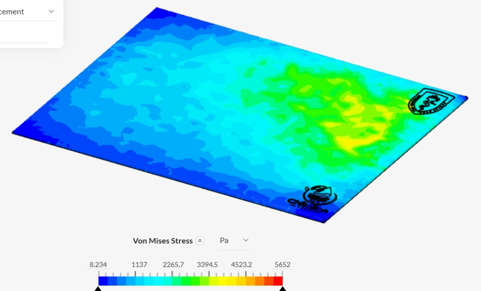
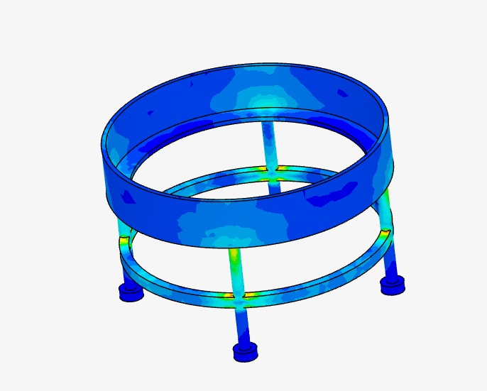
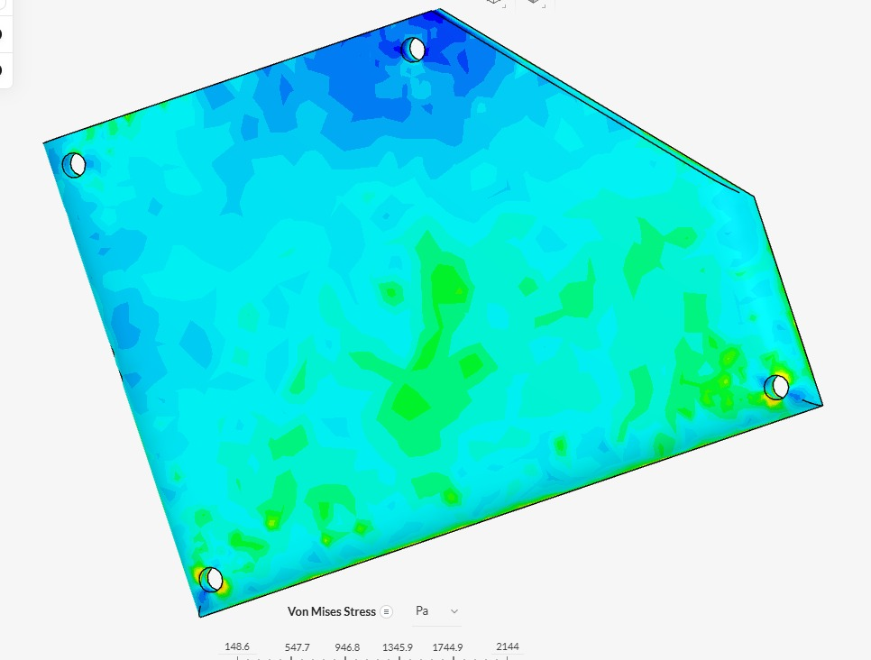
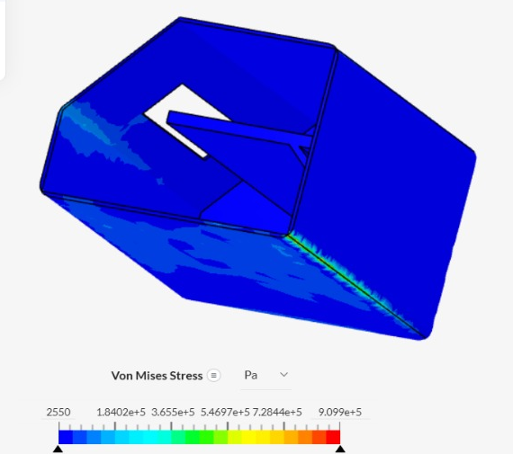

# CLARIFICACIÓN DE AGUA CON QUITOSANO

### Prueba de concepto experimental y analítica del sistema automatizado · TRL 3

Proyecto Integrador 2026-II | Universidad Peruana Cayetano Heredia | Equipo 05

2 de noviembre de 2026

---

## Ficha del proyecto

| Campo | Información |
|:---|:---|
| **Curso** | Proyecto Integrador 2026-II |
| **Institución** | Universidad Peruana Cayetano Heredia |
| **Tema** | TRL 3 · Sistema automatizado de clarificación de agua mediante dosificación de quitosano |
| **Fecha** | 02/11/2026 |

**Integrantes:**

- Marcelo Alarcón Camones
- Brad Cárdenas Parián
- Leonel Urbano Castillo
- Idania Parhuay Meza
- Gael Milla Fasabi

**Ingenieros:** Umbert Lewis De La Cruz, Maria Rejas, Harry Rivera y Renzo Chan

---

## Presentación

De acuerdo con la metodología de CONCYTEC, el TRL 3 corresponde al desarrollo experimental o prueba del concepto tecnológico: se demuestra que los principios básicos previstos sustentan el desarrollo de la tecnología, se comienza a probar su viabilidad mediante estudios analíticos y de laboratorio, y el trabajo se realiza en un entorno de laboratorio [1]. Sus indicadores de resultados son los datos de ensayos experimentales o analíticos y un demo o prototipo para las primeras pruebas experimentales; este documento se organiza siguiendo esos dos indicadores.

En el TRL 1 se identificaron los principios científicos del sistema: la coagulación-floculación con quitosano, la medición potenciométrica del pH, la medición óptica de la turbidez y la dosificación peristáltica. En este TRL 3 se pasa a la comprobación en laboratorio de la primera parte de la cadena de medición, que es la que decide la dosis de quitosano: el sensor de turbidez TS-300B y el sensor de pH PH-4502C, ambos leídos por un ESP32. A esto se suma una verificación analítica, mediante simulación estructural en SimScale, de las piezas que se imprimirán en PLA para el prototipo.

El estado de la evidencia es el siguiente. El sensor de turbidez ya entregó lecturas diferenciadas entre un agua clara y un agua turbia. El sensor de pH aún no está calibrado: su cadena electrónica funciona, pero la lectura obtenida está saturada, por lo que en este documento se presenta el protocolo de calibración que el equipo aplicará y la tabla en la que se registrarán sus resultados. Las simulaciones estructurales de cuatro piezas se completaron sin errores. No se presentan todavía ensayos de dosificación de quitosano ni porcentajes de remoción, que corresponden a etapas posteriores.

---

## 1 Demo o prototipo para las primeras pruebas experimentales

El prototipo de esta etapa tiene dos partes: un banco de pruebas de adquisición de señales, armado sobre protoboard y utilizado en los ensayos de laboratorio, y las piezas estructurales diseñadas en Onshape ([modelo CAD](https://cad.onshape.com/documents/06947ddb91d11baa99cb7771/w/ae9234bc94d45c112f779e45/e/bae95c7a29d602dc0212cc6e)) que se imprimirán en PLA y se verifican en la sección 3.2.

### 1.1 Banco de adquisición de señales

| Componente | Función en el sistema | Conexión en el prototipo |
|:---|:---|:---|
| ESP32 DOIT DevKit V1 | Microcontrolador que adquiere las señales y las envía al monitor serie | Alimentado por USB desde el computador |
| Sensor de turbidez TS-300B | Entrega una tensión analógica que varía con las partículas suspendidas | Señal al pin GPIO 33 |
| Módulo de pH PH-4502C con electrodo de vidrio y conector BNC | Acondiciona la señal potenciométrica del electrodo | Señal al pin GPIO 34, a través de un divisor resistivo |
| Divisor resistivo (factor 1,5) | Reduce la salida del módulo de pH al rango admisible del ADC del ESP32 | Dos resistencias sobre la protoboard |

El firmware se programó en el IDE de Arduino 2.3.10. Ambos sensores se leen con el ADC del ESP32 configurado a 12 bits (0 a 4095) y con atenuación de 11 dB; la tensión se obtiene con `analogReadMilliVolts()`. En el caso del pH, el programa recupera además la tensión original del módulo multiplicando la tensión medida por 1,5, inverso del factor del divisor. Una versión integrada del programa imprime cada 2 segundos una tabla con el ADC y la tensión de cada sensor.

**Figura 1.** Montaje del sensor de turbidez TS-300B: el ESP32 conectado a la protoboard y el sensor con su cable hacia la placa. *(Fuente: elaboración propia, 02/11/2026.)*

**Figura 2.** Montaje del sensor de pH: ESP32 y divisor resistivo en la protoboard, módulo PH-4502C con conector BNC y electrodo de vidrio. *(Fuente: elaboración propia, 02/11/2026.)*

### 1.2 Piezas estructurales del prototipo

El modelo en Onshape incluye la base del prototipo, el soporte del reactor, una placa con cuatro orificios y la caja de control del ESP32. Estas cuatro piezas se fabricarán por impresión 3D en PLA y son las que se analizan en la sección 3.2.

> **[COMPLETAR]** Insertar aquí una foto o un enlace a un video corto (30 a 60 s) del prototipo armado, con el banco de sensores midiendo y las piezas impresas, si ya se dispone de ellas.

---

## 2 Ensayos experimentales

Los ensayos se realizaron el 02/11/2026 en un entorno de laboratorio improvisado, a temperatura ambiente. Se registró la lectura cruda del ADC y la tensión en el pin del ESP32. En ambos sensores el resultado es una señal eléctrica y no una magnitud en unidades físicas: convertirla a NTU o a unidades de pH exige una curva de calibración propia [2], [3].

### 2.1 Ensayo del sensor de turbidez TS-300B

**Objetivo.** Comprobar que la señal del sensor cambia de manera medible cuando se pasa de un agua clara a un agua turbia.

**Procedimiento.** Se cargó en el ESP32 un programa que lee el pin 33 y muestra el ADC y la tensión en el monitor serie (Figura 3). Luego se sumergió el sensor, sostenido a mano, en dos muestras: agua clara contenida en una taza y agua turbia con sedimento contenida en un recipiente metálico. En cada muestra se esperó a que la lectura se estabilizara y se registró el valor mostrado.

**Figura 3.** Programa de lectura del sensor de turbidez (pin 33, ADC de 12 bits, atenuación de 11 dB) cargado correctamente en el ESP32. *(Fuente: elaboración propia.)*

**Figura 4.** Ensayo con agua clara: sensor sumergido en la taza (izquierda) y lectura registrada en el monitor serie (derecha). *(Fuente: elaboración propia.)*

**Figura 5.** Ensayo con agua turbia y sedimento: sensor sumergido en el recipiente (izquierda) y lectura registrada en el monitor serie (derecha). *(Fuente: elaboración propia.)*

**Resultados.**

| Muestra | ADC (0–4095) | Tensión en el pin (V) |
|:---|:---:|:---:|
| Agua clara | 1951 | 1,748 |
| Agua turbia con sedimento | 6 | 0,154 |

**Análisis.** La señal bajó de 1,748 V a 0,154 V al pasar del agua clara al agua turbia, es decir, cayó alrededor de 91 %. El sentido del cambio coincide con el principio óptico descrito en el TRL 1: a mayor cantidad de partículas, menos luz llega al receptor y menor es la tensión [4]. Si se usa la ley de Beer-Lambert como aproximación conceptual, con la tensión como indicador de la intensidad transmitida,

$$\alpha L = \ln\left(\frac{V_{clara}}{V_{turbia}}\right) = \ln\left(\frac{1{,}748}{0{,}154}\right) \approx 2{,}43$$

Este valor describe solamente la atenuación relativa entre estas dos muestras y no es un coeficiente de la muestra, porque no se conoce la relación entre la tensión del sensor y la intensidad luminosa, ni se midió la turbidez de las muestras con un instrumento de referencia. La diferencia de señal es amplia, y esto sustenta que el sensor distingue los extremos; todavía no se puede afirmar cuán bien distingue niveles intermedios, que son los que importan para dosificar. Además, el sensor se sostuvo a mano y la luz ambiente no estuvo controlada, dos fuentes de error señaladas para los sensores ópticos de bajo costo [2], [4].

### 2.2 Ensayo del sensor de pH PH-4502C

**Objetivo.** Comprobar que la cadena electrónica (electrodo, módulo, divisor resistivo y ADC) transmite la señal del pH hasta el programa.

**Procedimiento.** Se cargó un programa que lee el pin 34, calcula la tensión después del divisor y recupera la tensión original del módulo (Figura 6). Las lecturas se observaron en el monitor serie durante la prueba.

**Figura 6.** Programa de lectura del sensor de pH (pin 34, divisor con factor 1,5) y lecturas repetidas en el monitor serie. *(Fuente: elaboración propia.)*

**Resultados.**

| Lectura | ADC (0–4095) | Tensión en el pin (V) | Tensión original del módulo (V) |
|:---|:---:|:---:|:---:|
| Programa de pH (Figura 6), varias lecturas consecutivas | 4095 | 3,134 | 4,701 |
| Programa integrado (Figuras 4 y 5), en ambas muestras | 4095 | — | 5,014 |

**Análisis.** La lectura se mantuvo en 4095, que es el máximo del ADC de 12 bits, en todas las mediciones. Una señal fija en el tope de la escala indica que el ADC está saturado y que, por lo tanto, la lectura actual no contiene información del pH. La tensión del pin (3,134 V) está en el límite superior del rango del ADC con atenuación de 11 dB, y la tensión original calculada (4,701 V en un programa y 5,014 V en el otro) queda cerca de los 5 V de alimentación del módulo; la diferencia entre ambos valores sugiere que los dos programas convierten la lectura de forma distinta, algo que debe unificarse. Una salida cercana al máximo es compatible con que el ajuste del *offset* del módulo no se haya hecho o con que la entrada del BNC estuviera sin solución; ambas son hipótesis por verificar, no conclusiones.

Lo que sí demuestra esta prueba es que el prototipo adquiere, transmite y muestra la señal del módulo, y que el divisor y el ADC responden. Lo que queda pendiente es lo esencial para medir: ajustar el *offset* y calibrar el electrodo con soluciones de pH conocido, como se hace en otros sistemas de bajo costo, que calibran con soluciones amortiguadoras de pH 4,00 y 7,00 [5]. Como el electrodo de vidrio es frágil y requiere calibración frecuente [6], este paso también define la rutina de mantenimiento del sistema.

### 2.3 Protocolo de calibración del sensor de pH (en ejecución)

El equipo se encuentra preparando la calibración del sensor de pH. Se aplicará una calibración de dos puntos con soluciones amortiguadoras comerciales, que asume una respuesta lineal del electrodo con pendiente cercana a la nernstiana, de 59,16 mV por unidad de pH a 25 °C [7].

**Materiales.** Soluciones amortiguadoras de pH 4,00 y 7,00 (opcionalmente pH 10,00 para verificar), agua destilada para enjuagar, vasos limpios y termómetro.

**Procedimiento.**

1. Enjuagar el electrodo con agua destilada y mantenerlo hidratado antes de usarlo.
2. Con la entrada BNC en cortocircuito, ajustar el potenciómetro de *offset* del módulo hasta que su salida quede en la zona media del rango, según el procedimiento indicado en la hoja de datos del módulo.
3. Sumergir el electrodo en la solución de pH 7,00, esperar a que la lectura se estabilice y registrar al menos 10 lecturas de la tensión original del módulo, $V_7$.
4. Enjuagar y repetir el paso 3 con la solución de pH 4,00 para obtener $V_4$.
5. Calcular la pendiente y la ecuación de conversión:

$$m = \frac{V_7 - V_4}{7 - 4} \qquad\qquad pH = 7 + \frac{V - V_7}{m}$$

6. Verificar la calibración con una tercera solución (pH 10,00 o una muestra medida con un pHmetro de referencia) y calcular el error absoluto. Se propone aceptar la calibración si el error es menor o igual a 0,2 unidades de pH, criterio que el equipo puede ajustar.
7. Registrar la temperatura de cada medición, porque la pendiente del electrodo varía con ella [7].

**Registro de resultados de la calibración.**

| Solución | pH nominal | N.° de lecturas | Tensión del módulo, media (V) | Desviación estándar (V) |
|:---|:---:|:---:|:---:|:---:|
| Amortiguadora 1 | 7,00 | **[COMPLETAR]** | **[COMPLETAR]** | **[COMPLETAR]** |
| Amortiguadora 2 | 4,00 | **[COMPLETAR]** | **[COMPLETAR]** | **[COMPLETAR]** |
| Verificación | **[COMPLETAR]** | **[COMPLETAR]** | **[COMPLETAR]** | **[COMPLETAR]** |

Pendiente obtenida $m$ = **[COMPLETAR]** V/pH · Error en la verificación = **[COMPLETAR]** unidades de pH.

---

## 3 Ensayos analíticos

### 3.1 Cálculos de la cadena de medición

**Resolución del ADC.** Con 12 bits hay 4096 niveles. Si se toma una escala de referencia de unos 3,3 V, cada nivel equivale a unos 0,8 mV. Con el divisor de factor 1,5, cada nivel en la salida del módulo de pH equivale a unos 1,2 mV.

**Sensibilidad esperada del electrodo de pH.** A 25 °C, la ecuación de Nernst da una pendiente teórica de 59,16 mV por unidad de pH [7]. Entre pH 5 y pH 9, un rango en el que se ha estudiado la remoción de turbidez con quitosano [8], la diferencia de potencial teórica en el electrodo es de unos 237 mV, antes de la amplificación del módulo. La resolución del ADC es suficiente para esta variación, de modo que el factor limitante es la calibración y la temperatura, no la electrónica de lectura.

**Remoción de turbidez.** Una vez calibrado el sensor de turbidez, la eficiencia de clarificación se calculará con la expresión definida en el TRL 1:

$$\eta = \frac{T_i - T_f}{T_i} \times 100$$

donde $T_i$ y $T_f$ son la turbidez inicial y final.

### 3.2 Simulación estructural de las piezas impresas en PLA (SimScale)

**Objetivo.** Verificar, antes de imprimir, que las piezas estructurales del prototipo soportan las cargas de operación. Se simularon cuatro piezas diseñadas en Onshape: la base, el soporte del reactor, una placa con cuatro orificios y la caja de control del ESP32. Todas se fabricarán en PLA, material cuya resistencia depende de parámetros de impresión como la densidad de relleno, la orientación y la altura de capa [9].

**Configuración.** El análisis se realizó en SimScale como un estudio dinámico con 11 pasos de tiempo entre 0 y 0,01 s. En todos los casos se asignó PLA como material, se definieron las condiciones iniciales y de contorno con una fuerza aplicada, se generó la malla y se ejecutó la simulación sin errores. La variable analizada es el esfuerzo equivalente de von Mises.

**Resultados.**

| Pieza | Esfuerzo mínimo de la escala | Esfuerzo máximo de la escala | Equivalencia del máximo |
|:---|:---:|:---:|:---:|
| Base | 8,234 Pa | 5 652 Pa | 5,652 kPa = 0,005652 MPa |
| Soporte del reactor | 48,12 Pa | 33 150 Pa | 33,15 kPa = 0,03315 MPa |
| Placa con cuatro orificios | 148,6 Pa | 2 144 Pa | 2,144 kPa = 0,002144 MPa |
| Caja de control | 2 550 Pa | 909 900 Pa | 909,9 kPa = 0,9099 MPa |

| Pieza | Fuerza aplicada | Apoyos o restricciones |
|:---|:---|:---|
| Base | **[COMPLETAR]** | **[COMPLETAR]** |
| Soporte del reactor | **[COMPLETAR]** | **[COMPLETAR]** |
| Placa con cuatro orificios | **[COMPLETAR]** | **[COMPLETAR]** |
| Caja de control | **[COMPLETAR]** | **[COMPLETAR]** |

**Figura 7.** Esfuerzo de von Mises en la base del prototipo impresa en PLA. *(Fuente: SimScale, elaboración propia.)*

**Figura 8.** Esfuerzo de von Mises en el soporte del reactor impreso en PLA. *(Fuente: SimScale, elaboración propia.)*

**Figura 9.** Esfuerzo de von Mises en la placa con cuatro orificios impresa en PLA. *(Fuente: SimScale, elaboración propia.)*

**Figura 10.** Esfuerzo de von Mises en la caja de control impresa en PLA. *(Fuente: SimScale, elaboración propia.)*

**Análisis.** En la base, el esfuerzo se concentra hacia la zona de los logotipos del extremo derecho, con valores moderados en el resto de la placa. En el soporte del reactor, la mayor parte de la pieza se mantiene en esfuerzos bajos y los más altos aparecen en las patas y en la unión de estas con el anillo inferior. En la placa con cuatro orificios, las concentraciones de esfuerzo se ubican alrededor de los orificios, como se espera en cualquier geometría con agujeros. En la caja de control, casi toda la superficie permanece en esfuerzos bajos y el máximo se localiza en una línea del borde inferior y alrededor de la abertura.

En las cuatro piezas el valor máximo de la escala es menor que 1 MPa; la caja de control es la más exigida, con 0,9099 MPa, y la placa la menos exigida, con 0,002144 MPa. Estos valores deben compararse con la resistencia a la fluencia del filamento utilizado: **[COMPLETAR: resistencia del filamento PLA según su ficha técnica]**. Si esa resistencia es del orden de decenas de MPa, como suele ocurrir con el PLA impreso, las cuatro piezas operarían muy por debajo de su límite; esta conclusión debe confirmarse con el valor real, porque la resistencia de la pieza impresa cambia con los parámetros de impresión [9]. Los máximos localizados en bordes, uniones y orificios pueden estar influidos por la malla, por lo que conviene refinarla en esas zonas si se desea afinar el resultado.

---

## Referencias bibliográficas

[1] Consejo Nacional de Ciencia, Tecnología e Innovación Tecnológica (CONCYTEC), “Directiva N.° 001-2022-CONCYTEC-P: Uso de la metodología Nivel de Madurez Tecnológica (TRL),” Resolución de Presidencia N.° 020-2022-CONCYTEC-P, Lima, Perú, 2022. [En línea]. Disponible: https://vinculate.concytec.gob.pe/download/RP-020-2022-CONCYTEC-P.pdf

[2] Q. Zhu, F. Cherqui y J.-L. Bertrand-Krajewski, “End-user perspective of low-cost sensors for urban stormwater monitoring: a review,” *Water Science and Technology*, vol. 87, no. 11, pp. 2648–2684, 2023, doi: 10.2166/wst.2023.142.

[3] L. C. Sperandio, M. S. Colombo, C. M. G. Andrade y C. B. B. Costa, “Development of a low-cost portable turbidimeter for processes,” arXiv:2106.09491, 2021. [En línea]. Disponible: https://arxiv.org/abs/2106.09491

[4] M. Metzger et al., “Low-cost GRIN-lens-based nephelometric turbidity sensing in the range of 0.1–1000 NTU,” *Sensors*, vol. 18, no. 4, Art. no. 1115, 2018, doi: 10.3390/s18041115.

[5] A. A. García Gonzales, “Monitoreo de la calidad del agua para zonas rurales mediante un sistema de sensores de bajo costo basados en IoT,” Tesis para optar el título profesional de Ingeniero de Sistemas e Informática, Universidad Nacional de San Martín, Tarapoto, Perú, 2026. [En línea]. Disponible: https://repositorio.unsm.edu.pe/backend/api/core/bitstreams/7b703913-6a81-469a-a5b5-e6e399c3ab88/content

[6] F. Vivaldi et al., “Recent advances in optical, electrochemical and field effect pH sensors,” *Chemosensors*, vol. 9, no. 2, Art. no. 33, 2021, doi: 10.3390/chemosensors9020033.

[7] R. P. Buck et al., “Measurement of pH. Definition, standards, and procedures (IUPAC Recommendations 2002),” *Pure and Applied Chemistry*, vol. 74, no. 11, pp. 2169–2200, 2002, doi: 10.1351/pac200274112169.

[8] S. Sinardi et al., “Linking degree of deacetylation to coagulation efficiency of crustacean waste chitosan in water treatment,” *Jurnal Presipitasi: Media Komunikasi dan Pengembangan Teknik Lingkungan*, vol. 23, no. 2, pp. 533–542, jul. 2026, doi: 10.14710/presipitasi.v23i2.533-542.

[9] M. N. Ahmad, M. R. Ishak y M. Z. Zulkafle Hannah, “The effect of fused deposition modeling parameters (FDM) on the mechanical properties of polylactic acid (PLA) printed parts,” *Journal of Advanced Research in Applied Mechanics*, vol. 123, no. 1, pp. 238–246, 2024.

---

*Clarificación de agua con quitosano · TRL 3 · Equipo 05 · Proyecto Integrador 2026-II*
